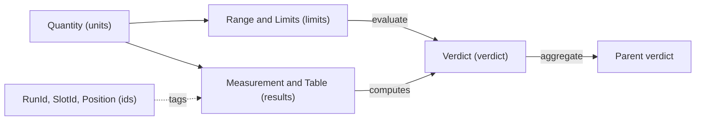

# The kernel

Every layer above this one has to agree on what a value, a limit, a verdict and a result actually *are*. If each kept its own idea of these, a result could be judged one way in a run and another way in a report, and you'd have no way of saying which was right.

`mastif.kernel` is that shared agreement. It's the smallest package, it's the one everything else depends on, and it's the part of the framework that should change least.

!!! success "Works today"
    Everything on this page runs against the current code. **Package:** `mastif.kernel`. **API:** [reference](../../reference/kernel/index.md).

## Why it's pure

The kernel does **no I/O and uses no threads or hardware**. That's a strict rule, and it pays for itself: every verdict decision in the system can be tested in microseconds, with no setup, and it's the same function everywhere. Since a result recomputes its verdict from its evidence, a report can always be checked.

The name comes from domain-driven design, where a *shared kernel* is a deliberately small model that every part of a system agrees to depend on.

## How the pieces relate



Read that from left to right, and you've got the life of a reading: a value with a unit gets compared with a limit, which produces a verdict, and verdicts combine into larger ones.

## `units`: values carry their unit

A bare `0.18` could mean anything, and [the tutorial](../../getting-started/tutorial/writing-tests/measurements.md) shows how much trouble that causes. A `Quantity` keeps the value and its unit together.

```python
from mastif.kernel.units import A, GHz, V, dB, dBm, mA

print(12 * V)                    # 12 V
print((2.4 * GHz).to("MHz"))     # 2400 MHz
print(300 * mA < 1 * A)          # True
print(10 * dBm + 3 * dB)         # 13 dBm
```

Dimensions are enforced, and so are the rules of decibels. Adding two levels in dBm raises a `UnitError`, because it doesn't mean anything. Units that mastif doesn't know about, like `Unit("psi")`, simply work, and they convert only to themselves. NaN is refused outright. [ADR-0003](../../adr/0003-units.md) explains why we don't use pint.

## `limits`: what's acceptable

A limit is a stored object, so the requirement survives alongside the evidence.

```python
from mastif.kernel.limits import Limits, evaluate
from mastif.kernel.units import V, mV

supply = Limits.between(4.75 * V, 5.25 * V, warn_low=4.5 * V, warn_high=5.5 * V)
print(evaluate(5.4 * V, supply))      # warn
print(evaluate(5400 * mV, supply))    # warn
```

There are three zones. Inside the passing range is PASS, inside the wider warning range is WARN, and anything else is FAIL. `evaluate` is a pure function, and it's the single source of truth for this decision.

`IndexedLimits` gives you per-channel limits, used with a [`Table`](../../getting-started/tutorial/writing-tests/limits.md#different-limits-per-channel). An index that isn't listed is an error unless you've given a default, as a missing limit is more likely to be a specification mistake than an instruction to accept anything.

## `verdict`: one answer at every level

There are six: `PASS`, `WARN`, `FAIL`, `ERROR`, `SKIPPED` and `ABORTED`. `aggregate` takes the worst of them.

```python
from mastif.kernel.verdict import Verdict, aggregate

print(aggregate([Verdict.PASS, Verdict.WARN]))   # warn
print(aggregate([Verdict.FAIL, Verdict.ERROR]))  # error
print(aggregate([]))                             # skipped
```

**ERROR isn't FAIL.** ERROR means the test broke, so you should retest the unit. FAIL means the unit is bad. An empty aggregate is SKIPPED and not PASS, since nothing was verified. [ADR-0005](../../adr/0005-verdicts-and-aggregation.md) has the ordering.

## `results`: evidence that can't contradict itself

```python
from mastif.kernel.limits import Limits
from mastif.kernel.results import Check, Measurement
from mastif.kernel.units import mA

print(Measurement("idle_current", 180 * mA, Limits.at_most(250 * mA)).verdict)  # pass
print(Check(name="fw", passed=False, detail="expected 2.1, got 2.0").verdict)   # fail
```

Verdicts are computed, and can never be passed in. A stored verdict gets recomputed on load. `Table` judges every cell, and it can pick per-row limits using `index` and `IndexedLimits`. All of them are frozen. See [Understanding the results](../../getting-started/tutorial/first-results/results.md) and [ADR-0006](../../adr/0006-results.md).

## `ids`: where the data came from

```python
from mastif.kernel.ids import Position, new_run_id

print(Position.of(profile="std", channel=2))
print(len(new_run_id()) > 0)  # True
```

`new_run_id()` gives you something like `20261021T090000Z-3fa9c2`: sortable by time, and unique. A `Position` names the current point in a plan's nested loops, outermost first. `SlotId` names a DUT slot, and defaults to `"0"`. They're the vocabulary that the engine will use to tag results. ([ADR-0007](../../adr/0007-identifiers.md))

## `errors`: the root of the hierarchy

`MastifError` sits at the top of everything mastif raises, with `UnitError` and `LimitsError` defined here. These deliberately aren't subclasses of `ValueError`, so that Pydantic can't swallow them during validation and report something misleading. [ADR-0002](../../adr/0002-error-model.md) is the full error model.

## Things that surprise newcomers

**Bare numbers.** `evaluate(5.0, limits)` treats a bare number as being in the limit's unit, which is convenient for a raw reading. But a *quantity* against *unitless* limits is an error, because mastif won't guess.

**Empty aggregation.** `aggregate([])` is SKIPPED, as we said. Nothing was verified, and it would be untrue to report otherwise.

**No limits means PASS.** A `Measurement` with no limits passes, so that values can be logged for information. A green verdict by itself doesn't prove that a limit was applied.

**Tables and booleans.** In a table, a boolean in a judged column is a FAIL, because a boolean isn't a number.

## Recap

- The kernel is **pure and small**, and everything depends on it.
- **Values carry units**, limits are stored objects, and verdicts are **computed from evidence**.
- `evaluate` and `aggregate` are the single source of truth for every decision.

The kernel can't touch the outside world. The next layer up is where that begins.

**Next:** [Infra](infra.md)
