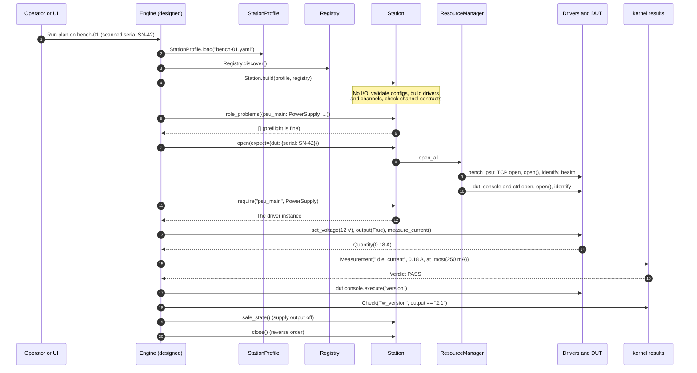

# Life of a station

Reading module by module, it's hard to see how the pieces work together. So before we go through the packages, let's follow one bench from a YAML file to recorded results and a safe shutdown, and note which module does what along the way.

!!! success "Works today"
    Everything here runs today except the steps marked *(engine)*. In those steps, your own application does the engine's job for now.

## The cast

Our bench has a power supply and a widget board. The board has a serial console and a UDP control port. The supply's driver and the board's DUT type come from an organisation's SDK, and the test is: *power the board at 12 V, check that idle current is at most 250 mA and that the firmware version is 2.1.*

```yaml title="bench-01.yaml"
station: bench-01
resources:
  bench_psu:
    driver: acme.psu-x
    config: {transport: {kind: tcp, host: 192.0.2.5, port: 5025}}
    expect: {serial: A123}
  dut:
    driver: demo.widget-board
    channels:
      console:
        driver: mastif.line-shell
        config: {transport: {kind: serial, port: COM3, baudrate: 115200}, prompt: "# "}
      ctrl:
        driver: mastif.udp
        config: {transport: {kind: udp, host: 192.0.2.50, port: 9000}}
roles:
  psu_main: bench_psu
```

## The whole flow



## Step by step

### 1. Load the profile

`StationProfile.load` parses the YAML and checks names, roles and `sim` keys. A typo stops everything here, with the file and field named, before anything else has happened. ([ADR-0021](../../adr/0021-station-profile.md))

### 2. Discover the drivers

`Registry.discover` reads the entry points of the installed packages, and imports only what they advertise. `mastif.line-shell`, `mastif.ssh-shell` and `mastif.udp` are always included. ([ADR-0012](../../adr/0012-driver-registry.md))

### 3. Build the station, without touching anything

`Station.build` does a lot, and it does none of it to hardware. For each resource:

- It looks up the driver in the registry.
- `build_resource` validates `config:` against the driver's own `Config` model. ([ADR-0011](../../adr/0011-drivers-and-duts.md))
- `build_io` creates the connection objects the driver asked for, unopened: here, a `Scpi` over a `StreamLineIO` over a `TcpTransport`. ([ADR-0018](../../adr/0018-io-injection.md))
- For a DUT, it builds each channel, checks that its driver provides the declared contract, and attaches it as `board.console` or `board.ctrl`. ([ADR-0023](../../adr/0023-station-composition-root.md))

Every mistake at this stage becomes a `StationError` that names the resource.

### 4. Preflight *(engine)*

The engine collects the roles its tasks need, and calls `role_problems`. A bench with nothing under `psu_main` gets reported before anything's energised. Today, your application builds that mapping itself.

### 5. Open

The `ResourceManager` works through resources in profile order. For each one, it opens the I/O, then the channels, calls `open()`, checks `identify()` against `expect:` and any scanned serial, checks `health()`, and collects `children()`.

Say the DUT reports SN-41 rather than SN-42. An `IdentityMismatch` is raised, the supply that's already open gets closed again, and nothing is tested on the wrong unit. ([ADR-0022](../../adr/0022-resource-manager.md))

### 6. Run the tasks *(engine)*

Tasks reach hardware only through `require(role, Contract)`. Values come back as quantities, and results judge themselves. ([ADR-0003](../../adr/0003-units.md), [ADR-0006](../../adr/0006-results.md))

### 7. Record *(engine)*

Each result becomes an event tagged with the run id, slot and position, using the vocabulary in `mastif.kernel.ids`. ([ADR-0007](../../adr/0007-identifiers.md))

### 8. Make safe

`safe_state()` turns the supply's output off, using the contract's declared action or the driver's own `safe_state`. It carries on past any device that doesn't respond, and it returns those failures to you.

### 9. Close

Closing happens in reverse: the DUT's channels, then the DUT, then the supply, and then their sockets and ports.

## When things go wrong

Now let's run through the same sequence on a bad day. Notice how much of this is caught before anything's powered.

| What goes wrong | Where it surfaces | What happens |
|---|---|---|
| A typo in the profile | Step 1 or 3, `StationError` | Nothing's opened. The message names the field. |
| The driver isn't installed | Step 3, `StationError` | Nothing's opened. Known ids are listed. |
| The wrong unit is on the fixture | Step 5, `IdentityMismatch` | What's open gets closed. Nothing's tested. |
| The supply is over temperature | Step 5, `ResourceFault` | The same. |
| A cable's pulled mid-test | Step 6, `TransportTimeout` | The task is an ERROR *(engine)*. The station's made safe and closed. |
| A value's out of limits | Step 6, `verdict == FAIL` | It's recorded, and the plan's policy decides what's next *(engine)*. |
| One device hangs up during shutdown | Step 8 | The failure's returned. Every other device is still made safe. |

## Try it today

Without the engine, your application plays its part. It comes to only a few lines:

```python title="excerpt: needs an installed SDK and the profile above"
from mastif.kernel.limits import Limits
from mastif.kernel.results import Measurement
from mastif.kernel.units import V, mA
from mastif.resources.registry import Registry
from mastif.resources.std import PowerSupply
from mastif.station import Station, StationProfile

station = Station.build(StationProfile.load("bench-01.yaml"), Registry.discover())
with station:
    psu = station.require("psu_main", PowerSupply)
    psu.set_voltage(12 * V)
    psu.output(True)
    result = Measurement("idle_current", psu.measure_current(), Limits.at_most(250 * mA))
    print(result.verdict)
```

For something you can run with no hardware at all, see `docs/examples/learn_lifecycle.py`, which [the tutorial](../../getting-started/tutorial/deploying/lifecycle.md#watch-it-happen) walks through.

## Recap

- Loading, discovery and building all happen with **no hardware**, so that's where most mistakes get caught.
- Opening is ordered and verified, and **a failed open leaves nothing open**.
- Shutdown is **safe state, then close**, in reverse, and it doesn't stop early.

Now let's look at the packages, from the bottom up.

**Next:** [The kernel](kernel.md)
