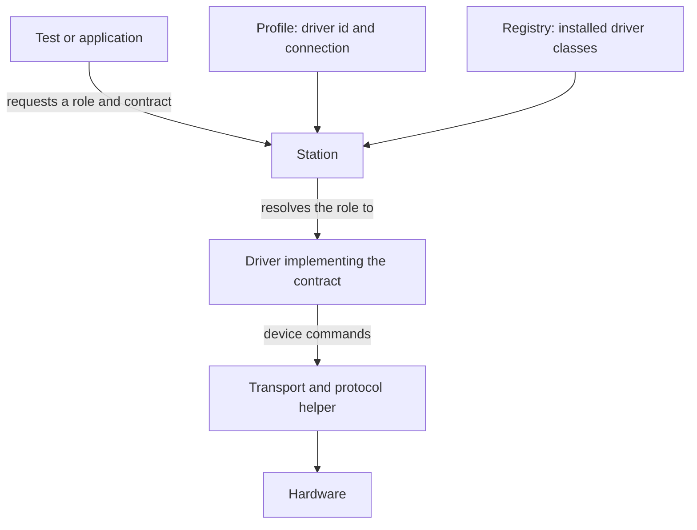

# Resources

A test needs a current reading. Today it comes from a bench supply over TCP, and next year it might come from a different model through a vendor's library. The acceptance rule won't have changed, so why should the test's code?

`mastif.resources` is the layer that keeps those apart. It separates **the capability a test needs** from **the commands a particular device understands**. It's the largest package in mastif, and it's a direct application of the [ports and adapters](../system-design/styles-and-patterns.md#hexagonal-or-ports-and-adapters) pattern: contracts are ports, and drivers are adapters.

!!! success "Works today"
    Everything on this page runs against the current code. **Package:** `mastif.resources`. **API:** [reference](../../reference/resources/index.md). For a hands-on route, see [Your first driver](../../getting-started/tutorial/hardware-integration/first-driver.md).

## One request, several responsibilities

Say a test wants to set a voltage and measure a current. Five different concepts take part in that, and each has one job:

| Concept | The question it answers | Example |
|---|---|---|
| **Contract** | What operations does the test need? | `PowerSupply` |
| **Driver** | How does this device implement them? | An organisation's `acme.psu-x` class |
| **Transport, protocol helper** | How do commands get delivered and replies decoded? | TCP carrying SCPI |
| **Profile** | Which device and connection are on this bench? | Driver id, host, port, serial |
| **Role** | What name does the test use? | `psu_main` |

A **resource** is anything a station manages: an instrument, a DUT, or one of a DUT's channels.



The arrows there show requests and composition, not imports.

## Contracts

A contract is a Python `Protocol`: an interface defined by its members, so that an implementation doesn't need to inherit from anything. An organisation can even define one without importing mastif at all, though the built-in ones use mastif quantities so that their values keep their units.

```python
from mastif.resources.std import PowerSupply
```

The optional built-ins cover what nearly every station has: `PowerSupply`, `SignalSource`, `PowerMeter`, `Switch`, `Relay`, `DigitalIO`, `Axis`, and `Shell` and `MessageChannel` for reaching DUTs. They're starting points, and you're expected to define your own. ([ADR-0009](../../adr/0009-standard-contracts.md))

mastif checks members and compatible signatures when a driver declares `provides=`, and again when a station resolves a role. That detects a missing method or wrong parameters. It can't prove that a device's physical behaviour is correct. `@contract(safe_state=...)` also lets a contract say how to make any provider safe. ([ADR-0008](../../adr/0008-contracts.md), and [Defining a capability contract](../../getting-started/tutorial/hardware-integration/contracts.md))

## Drivers

A driver translates capability calls into one device model's commands. `@driver` validates the declaration, and attaches a specification. It doesn't add the class to any global registry, and it doesn't open anything.

The driver receives validated configuration and injected I/O. A SCPI driver is handed a `Scpi` helper, rather than constructing its own socket, and that keeps device commands apart from connection details, while making fake I/O possible. ([ADR-0011](../../adr/0011-drivers-and-duts.md), [ADR-0018](../../adr/0018-io-injection.md))

## DUTs and channels

A DUT can have several independent ways in: a console, a message interface, something proprietary. A **channel** describes one of these by contract, and the station builds and attaches it before calling the DUT's `open()`.

| Built-in channel driver | Provides | Use it for |
|---|---|---|
| `mastif.line-shell` | `Shell` | A prompt-based console over serial, TCP, Telnet or interactive SSH |
| `mastif.ssh-shell` | `Shell` | Separate SSH commands, with exit codes and stderr |
| `mastif.udp` | `MessageChannel` | A UDP request and reply interface |

See [Modelling a DUT](../../getting-started/tutorial/hardware-integration/duts.md), [ADR-0020](../../adr/0020-builtin-line-shell.md), [ADR-0034](../../adr/0034-builtin-ssh-shell.md) and [ADR-0019](../../adr/0019-builtin-udp-channel.md).

## Identity and health

Connecting successfully doesn't mean you've reached the intended device. A driver can implement `identify()` to report an [`Identity`][mastif.resources.identity.Identity], and the station compares that with `expect:`.

```python
from mastif.resources.identity import Identity

connected = Identity(vendor="ACME", model="PSU-X", serial="B999")
print(connected.mismatches({"serial": "A123"}))
# {'serial': ('A123', 'B999')}
```

`mismatches()` only reports differences. It's the manager that turns one into an [`IdentityMismatch`][mastif.resources.errors.IdentityMismatch]. If there are expectations and no identity is available, that fails too. And without expectations, identity doesn't restrict what can be connected.

An optional `health()` hook returns a [`Health`][mastif.resources.identity.Health], and `ok=False` causes a `ResourceFault`. It reports what the driver checks at that moment, and it's neither continuous monitoring nor proof of physical safety. ([ADR-0010](../../adr/0010-identity-and-health.md))

## The hooks and who calls them

A driver's hooks say what to do. The station's resource manager decides when:

1. Open injected I/O and DUT channels.
2. Call `open()`, if it exists.
3. Verify identity, and then check health, if those hooks exist.
4. Collect child resources, and mark bring-up complete.
5. When asked, attempt safe-state actions, and separately, close in reverse order.

!!! note "Opening, making safe, and closing are separate operations"
    Identity gets checked **after** `open()`, so it can't prevent commands that hook has already sent. Closing a transport doesn't prove that an instrument's output is off. Safe-state actions and cleanup can themselves fail. [ADR-0022](../../adr/0022-resource-manager.md) specifies the guarantees and limits.

## Finding installed drivers

An organisation advertises driver modules through an entry point:

```toml title="your SDK's pyproject.toml"
[project.entry-points."mastif.drivers"]
acme = "acme_sdk.drivers"
```

`Registry.discover()` reads these when you call it, and not on import. For isolated tests, build a registry from the classes you choose instead. Duplicate ids are errors, because a profile's `driver:` has to mean exactly one thing. ([ADR-0012](../../adr/0012-driver-registry.md), [Packaging an SDK](../../getting-started/tutorial/hardware-integration/packaging.md))

## Where to look

| Module | What's in it |
|---|---|
| `resources/contracts.py` | `@contract`, conformance checking |
| `resources/std.py` | Built-in contracts |
| `resources/driver.py` | `@driver`, `@dut`, `channel`, `build_resource` |
| `resources/registry.py` | `Registry` |
| `resources/identity.py` | `Identity`, `Health` |
| `resources/errors.py` | The resource error hierarchy |
| `resources/channels/` | The built-in channel drivers |
| `resources/transports/` | The [next chapter](transports.md) |

## Recap

- **Contracts** say what's needed, **drivers** say how for one device, and **profiles** say which and where.
- **Decorators validate at import time**, and register nothing globally.
- **Hooks are called by the manager**, in a fixed order, and identity comes after `open()`.

A driver needs to reach its device, and that's more difficult than it first appears.

**Next:** [Transports](transports.md)
