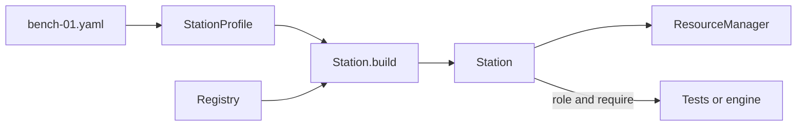
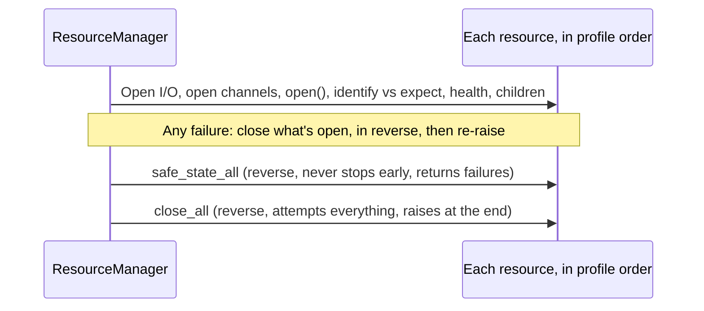

# Station

Drivers describe devices in general. A **station** is one particular bench: these instruments, at these addresses, with these serial numbers, known to tests by these role names. `mastif.station` turns a YAML description of that bench into live objects, and it owns their lifecycle.

That lifecycle is the most safety-relevant code in the framework: ordered bring-up, verification, rollback, safe state and shutdown. It's small, and we've been deliberately careful with it.

!!! success "Works today"
    Everything on this page runs against the current code. **Package:** `mastif.station`. **API:** [reference](../../reference/station/index.md). For the walk-through, see [Station profiles](../../getting-started/tutorial/deploying/profiles.md) and [Opening, checking, and closing](../../getting-started/tutorial/deploying/lifecycle.md).

## Three parts



## 1. The profile: facts as data

```yaml title="bench-01.yaml"
station: bench-01
resources:                       # Opened top to bottom, closed bottom to top
  bench_psu:
    driver: acme.psu-x
    config: {transport: {kind: tcp, host: 192.0.2.5, port: 5025}}
    expect: {serial: A123}       # Must match identify() before use
  dut:
    driver: demo.widget-board
    channels:
      console:
        driver: mastif.line-shell
        config: {transport: {kind: serial, port: COM3}, prompt: "# "}
roles:
  psu_main: bench_psu            # Tests say "psu_main", never "bench_psu"
  console: dut.console           # Roles can point at channels or children
sim:
  bench_psu: {driver: demo.psu-sim}   # Used when building with sim=True
```

No control flow belongs in here, and that's a firm rule. A profile holds facts. Loading one validates names, roles and `sim` keys, and reports every problem with its location. ([ADR-0021](../../adr/0021-station-profile.md))

The order of `resources` is meaningful, since it's the order things come up, and it's reversed on the way down. List what something depends on before the thing that depends on it.

## 2. `Station.build`: wire everything, touch nothing

For each resource, the build finds the driver, validates `config:`, creates but doesn't open the I/O, builds the DUT's channels, and checks that each provides its declared contract. Each mistake becomes a `StationError` that names the resource.

**No I/O happens**, and that's the property that matters: profiles can be fully validated on a laptop, or in CI. ([ADR-0023](../../adr/0023-station-composition-root.md))

Tests then reach hardware through roles:

```python title="excerpt"
psu = station.require("psu_main", PowerSupply)   # RoleError if the bench can't serve it
station.role_problems({"psu_main": PowerSupply, "console": Shell})   # A preflight list
```

`require` raises, whereas `role_problems` returns a list, so that you can show someone everything that's wrong at once. It can also tell apart a role that's wrong from a child resource that can't be checked until the station's open.

`Station.build` also takes `sim=True` for the `sim:` overlay, `io_factory=` to substitute fakes, `listener=` for lifecycle events, and `settings=` to inject settings.

## 3. The resource manager: the lifecycle



Here's the reasoning. Cleanup code is what runs when things have already gone wrong, so it can't assume anything has worked. It has to keep going past failures, and it can't lose the original error. Getting all this right, in every test, isn't realistic, so it's written once, here. ([ADR-0022](../../adr/0022-resource-manager.md))

An operator's scanned serial can be checked too:

```python title="excerpt"
station.open(expect={"dut": {"serial": "SN-42"}})
```

And as a context manager, a station opens on entry, and runs **safe state, then close** on exit, even if your code raised.

## Guarantees you can rely on

- A failed open leaves nothing open.
- Identity is checked before your code gets the resource.
- Safe state is attempted on every open resource, even if some of them fail.
- Close attempts every step of every open resource.
- Every step is emitted as a `ResourceEvent`, for UIs and logs.

And what isn't guaranteed: if a device can't be reached, it can't be made safe. A driver call that blocks forever will block cleanup too. [The cancellation chapter](../system-design/cancellation.md) deals with this.

## Recap

- A **profile** holds facts about a bench, as validated data with no logic.
- **`Station.build`** wires everything and touches nothing.
- The **resource manager** is the one place that the lifecycle lives, and it's careful about failure.

That's all of the layers. The last package isn't really a layer at all: it's how you test everything that sits on them.

**Next:** [Testing kit](testing-kit.md)
