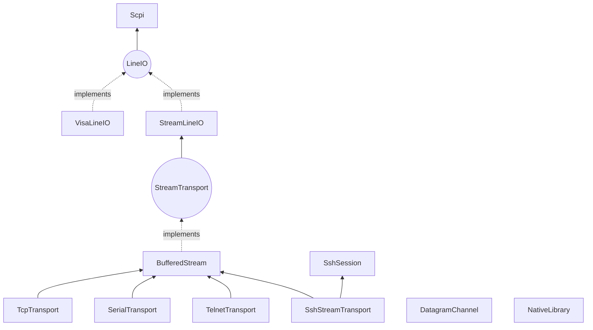
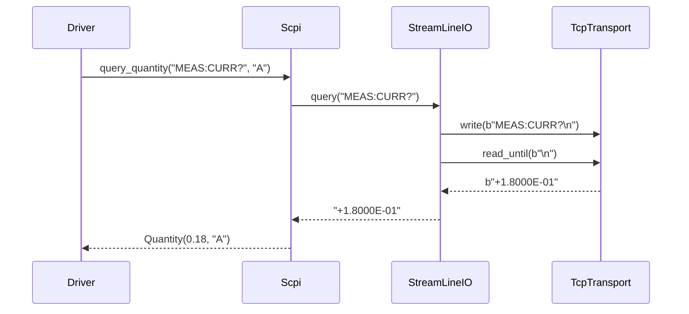

# Transports

Drivers need to reach devices over TCP, serial, VISA, UDP, Telnet or SSH, or through a vendor's native library. Each of those has its own library, its own errors, and its own ways of losing or merging data. If every driver dealt with this itself, you'd have dozens of slightly different, slightly wrong implementations.

So this layer handles it once, and it gives every driver the same guarantees: framing that copes with partial reads, timeouts that raise rather than hang, typed errors, I/O tracing in the log, and connections that are injected rather than constructed.

!!! success "Works today"
    Everything on this page runs against the current code. **Package:** `mastif.resources.transports`. **API:** [reference](../../reference/resources/index.md#mastif.resources.transports.config). For how to choose between them, see [Communicating with a device](../../getting-started/tutorial/hardware-integration/communication.md).

## The stack



A driver asks for the interface it wants, and the station builds it from whatever `kind` the profile names:

| You need to | Ask for | Built from `kind` |
|---|---|---|
| Speak a binary protocol | `io: StreamTransport` | tcp, serial, telnet, ssh |
| Speak a text-line protocol | `io: LineIO` | tcp, serial, visa, telnet, ssh |
| Drive a SCPI instrument | `io: Scpi` | tcp, serial, visa, telnet, ssh |
| Exchange UDP messages | `io: DatagramChannel` | udp |
| Run commands on a host | `session: SshSession` | ssh |
| Call a vendor DLL | `lib: NativeLibrary` | native |

That table is enforced. Asking for a combination that can't work is a `StationError` at build time. ([ADR-0018](../../adr/0018-io-injection.md))

## Configs: where a device is

A transport's configuration lives in the station profile, under the driver's `config.transport`, and `kind` picks the model:

```yaml title="the options"
transport: {kind: tcp, host: 192.0.2.5, port: 5025, timeout: 2.0}
transport: {kind: serial, port: COM3, baudrate: 115200, read_termination: "\r\n"}
transport: {kind: visa, resource: "USB0::0x1234::0x5678::A123::INSTR"}
transport: {kind: udp, host: 192.0.2.50, port: 9000, local_port: 9001}
transport: {kind: telnet, host: 192.0.2.9, login_prompt: "login: ", username: admin, password: "...", ready_prompt: "> "}
transport: {kind: ssh, host: 192.0.2.60, username: root, key_file: ~/.ssh/id_ed25519}
transport: {kind: native, library: acmedio, search_paths: ["C:/Program Files/Acme/bin"]}
```

Unknown keys, bad ports and impossible stop bits get rejected before anything's opened. Passwords are `SecretStr`, so they don't show up in logs or error messages. Serial, VISA and SSH need extras, such as `pip install 'mastif[serial]'`. Telnet needs nothing extra. ([ADR-0013](../../adr/0013-transport-configuration.md))

## What each layer takes care of

### Streams

TCP has no message boundaries, and a read can return part of a message, or two messages at once. `BufferedStream` deals with this. ([ADR-0014](../../adr/0014-byte-streams.md))

- `read_until` keeps any bytes after the terminator for the next read.
- Timeouts cover the whole read, not each chunk.
- `write("text")` encodes but **never adds a terminator**, because that would corrupt a binary protocol. `LineIO.write_line` is what adds one.

### Line I/O and VISA

`LineIO` is a connection that carries lines of text, whichever way it's delivered. For VISA, errors mentioning "timeout" become `TransportTimeout`, and note that the per-read timeout argument is ignored there, as the resource's timeout applies. ([ADR-0015](../../adr/0015-line-io.md))

### SCPI

`Scpi` adds the language on top. ([ADR-0016](../../adr/0016-scpi.md))

- `query_float` rejects the overflow marker `9.9E37`, so an over-range reading becomes an error and not a huge "valid" number.
- `identify()` parses `*IDN?`, and `errors()` drains `SYST:ERR?`.
- `Scpi(io, check_errors=True)` checks for errors after every write.

### Datagrams

UDP messages arrive whole, but not reliably, and not necessarily in response to anything. ([ADR-0017](../../adr/0017-datagram-channel.md))

- A background thread reads everything.
- `request(msg, match=...)` registers a waiter **before** sending, and returns the first datagram that the matcher accepts.
- Unsolicited messages go to subscribers, and they're never mistaken for replies.
- Retries resend on a timeout, and a failing subscriber gets logged without breaking the channel.

### Telnet

Telnet is TCP with in-band negotiation mixed into the data. ([ADR-0032](../../adr/0032-telnet-transport.md))

- `IAC` negotiation sequences are stripped, and every option is refused, so drivers see clean bytes, even if a server negotiates mid-reply.
- Lines default to `\r\n`, the Telnet standard.
- The optional login runs during `open`, and `ready_prompt` skips the banner. A wrong prompt fails `open` with a `TransportTimeout` that names the prompt.

### SSH

There are two distinct modes here, for two different kinds of target. ([ADR-0033](../../adr/0033-ssh-transports.md))

- `SshSession.run(cmd)` uses one exec channel per command, and it returns a `ShellResult(command, output, exit_code, stderr)`, with real exit codes and stderr kept separate. Each command gets a fresh shell, so `cd` doesn't carry over.
- The stream (`StreamTransport`, `LineIO`, `Scpi`) is an interactive shell, for targets that only offer a CLI.
- Host keys are always checked. `known_hosts: strict`, the default, refuses unknown hosts, and `accept_new` remembers them. A changed key is always refused.
- With no `password` or `key_file`, the SSH agent and `~/.ssh/id_*` are tried.

### Native libraries

Calling C is unforgiving, so this one makes you declare everything. ([ADR-0035](../../adr/0035-native-vendor-libraries.md), and the [recipe](../recipes/native-library.md))

- Declare each prototype with `lib.function(name, restype, argtypes)` before calling it with `lib.call(name, *args)`. Undeclared calls are refused.
- Calls run on one dedicated thread by default, as most vendor libraries need.
- `StatusCheck` turns status codes into `ProtocolError`, with the vendor's text.
- Load failures explain themselves, whether it's a missing dependency or a 32-bit DLL that a 64-bit Python can't load.

## One query, all the way down

Here's what happens when a driver asks a question:



And here it is for real, with a fake standing in for everything below the line:

```python
from mastif.resources.transports import Scpi
from mastif_testing import FakeLineIO

io = Scpi(FakeLineIO({"MEAS:CURR?": "+1.8000E-01"}))
io.open()
print(io.query_quantity("MEAS:CURR?", "A"))  # 0.18 A
io.close()
```

## Recap

- Each medium's problems are **solved once**, and each driver gets the same guarantees.
- A driver **asks for an interface**, and the profile's `kind` picks the implementation. Combinations that can't work are rejected at build time.
- Silent devices **raise**, malformed replies **raise**, and nothing invents a value.

We can now describe a device and reach it. What's left is to assemble them into one physical bench.

**Next:** [Station](station.md)
