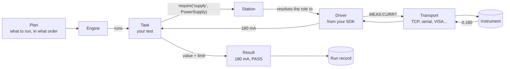
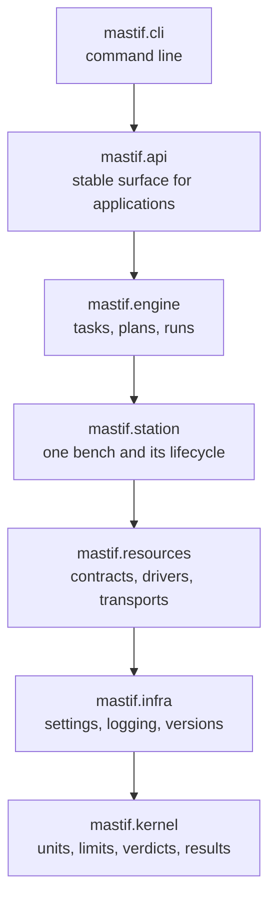
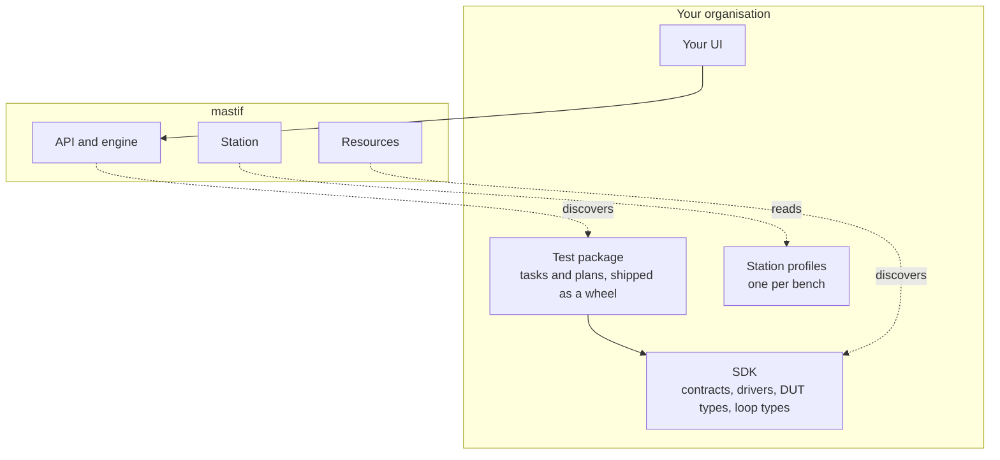
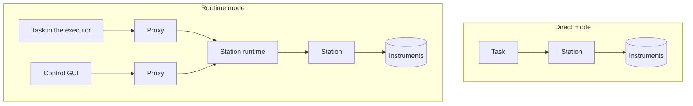

# The system at a glance

In this chapter we walk through the whole of mastif once, without stopping to explain
any part in depth. Think of it as looking at the map before starting the hike. You don't
need to memorise anything here. Later chapters will each zoom in on one piece, and you
can return here whenever you want to see where that piece fits.

We'll do it by following one number.

## Follow the reading

Our test needs to know how much current a widget board draws while idle. Here's the
journey of that one reading, from the board's power rail to the record of the run.

Reading it left to right:

1. A **plan** says what to run. The **engine** works through it, and it calls your
   **task**, which is a small Python class containing your test.
2. The task needs a power supply, so it asks for one by its **role** (`supply`) and
   the capability it requires (`PowerSupply`). It has no idea what instrument that is.
3. The **station** knows this bench. It looks up the role and hands back the right
   object: an instance of a **driver**.
4. The driver is what knows this instrument's language. It sends `MEAS:CURR?` through a
   **transport**, which handles the actual bytes on the wire.
5. The instrument answers `0.180`. The driver knows that means amperes, so it returns a
   **quantity**: a number with its unit attached, which stays attached from here on.
6. The task compares the quantity with a **limit** and records a **result**. The result
   computes its own **verdict**, and the engine adds it to the **run record**.

Every box has a single job, and each knows as little as possible about its neighbours.
That's the whole design in one picture. Everything in this course is a closer look at
one of these boxes or the arrows between them.

## Eight words to know

These appear constantly, so it's worth having them straight from the start.

| Term | What it means |
|---|---|
| **DUT** | *Device under test*: the product you are evaluating. Our widget board. |
| **Resource** | Anything a station manages: an instrument, a DUT, or a DUT's channel. |
| **Contract** | A Python `Protocol` describing a capability, like `PowerSupply`. It says what, not how. |
| **Driver** | The class that implements a contract for one specific instrument. |
| **Role** | The name a test uses for a resource, like `supply`. Mapped to a real resource per bench. |
| **Station** | One physical bench: these resources, at these addresses, with this lifecycle. |
| **Task** | One test: a class with `setup`, `run` and `teardown` that records results. |
| **Plan** | The order to run tasks in, with the loops around them. |

The [glossary](../architecture/glossary.md) has the rest, and we'll link to it as they come up.

## The layers

Under that picture, the code is organised in strict layers. A layer may only import
the layers beneath it. A check in continuous integration enforces this, so it can't
quietly erode.

Why be so strict? Because it means each layer is testable, and understandable, without
the ones above it. `mastif.kernel` has no I/O, threads or hardware at all, so a verdict
calculation can be checked in microseconds. `mastif.resources` can be exercised against
a scripted fake instrument. And because nothing beneath the engine knows the engine
exists, the implemented layers are useful right now in a plain Python script.

You'll meet each layer in the [architecture section](../architecture/index.md) if you want
more depth. [ADR-0001](../../adr/0001-layered-architecture.md) records the decision.

## Your code, and ours

mastif never imports your organisation's code by name. Instead, your packages advertise
themselves through Python entry points, and mastif discovers them when you ask it to.

Solid arrows are imports, and dotted arrows are discovery or data. Note the direction.
Your tests depend on your SDK, and your SDK depends on mastif, so the arrows only ever
point down toward the framework. That's what lets you upgrade mastif, or swap a driver,
without your test package even noticing.

## Two kinds of ownership

There's one more big idea to plant now, though we won't develop it until much later: *who
holds the instruments open?* An instrument connection is exclusive. Usually only one
process can have the serial port.

**In direct mode**, your test process owns the station. It opens the instruments, runs,
and closes them. There's nothing else to install, and this is the default.

**In runtime mode**, one long-lived process owns the station, and everything else is its
client: the test executor, a control GUI, a dashboard. They all get objects that implement
the same contracts but forward each call to the owner.

Your task's code is identical in both, which is the design constraint that shapes a great
deal of the engine. We build all of that up carefully in
[Direct execution and a persistent station runtime](../system-design/execution-modes.md).

!!! warning "Two things called runtime"
    `mastif.infra.bootstrap.Runtime` already exists. It's a small object holding your
    application's settings and version, and it has nothing to do with the station runtime
    described above.

## Recap

A reading travels from instrument to transport to driver to task to result, and each
stage only knows about its neighbours. The code is layered so that lower layers never
depend on higher ones, and your organisation's packages sit on top without the framework
ever naming them.

That's mastif from one station's point of view. It leans on a few general ideas that are worth having straight, so the next chapters cover those.

**Next:** [Python types and protocols](types.md)
