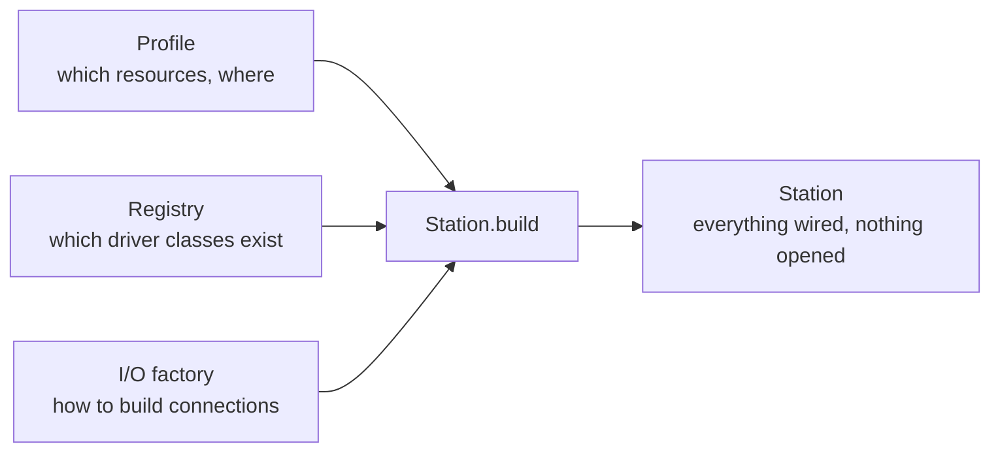

# Dependency injection and composition

"Dependency injection" sounds like something that requires a framework, and in some languages it's associated with large and confusing ones. The idea itself is very simple, though, and you've almost certainly used it without calling it that. This chapter explains the idea, then shows how mastif applies it, and why it matters so much for code that talks to hardware.

## The idea

Here's a class which reads from an instrument:

```python title="a class that builds what it needs"
import socket


class Reader:
    def __init__(self) -> None:
        self.sock = socket.create_connection(("192.0.2.10", 5025))

    def read_text(self) -> str:
        self.sock.sendall(b"READ?\n")
        return self.sock.recv(64).decode()
```

Now let's ask some questions about it. How do you test this without an instrument at that address? How do you use it over a serial port? How do you create one without immediately opening a connection? In each case, you can't, without changing the class.

Here's the same class, with one change:

```python
class Reader:
    def __init__(self, io) -> None:
        self.io = io

    def read_text(self) -> str:
        return self.io.query("READ?")
```

That's dependency injection, and there's nothing more to it. **A component receives what it needs, rather than building or finding it.** It needs no framework at all.

Those questions now have easy answers. To test it, pass in a fake. To use it over serial, pass in something serial. Creating one opens nothing.

```python title="continuing: a fake is just another object"
class FakeIO:
    def query(self, line: str) -> str:
        return "42"


print(Reader(FakeIO()).read_text())  # 42
```

## Three ways of getting a dependency

It's helpful to compare it with the alternatives. Here are the three ways a piece of code can get hold of something it needs:

| Approach | Example | Problem |
|---|---|---|
| **Build it** | `self.sock = socket.create_connection(...)` | It's fixed, and can't be replaced |
| **Find it globally** | `from config import settings` | It's hidden, and shared between tests |
| **Receive it** | `def __init__(self, io)` | The caller has to supply it |

The third one has a cost: somebody has to supply the thing. But that's in fact a benefit, because now it's visible. You can read a constructor's signature, and see all that the class depends on.

## Someone has to build it: the composition root

If everything receives its dependencies, then something, somewhere, must actually create them and wire them together. That place is called the **composition root**, and the idea is to have just one, near the program's entry point.

In mastif, that's `Station.build`. It takes three inputs, and it produces a fully wired station:



Having one place that does this has real benefits. All construction knowledge is in one spot, so a driver doesn't need to know how to build a connection. It can validate everything before anything starts. And it gives tests a single place to substitute a fake: pass a different `io_factory`, and the whole station runs without hardware.

At the application level, there's a similar idea. `bootstrap` creates the settings once, and they're passed along explicitly from there.

## The annotation convenience

Wiring up every constructor by hand would get tedious, so mastif does one convenient thing: it reads your constructor's type annotations, and it supplies what you've asked for.

```python title="excerpt"
def __init__(self, cfg: Config, io: Scpi, log: logging.Logger) -> None:
    ...
```

This can look like magic if you're not used to it, so let's be clear on what it is and isn't. It's a short, fixed list: your `Config`, a recognised I/O type, a logger, and settings. It doesn't scan your code, it won't construct arbitrary classes, and there's no global container of services. Should you ask for anything else, your class is refused at import time, with an explanation.

So it's the same explicit idea, only with less typing. You can always construct a driver by hand, by passing the arguments yourself, which is what a unit test might do.

## Separating building from opening

There's one more idea which injection enables, and it's perhaps the most valuable. Since a driver receives an unopened connection, creating a driver has no side effects. This splits a station's life into two clean phases:

| Phase | Does | Needs hardware? |
|---|---|---|
| **Build** | Validates and wires everything | No |
| **Open** | Connects, verifies and starts | Yes |

That's how you're able to validate a station on a laptop or in CI. It only works because of a rule that all of this depends on: **a constructor must do no I/O.** Should a driver open a socket in `__init__`, then building the station requires hardware, and this whole benefit disappears.

## Keeping the direction clear

A dependency should point at something more stable than itself:

- **Tasks** depend on contracts, not on drivers.
- **Drivers** implement contracts, and they depend on transports' interfaces.
- **The composition root** is the only thing that knows which concrete classes are in use.

Here's a warning sign that this has gone wrong: a test that imports a driver, in order to construct its own connection. It's bypassed the station, so it has skipped identity checks, lifecycle handling and simulation, and it now works on only one bench.

## Recap

- **Dependency injection** just means that a component receives what it needs, and it needs no framework.
- It makes things **testable, replaceable and visible**.
- A **composition root**, `Station.build`, is the one place where everything's wired together.
- mastif's annotation reading is **a convenience over a short, fixed list**. It isn't a general container.
- **Constructors doing no I/O** is what separates building from opening.

**Next:** [Units and dimensional correctness](units.md)
