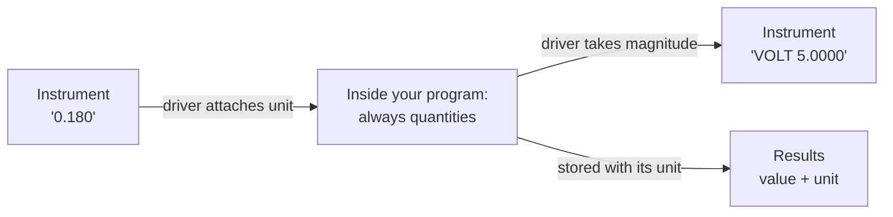

# Units and dimensional correctness

In 1999, a Mars orbiter was lost because one piece of software produced values in pound-force seconds, and another read them as newton seconds. The numbers were perfectly valid and the code ran without errors. It was only the meaning that had been lost, somewhere between two systems.

Test software has this problem at a smaller scale, but it has it every day. This chapter is about why it happens, and what a type like `Quantity` can and can't do about it.

## Why numbers lose their meaning

Think of how a current reading typically moves through a program: a driver reads `0.18` from an instrument. A helper function takes it. Somewhere a limit of `250` is compared with it. At each step, the unit exists only in someone's head, or in a variable name, or in a comment that may or may not still be correct.

These bugs have two features that make them particularly bad.

**They don't crash.** Comparing `0.18` to `250` is perfectly legal, and it's simply wrong by a factor of a thousand.

**In test software, they're biased toward passing.** Being off by a factor of a thousand in the right direction means that every board passes, forever. A bug like that won't show up in testing, because nothing looks wrong. A test that can't fail looks exactly like a product with no problems.

## Carrying the unit with the value

The fix is to stop treating a measurement as a number. A `Quantity` is a value and a unit, in one object:

```python
from mastif.kernel.units import A, V, mA

current = 0.18 * A

print(current.to("mA"))         # 180 mA
print(current.magnitude("mA"))  # 180.0
print(300 * mA < 1 * A)         # True
```

Comparison and arithmetic take account of units automatically. Having to name a unit for `.magnitude()` means that a bare number can't come out without someone saying what it means.

And mixing dimensions is an error, right where it happens:

```python
from mastif.kernel.errors import UnitError
from mastif.kernel.units import A, V

try:
    5 * V + 1 * A
except UnitError as error:
    print(error)
```

## The boundary rule

There's a simple discipline for using this, which is the same one that's taught for handling text encodings. Keep values as quantities everywhere inside your program, and convert only at the edges, where something outside requires a bare number.



So a driver is where units cross the boundary, in both directions, and it's the only place that should need to. If you find `.magnitude()` in the middle of your test logic, that's worth a second look.

## Logarithmic units

Decibels deserve special mention, because they follow different rules, and they cause subtle bugs for people who aren't used to them.

A level in **dBm** is an absolute power. A value in **dB** is a ratio, such as a gain. So:

| Operation | Meaningful? | Why |
|---|---|---|
| dBm + dB | Yes | A level, with a gain applied |
| dBm − dBm | Yes | The ratio of two powers: a dB |
| dB + dB | Yes | Two gains in series |
| dBm + dBm | **No** | Adding two power levels isn't addition of their logarithms |

```python
from mastif.kernel.errors import UnitError
from mastif.kernel.units import dB, dBm

print(10 * dBm + 3 * dB)  # 13 dBm

try:
    10 * dBm + 3 * dBm
except UnitError as error:
    print(error)
```

Someone who adds 10 dBm and 3 dBm will get a number if they're using floats, and it'll be wrong. This one raises an error.

## Units in a limit

Limits convert before they compare, so they can be written in whichever unit the specification uses:

```python
from mastif.kernel.limits import Limits, evaluate
from mastif.kernel.units import A, mA

print(evaluate(0.2 * A, Limits.at_most(250 * mA)))  # pass
```

And mastif refuses to guess. A quantity compared with limits that have no units is an error, not an assumption:

```python
from mastif.kernel.errors import UnitError
from mastif.kernel.limits import Limits
from mastif.kernel.results import Measurement
from mastif.kernel.units import mA

try:
    Measurement("x", 180 * mA, Limits.at_most(250))
except UnitError as error:
    print(error)  # value has unit 'mA' but limits are unitless
```

## Your own units

Unknown units are allowed, so you don't need to register anything before using them. An unknown unit just converts only to itself:

```python
from mastif.kernel.units import Unit

print(5 * Unit("psi"))  # 5 psi
```

This is a sensible default. mastif won't invent a conversion it doesn't know about, and it doesn't stop you from working.

## What units don't establish

We should be clear about the limits of all this. `Quantity` makes sure you and the computer agree about what a number says. It doesn't tell you whether the number's right.

```text
180 mA at the supply's terminals
180 mA at the board's input connector
```

Those have the same unit, and may be different currents. Other things a unit can't capture include:

- **Where** it was measured, and what the wiring between does.
- **Accuracy**: 180 mA from a 1 A range isn't 180 mA from a 200 mA range.
- **Calibration**: whether the instrument is telling the truth today.
- **Conditions**: bandwidth, averaging, temperature and timing.

These are the things which make someone an expert in measurement, and no type system can replace them. Record what you can in your procedure and your run's provenance, and write down the rest.

## Recap

- Numbers without units **fail silently**, and in test software, often in the passing direction.
- A **`Quantity`** keeps its unit, and mixing dimensions raises an error where it happens.
- **Convert only at the boundary**, in the driver.
- **dB and dBm** follow their own rules, and these are enforced.
- A unit tells you what a number *says*, not whether it's **right**.

**Next:** [Concurrency versus parallelism](concurrency.md)
