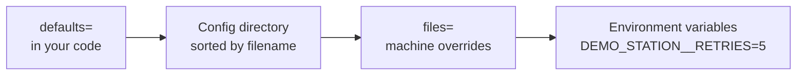

# Application settings and bootstrap

This part of the course is for whoever has to make a station work somewhere that matters, and keep it working. Up to now, our examples have run from a checkout on a developer's machine. A production station needs a defined way of starting up, and it should be the same for every application in your organisation, so that a failure on one looks like a failure on any other.

We'll start where every application starts: its first few lines.

!!! success "Works today"
    Everything on this page runs against the current code.

## What needs to happen, in what order

Any station application needs to do the same few things when it starts, and the order matters:

1. **Load the settings**, since everything else depends on them.
2. **Configure logging**, using those settings, so that everything after this point gets recorded.
3. **Work out which version of the software is running**, and log it. When a run looks strange months later, this line will matter.
4. **Build the station**, and pass it the settings.

If every application hand-writes that sequence, they'll each do it slightly differently. So mastif provides a single call:

```python
from mastif.infra import bootstrap

runtime = bootstrap(
    defaults={"application": {"name": "demo-bench"}},
    envvar_prefix="DEMO",
    rich_tracebacks=False,
)
print(runtime.settings.application.name)  # demo-bench
print(runtime.version)                    # None: we didn't name a distribution
```

The returned `Runtime` is a small container holding the settings and version. (This isn't the [station runtime](../system-design/execution-modes.md). It has an unfortunate name, and it's only a dataclass.)

A real application looks more like this:

```python title="my_app/__main__.py — excerpt"
import sys

from mastif.infra import ConfigError, VersionError, bootstrap
from mastif.resources.registry import Registry
from mastif.station import Station, StationProfile


def main() -> int:
    try:
        runtime = bootstrap(
            "C:/stations/bench-01/config",
            distribution="demo-app",
            log_dir="C:/stations/bench-01/logs",
            envvar_prefix="DEMO",
        )
    except (ConfigError, VersionError) as error:
        print(f"cannot start: {error}", file=sys.stderr)
        return 2

    profile = StationProfile.load("C:/stations/bench-01/profiles/station.yaml")
    station = Station.build(profile, Registry.discover(), settings=runtime.settings)
    with station:
        ...
    return 0
```

There's a reason why the `except` catches only those two types. They mean "the configuration is wrong", and the right response is a clear message and a clean exit. Any other exception is a bug, and it should crash loudly with a traceback.

## The one rule: never global

In a lot of Python projects you'll find something like this at the top of every module:

```python title="the pattern we avoid"
from myapp.config import settings      # Reads files at import time
```

It's convenient, and it causes real trouble. Importing the module now does file I/O, and it might fail. Two tests can't use different settings without patching globals. Nothing tells you which parts of the system depend on which settings, because it's invisible in every signature.

So mastif has a firm rule: **settings are created once, at the entry point, and passed to whatever needs them.** If a driver needs a setting, it asks for it in its constructor:

```python title="excerpt"
@driver("acme.psu-x", provides=[PowerSupply])
class PsuX:
    def __init__(self, cfg: Config, io: Scpi, settings: Settings) -> None:
        self.defaults = section(settings, "acme.psu", PsuDefaults)
```

`Station.build(profile, registry, settings=runtime.settings)` passes them along. Now the dependency is visible in the signature, and a test can supply whatever settings it likes.

## Where settings come from

Settings are provided by [Dynaconf](https://www.dynaconf.com/), with several layers merged together. From lowest precedence to highest:



Each layer can override individual values, and nested sections merge rather than replace. The directory is read in sorted order, so you can control precedence by numbering the files:

```text title="a typical deployment"
C:/stations/bench-01/
├── config/
│   ├── 00-base.toml        # Shared settings, often shipped with your SDK
│   ├── 10-site.yaml        # This site's overrides
│   └── logging.yaml        # Optional: custom logging
├── profiles/
│   └── station.yaml        # The station profile
└── logs/
```

!!! warning "Keep the profile out of the config directory"
    The settings loader reads *every* `.toml`, `.yaml`, `.yml`, `.json` and `.ini` file in the config directory. If your station profile's in there, it'll get merged into the settings. Keep it in its own folder, as above.

A double underscore in an environment variable's name means nesting, so `DEMO_STATION__RETRIES=5` sets `station.retries`. Environment variables are the right place for anything that has to differ without changing a file, including secrets you don't want on disk.

## Validate settings where they're used

`settings` is a flexible, dictionary-like object, which means that a typo returns nothing until the moment it matters. So when a component depends on a section, ask for a typed view of it:

```python
from pydantic import BaseModel

from mastif.infra import ConfigError, create_settings, section


class StationSettings(BaseModel):
    name: str
    retries: int = 1


settings = create_settings(defaults={"station": {"name": "bench-01", "retries": "lots"}})

try:
    section(settings, "station", StationSettings)
except ConfigError as error:
    print(error)
```

The error names each bad field, at start-up, instead of a mysterious failure when `retries` is first used hours later. This is the same idea as for profiles: push failures to the earliest possible moment.

## What goes where

We've met three kinds of configuration so far, and it's worth repeating the distinction here, because deployment is where they tend to blur.

| It goes in | If it answers | Example |
|---|---|---|
| **Settings** | How is the software deployed here? | Log directory, report location |
| **Station profile** | What's connected to this bench? | Instrument addresses |
| **Task config** | What is acceptable for this product? | Current limits |

An acceptance limit should never end up in your site's settings file. If `10-site.yaml` can change a limit, then two sites could apply different limits to the same product, without anyone having decided they should.

## Recap

- **`bootstrap`** does settings, logging and versions in the right order. Use one entry point per application.
- **Settings are never global.** Build them once, and pass them explicitly.
- Layers merge from `defaults`, through **sorted config files**, to **environment variables**.
- Use **`section`** to validate what a component depends on, at start-up.

Once your application is running, you need to be able to see what it's doing.

**Next:** [Logging and diagnostics](logging.md)
