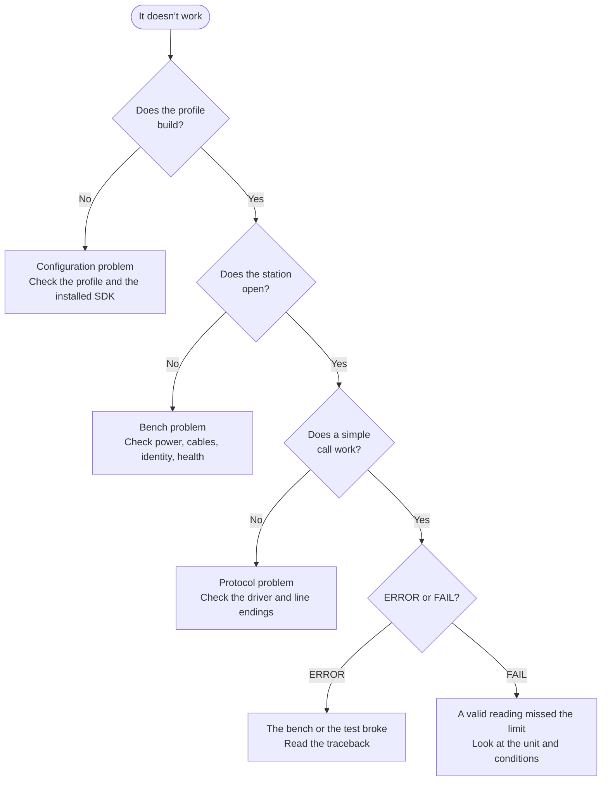

# Troubleshooting startup and execution

Something's not working, and it's probably not at a convenient time. This chapter is organised around how you'd actually use it: start from what you can see, and narrow it down.

!!! success "Works today"
    The diagnostics here apply to station use today. Commands that belong to the engine are marked as previews.

## Start with the first failure

When things go wrong on a bench, they tend to go wrong in a cascade. An instrument drops off, a measurement times out, then cleanup fails, and the last message on your screen is `failed to close bench_supply`. That message is true, and it's probably not the problem.

So our first piece of advice is to **scroll up**. Find the first thing that went wrong. Later errors are often just its consequences.

Then ask which stage it belongs to, as each one tells you what kind of problem you've got:



## By symptom

### While building

| You see | It means | Do this |
|---|---|---|
| `invalid station profile: ...` | A YAML or structure error | The message names the field |
| `no driver 'x'; known: ...` | The SDK isn't installed, or there's a typo | Look at the known list. Is the SDK installed in *this* environment? |
| `invalid config: x: Extra inputs are not permitted` | A misspelled key | Compare it to the driver's `Config` |
| `role 'x' points to unknown resource` | A typo in `roles:` | Compare with the names under `resources:` |
| `ContractMismatch` | A driver is missing methods | Fix the driver. It failed at import |
| `DriverDefinitionError` | A driver class is badly formed | Read the message. It names the parameter |

If an SDK is installed, but its drivers aren't listed, the usual cause is that its entry point names a module which doesn't import them. See [Packaging](../../getting-started/tutorial/hardware-integration/packaging.md).

### While opening

| You see | It means | Do this |
|---|---|---|
| `TransportError`: refused | Nothing's listening there | Is it powered on? Is the address right? Is another program holding it? |
| `TransportError`: needs a package | A missing extra | Install `mastif[serial]`, `[visa]` or `[ssh]` |
| `TransportTimeout` | It connected, then silence | See [below](#when-it-times-out) |
| `IdentityMismatch` | The wrong device | See [the recipe](../recipes/identity-failures.md) |
| `ResourceFault`: unhealthy | The device reported a fault | Read the detail. It's probably real |

"Another program is holding it" is worth checking first, particularly on Windows, as a serial port or USB instrument can only have one owner. A leftover process, a vendor's front-panel application, or a terminal someone left open: any of these will produce a confusing failure.

### During a run

| You see | It means | Do this |
|---|---|---|
| `TransportTimeout` | No reply in time | See below |
| `ProtocolError`: expected a number | The reply wasn't what the driver expected | Look at the raw traffic in the log |
| `ProtocolError`: overflow marker | The instrument's overranged | Check its range and connections |
| `UnitError` | A bug in the test: mismatched dimensions | Fix the test |
| A valid reading, and FAIL | The unit may really be out of spec | Check conditions, then the unit |
| It fails only sometimes | Timing, or a marginal connection | See [below](#when-it-only-fails-sometimes) |

### While cleaning up

| You see | It means | Do this |
|---|---|---|
| `close_failed` | Something didn't close cleanly | Often a consequence: look for an earlier failure |
| Safe state failed | The output may still be on | **Go and check the bench** |

## When it times out

This is the most common failure of all, and it usually isn't a dead instrument. Look at the raw traffic in the log first. mastif records each byte exchanged, at `DEBUG` on the `mastif.io` logger.

**Are line endings wrong?** This is the classic. The driver is waiting for `\n`, while the instrument sends `\r\n`, or it doesn't recognise your command because it wants `\r`. If it works in a terminal but not in your driver, suspect this first. Set `read_termination` and `write_termination` in the transport's config.

**Is it a serial setting?** A wrong baud rate gives garbage or silence. Check the data bits, parity and stop bits against the manual too.

**Is the operation just slow?** A sweep or a self-test may legitimately take longer than the 2-second default. Pass a longer timeout on that call.

**Did the previous command's reply get left behind?** If an earlier timeout left a late reply in the buffer, the next query reads that reply rather than its own, and it stays out of step from then on. This often looks like nonsense values that are one step behind. Clear the input on open, or reset the connection after a timeout.

**Is it a console prompt?** For `mastif.line-shell`, a wrong `prompt` means that it waits forever for something that never comes. Copy the exact prompt from a real session, including any trailing space.

## When it only fails sometimes

Intermittent problems are the hardest, and the ones most worth being methodical about. Before anything else, collect some evidence: how often, on which bench, and at which step? Run folders make this easy, if you're looking at structured results.

| Pattern | Suspect |
|---|---|
| The first reading after a change is wrong | Settling time |
| It's worse when the bench is warm | Thermal drift, or a marginal component |
| Only on one bench | That bench's wiring or instrument |
| Only after hours of running | A resource leak, or a slow drift |
| It correlates with another activity | Something else is using the bus |
| Random, with no pattern | A loose connection. Go and wiggle the cables |

Be wary of solving these with a retry. A retry hides the symptom, and the cause is still there. A unit that passes on the third attempt is giving you information.

## Reproduce it at the smallest scale

You'll narrow things down much more quickly by removing layers, one at a time. Try each of these:

**1. Can you build it?** That rules out configuration.

**2. Can you open it?** That rules out reachability and identity.

**3. Can you make one call, from a Python prompt?** That takes your test logic out of the picture:

```python title="at a Python prompt — excerpt"
station = Station.build(StationProfile.load("profiles/bench-01.yaml"), Registry.discover())
station.open()
supply = station.require("supply", PowerSupply)
supply.measure_voltage()
station.close()
```

**4. Can you reproduce it with a fake?** If a parser fails on a certain reply, capture that reply, and give it to `FakeLineIO`. Now you've got a test that shows the bug on your laptop, and it will never come back.

**5. Does it happen with the vendor's own software?** If the vendor's tool also fails, it's not your code. That's well worth knowing before you spend a day on it.

## What to include when asking for help

Whether you're asking a colleague or filing an issue, this gives them what they need:

- The **first** error, with its full traceback, and its chained cause.
- The profile, with anything secret removed.
- The output of `VersionInfo.load(...).summary()` for mastif and your SDK.
- The relevant piece of the log, including `mastif.io` traffic.
- What changed recently. Something usually did.

A screenshot of a red box rarely has enough information. The [error map](../architecture/errors.md) lists every exception, with its usual causes.

## Recap

- **Find the first failure.** The last message is usually a consequence.
- The **stage** tells you the type of problem: configuration, bench, protocol or test.
- For timeouts, **look at the raw traffic**, and suspect line endings first.
- For intermittent failures, **gather evidence**, and don't reach for a retry.
- **Remove layers** until it's small enough to understand, and then capture it as a test.

That completes the course's main paths. The remaining sections are for dipping into when you need them.

**Next:** [Use SCPI over TCP, serial, or VISA](../recipes/scpi.md)
