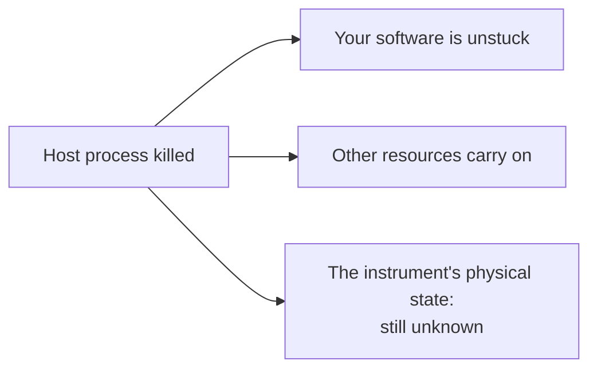

# Cancellation, timeouts, and cleanup

What happens when an operator presses Stop? From a test author's point of view, the answer is an orderly unwinding, which [the tutorial covers](../../getting-started/tutorial/writing-tests/cleanup.md). This chapter is about the uncomfortable part: what if a call doesn't come back? It's the case where a lot of test software quietly gives up, and we want to be exact about what we can and can't promise.

!!! example "Part implemented, part preview"
    Transport timeouts and the station's cleanup work today. Run-level deadlines and process-hosted resources are a design preview.

## You can't safely kill a thread

Let's start with the hard constraint, because everything else follows from it.

Suppose a task's thread is inside a vendor's C library, which is blocked waiting for an instrument. An operator presses Stop. Can we just terminate that thread?

No. Python doesn't let you, and for good reason. That thread might be holding the library's internal lock, or be halfway through updating a structure. Killing it would leave the library corrupted, in a way that may not show up until later, in a completely different call. Even if you could do it safely, you still wouldn't know what the instrument had done.

So there's exactly one thing that a stop request can do to a running call: wait for it. And that means the real work of making things stoppable comes earlier, in **making sure that every call eventually returns.**

## Layers of deadline

That's what timeouts are for, and a station has several of them, each limiting a different thing.

| Deadline | What it limits | Where it's set |
|---|---|---|
| **Connection** | Establishing contact | The transport's config |
| **Read** | Waiting for one reply | The transport's `timeout`, or per call |
| **Operation** | One device action, such as a sweep | A driver method's `timeout=` argument |
| **Task** | One task's whole duration | The plan (preview) |
| **Run** | The whole run | The plan (preview) |
| **Cleanup budget** | How long unwinding may take | Engine settings (preview) |

Here's a rule worth following: **an inner deadline mustn't reset an outer one.** Consider this:

```python title="a loop that never honours its deadline"
for attempt in range(1000):
    try:
        return self.io.query("STATUS?", timeout=10.0)
    except TransportTimeout:
        continue
```

Each attempt is correctly bounded at ten seconds, and the whole thing can take nearly three hours. So if you do retry, then calculate how much time you have left, and pass that along.

Choose values based on what you know of the device. A driver should document how long its slowest operation takes. If an operation might take an unbounded time, then look for a way to poll it instead of blocking for the whole duration, since a poll gives you somewhere to check for an abort:

```python title="a stoppable long operation — preview"
def run(self, ctx):
    self.chamber.start_ramp(self.config.target)
    while not self.chamber.at_temperature():
        ctx.checkpoint()      # An abort can take effect here
        ctx.sleep(5.0)        # Sleeps, but wakes up early on an abort
```

Prefer `ctx.sleep` to `time.sleep` in a task, since it can be interrupted by an abort.

## Asking and having stopped are different

Here's the sequence from the engine's point of view, and what makes it honest is the distinct states:

| Moment | State | Shown to the operator |
|---|---|---|
| Stop pressed | `Running`, abort requested | "Stopping..." |
| Waiting for the active call | `Aborting` | "Stopping: waiting for `bench_meter` (12 s)" |
| Task `teardown` | `Aborting` | "Stopping: cleaning up `idle_current`" |
| Loop exits | `Aborting` | "Stopping: leaving `profile=std`" |
| Station safe state | `SafeState` | "Making the bench safe" |
| Done | `Finished(ABORTED)` | "Stopped. 11 of 16 items complete" |

Because each of these is reported, an operator always knows the true situation. Particularly in the second row, where a person is deciding whether to walk over and turn something off by hand, "waiting for `bench_meter` (12 s)" is the most useful thing you could possibly be showing.

## When it really won't come back

Timeouts handle almost every case. But a vendor library might have a bug that blocks forever, ignoring every timeout you set. What can we do?

In direct mode, not a great deal. The call is on a thread in your process, so that thread is stuck. The engine can keep reporting that it's stuck, and it can make the other resources safe, but it can't finish cleanly, and the operator might eventually have to kill the process. We're telling you that plainly because we think you should know it before you design a station around it.

The [station runtime](execution-modes.md#containing-a-crash) offers a better tool. A resource that's known to be unreliable can be hosted in its own **child process**, and unlike a thread, a process can be killed safely. The runtime kills the host, marks that resource as faulted, and all the others carry on.

Note what that does and doesn't achieve:



Ending a process is a software matter, and it tells you nothing about the state of the hardware. That's why a station capable of doing harm needs an independent, physical way of making it safe.

## Cleanup itself can fail or hang

Every cleanup step calls into a driver, and those can block too. What should happen if safe state on one instrument hangs?

The station's existing behaviour is to attempt each resource in turn. It carries on past exceptions, but a call which simply never returns would hold up the ones after it. In direct mode, this is a real limitation, and transport timeouts are the main defence against it: a dead instrument's `output(False)` should fail in about two seconds rather than hanging.

In the runtime, each resource has its own worker, so one that's stuck can't hold up safe state on the others. That's one more real benefit of that design.

Whatever happens, the record keeps track of what was attempted, what finished, and what didn't:

```json title="the end of a run's report — preview"
{
  "verdict": "aborted",
  "cleanup": {
    "bench_supply": {"safe_state": "ok", "close": "ok"},
    "bench_meter": {"safe_state": "timed out after 5 s", "close": "failed: connection lost"}
  },
  "first_cause": "bench_meter: no reply to MEAS:VOLT? within 2.0 s"
}
```

That last field is important. When everything's failing at once, the first failure is usually the real one, and the rest are consequences. A report should show that distinction.

## What we can promise

Let's end with a careful statement of what's guaranteed, since "safe shutdown" is one of those phrases that can promise far more than it delivers.

**We promise:**

- A stop request is recorded immediately.
- No new work starts after it.
- Each cleanup step gets attempted, for every resource, unless an earlier call never returns.
- Every failure is recorded.
- The status displayed is the true status.

**We don't promise, and nobody can:**

- That a stop takes effect within a fixed time. That depends on the drivers and instruments.
- That an instrument has reached a safe state, if it can't be reached.
- That killing a process makes hardware safe.

## Recap

- **You can't kill a thread**, so stopping means waiting, and being stoppable means every call has a deadline.
- **Inner deadlines mustn't reset outer ones.** Long operations should poll, with `ctx.checkpoint()`.
- Requested and stopped are **different states**, and an operator should always see which applies.
- A library that truly hangs needs **process isolation**, and even that doesn't tell you the state of the hardware.

So we've stopped the run. What now? Can we try again, and if so, how much of what we did can we keep?

**Next:** [Failure propagation and recovery](recovery.md)
