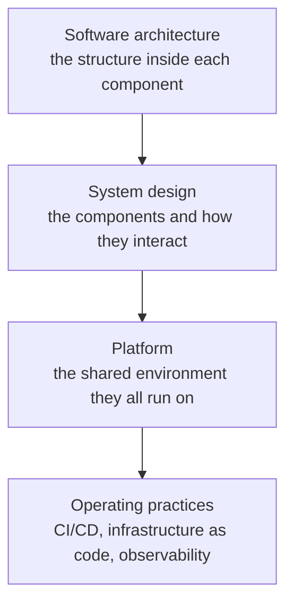

# System design, architecture, and platforms

Before we look at mastif's own design, we need a few words we can rely on. "Architecture" gets used for everything from a network diagram to a folder layout, and when one word covers that much, two engineers can agree in a meeting and build different things.

So this chapter separates the levels at which a system gets designed. Later chapters use these terms precisely. If they're already second nature to you, skim the table and move on.

## Three levels, three questions

| Level | It decides | Typical questions | In a test station |
|---|---|---|---|
| **System design** | The shape of the whole system | What are the components? Where does state live? What happens when one fails? | The hardware owner attempts cleanup when a client disappears |
| **Software architecture** | The shape inside one component | Which way do dependencies point? What may import what? | Tests depend on contracts, never on drivers |
| **Code structure** | The layout of the implementation | Which folder, which file? | `mastif/resources/transports/scpi.py` |

Each level can be good while the next is bad, and that's why you need all of them.

A well-drawn system can still fail if each component inside it is a tangle: nobody can change anything without breaking something. A beautifully structured service can still fail if the system around it is fragmented, with five stations each doing the same job differently. System design gives you the topology, and software architecture gives you integrity inside each piece.

## System design

System design defines the components, what each is responsible for, and how they interact. It became its own discipline when software stopped being one program on one machine. Once there's more than one process, some questions can't be answered by reading any single codebase:

- Which paths are synchronous, and which are queued for later?
- Where does each piece of state live, and who's allowed to change it?
- What's the failure model? What does a component do when its neighbour disappears?
- How do we see what the system is doing while it runs?

Its tools are things like service boundaries, datastores and their consistency models, message queues, caches, identity layers, and telemetry pipelines. Its output is a shared blueprint, which lets several people build parts of one system without conflicting assumptions.

For a test system, the failure model is especially important. A disconnected screen doesn't tell you whether an instrument's output is still on. The chapters on [ownership](ownership.md) and [recovery](recovery.md) explain how we assign responsibility for finding out, attempting cleanup, and preserving the evidence.

At the wider system level, the [concept system design](station-and-server.md) shows how local execution, durable evidence and shared services fit together. It separates those responsibilities without prescribing a platform stack or a physical station deployment.

## Software architecture

Software architecture applies inside each component that the system design defines. Its purpose is **evolvability**: being able to change the software, for years, without rewriting it.

It helps to think of it as four things:

**Characteristics** are the qualities you're optimising for: reliability, testability, performance, security. They conflict with one another, so a good architecture makes the trade-offs deliberately rather than by accident.

**Decisions** are the binding rules, such as "domain logic must not depend on infrastructure". They stop a system from drifting as people come and go. In mastif, these are recorded as [ADRs](../../adr/index.md), and where possible they're enforced by a tool.

**Styles and patterns** are templates for how structure and dependencies are organised, like layered or hexagonal architecture. There's a [whole chapter](styles-and-patterns.md) on those.

**Principles** are the foundations under all of that: separation of concerns, single responsibility, dependency inversion.

## What a platform is

There's a third idea, and it's the one that's most often misunderstood. People hear "platform" and picture a server, or a cluster. A server can *host* a platform, but it isn't one.

A **platform** is a shared set of capabilities that other software is built and run on, offered like a product to the engineers who use it. Picture the things that every test application needs, and that have nothing to do with what it's testing:

- A way to install and update software on a station.
- Somewhere to store results, and a way to find them.
- Identity: who's logged in, and what they may approve.
- A way to see whether things are healthy.
- Standard project templates, so that a new application starts out right.

Without a platform, each application builds its own copy of these. The organisation pays for them repeatedly, and each copy drifts into its own assumptions. With one, the team building a calibration application gets to spend its time on calibration. People call this a **paved road**: the easy way to do something and the right way become the same way.

These are general platform concepts, not a list of services mastif ships. mastif supplies a domain-neutral testing foundation; an organisation decides which shared services it needs around that foundation, and how to deploy them. No particular network topology, identity provider or database follows from using the framework.

Where do these sit relative to the other two levels?

Each level stands on the one below it, and the bottom level is what turns a good design into something you can actually ship, and keep running.

## The practices underneath

A design doesn't deliver itself. These practices are what turn engineering intent into reliable behaviour, and each exists to remove a particular source of human variation.

| Practice | The idea | What goes wrong without it |
|---|---|---|
| **CI/CD** | The same input produces the same output, every time | Releases are manual rituals that differ by person |
| **Infrastructure as code** | An environment is a versioned definition | Each station has undocumented differences |
| **Observability** | You can't stabilise what you can't see | Failures are local mysteries |
| **Test layers** | Each layer answers a different question | Change is frightening, so the system freezes |
| **Quality gates** | Tests that block a release are real; others are suggestions | Regressions ship quietly |
| **Code review** | A place to enforce boundaries and spread knowledge | Critical knowledge lives in one person's head |
| **Generated documentation** | Docs built from the source of truth can't drift | Nobody trusts the docs |

You can see several of these at work in mastif itself. An import-linter contract enforces the layer rules in CI. Every docstring example runs as a doctest. The [API reference](../../reference/kernel/index.md) is generated from the code. And [testing kit](../architecture/testing-kit.md) exists so that drivers can be tested on every commit, without a bench.

## Why any of this matters for test equipment

It's fair to ask whether this is overkill, since test software has a long tradition of being written quickly by whoever needed it. Here's the argument for taking it seriously.

Test software is usually treated as a tool, but it's really part of a production system. Provisioning, calibration, environmental screening and board test are steps in one workflow, passing a product along. A result from one step is an input to another, and all of it is evidence you may have to defend years later. Once you see it this way, the questions from this chapter stop being abstract: *where does state live* becomes *what happens to this unit's results when the network drops*.

## Recap

- **System design** is the shape of the system, **software architecture** is the shape inside each component, and **code structure** is the layout of the files.
- A **platform** is a shared set of capabilities offered like a product, and not simply a server.
- **Operating practices** remove human variation from delivery and operations.

With that vocabulary, we can say what the system actually has to do.

**Next:** [What the system must do](specification.md)
