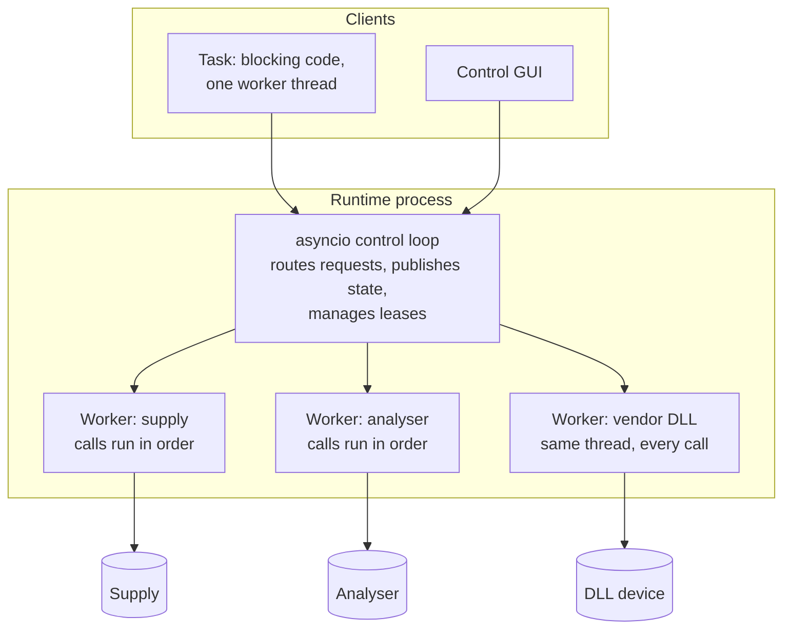

# Concurrency and blocking device operations

Most of what you've read about concurrency in Python assumes that the slow part is a network request to a server that can happily handle thousands of them. A test station is different. Its slow part might be a spectrum analyser that takes two seconds to sweep and can only do one sweep at a time, or a vendor DLL that crashes if called from the wrong thread.

So our concurrency model starts from the instruments and works upward. Here's how it comes out, and why it's arranged this way. (If the terms are new, the background chapter on [concurrency versus parallelism](../fundamentals/concurrency.md) explains them.)

!!! example "Part implemented, part preview"
    Drivers are synchronous today, and `NativeLibrary` already confines calls to one thread. Per-resource workers, the async control loop and proxies are part of the runtime design.

## What the hardware demands

Let's list the physical constraints first, as they aren't negotiable.

**One instrument can do one thing at a time.** A SCPI connection is a conversation. If two threads send a query at once, the replies can get mixed up, and thread A might receive thread B's answer. That's silently wrong data.

**Different instruments are independent.** The supply and the analyser don't care about each other, so there's no reason for one to wait for the other. A slow sweep shouldn't stop a safety reading from getting through.

**Many calls just block.** A vendor's C library blocks the calling thread until it's done, and that isn't negotiable. There's no `await` for that.

**Some libraries care which thread calls them.** It's quite common for a vendor DLL to keep thread-local state, so that it must be opened, used and closed on the same thread.

**Test authors shouldn't have to think about any of this.** That's more of a requirement than a physical constraint, but it's the one we care most about. The person writing a test is an expert in their product. They should be able to write what they mean, from top to bottom.

## The model

Those constraints lead to a design in three parts:



**An async control loop** handles everything that's mostly waiting: accepting requests, routing them, publishing updates. It never talks to hardware itself, so it never blocks, and it stays responsive even while every instrument is busy.

**One worker thread per resource** handles the hardware. Every call to a resource runs on that resource's own thread, in order. So calls to one resource can't overlap, whereas calls to different resources run in parallel. A vendor DLL always sees the same thread, without having to do anything special. Drivers stay synchronous and simple, without any locks.

**Tasks are ordinary blocking code.** A call through a proxy looks and behaves like a normal function call. It sends a message and waits for the answer.

## Why drivers aren't async

We considered making drivers `async`, and it's worth explaining why we didn't, since it's a question that comes up often. It would be elegant in a way: one event loop, and no threads.

But it would force every driver in every organisation to be written in `async`, and a single blocking call in any of them, whether it's a vendor DLL or an accidental `time.sleep`, would freeze the entire loop, including every other instrument. Since many vendor libraries are blocking and can't be made otherwise, we'd have needed thread pools for them in any case. So we'd have made everything harder, and still ended up with threads.

Per-resource threads give us the same outcome in a much simpler way. Your driver is written as plain blocking Python, and it's easy to test and to reason about. The price is one thread per resource, and that's trivial for a station with a dozen instruments.

## Native libraries

Thread confinement already exists in the implemented code, because it was needed before there was a runtime. `NativeLibrary` runs every call on a single dedicated thread by default:

```python title="excerpt: a vendor library is loaded and confined automatically"
self.lib.function("ACME_Read", c_int, [c_void_p, POINTER(c_double)], check=status)
self.lib.call("ACME_Read", self.handle, byref(value))   # Always on the same thread
```

So don't wrap that driver in your own thread pool. You'd be working against the guarantee that it's giving you. The [vendor DLL recipe](../recipes/native-library.md) has the details.

## What a queue does and doesn't protect

This is the point we'd most like you to take away from this chapter, because it's a very natural mistake to think that the per-resource queue has solved concurrency.

A queue guarantees that two **calls** don't overlap. It doesn't guarantee that a **sequence** of calls is uninterrupted:

```text title="each call is fine; the sequence isn't"
Task: supply.set_voltage(5 V)     runs alone, fine
GUI:  supply.set_voltage(12 V)    runs alone, fine
Task: supply.measure_current()    runs alone, fine, and is measuring the wrong thing
```

Each line ran alone on the worker, but the result is wrong, because the test needed those lines to be a unit. That's precisely what a [lease](resource-lifetimes.md) is for.

| Mechanism | Protects | From |
|---|---|---|
| Per-resource worker | One call | Other calls overlapping it |
| Lease | A whole run's sequence of calls | Other clients changing things in between |

## Background polling

There's one more source of concurrency to think about: monitors. It seems harmless for a thread to read an instrument every few seconds. A read is just a read, isn't it?

It isn't, and we've learned this from people who've been burned by it. **A poll is a command.** It might change the measurement range, restart an average, abort a sweep, or read and clear the error queue the test was about to check. On a slow bus, it delays the test's next command at random, and that makes the timing unpredictable. We've put together the full argument in the [field notes](../architecture/field-notes.md#2-why-continuous-polling-harms-tests).

So in mastif, polling is opt-in, and it's restricted:

- A resource is only polled if its profile has a `monitor:` block.
- Only readings the driver has declared to be side-effect-free can be monitored.
- By default, monitoring pauses while something holds a lease on that resource.

And the rule that keeps tests honest: **a value from a monitor can never be returned as a test's measurement.** We'll look at how in [Events, state, and connected clients](events-state.md).

## A note on what a task can do

Since tasks are blocking and each run has one worker, a task runs one thing at a time. What if you really do want two measurements to happen simultaneously, for instance triggering two instruments together? Keep in mind that a thread can't give you precise simultaneity anyway. Python threads offer timing on the order of milliseconds, with no guarantees. If you need simultaneous measurements, use the hardware: a shared trigger line, with both instruments armed beforehand. That's a hardware problem with a hardware solution, and your driver's `arm` and `read` methods can express it clearly.

## Recap

- The model starts from the **hardware's constraints**: one thing at a time per instrument, and independence between instruments.
- **Asyncio coordinates, worker threads do the hardware, and tasks just block.** Authors see plain sequential Python.
- **Drivers stay synchronous**, because a single blocking call would freeze an async design.
- A worker queue protects **one call**, and a lease protects a **sequence**.
- **A poll is a command**, so monitors are opt-in, declared and restricted.

Blocking raises an obvious question, though. If a call is blocked, how do you stop it?

**Next:** [Cancellation, timeouts, and cleanup](cancellation.md)
