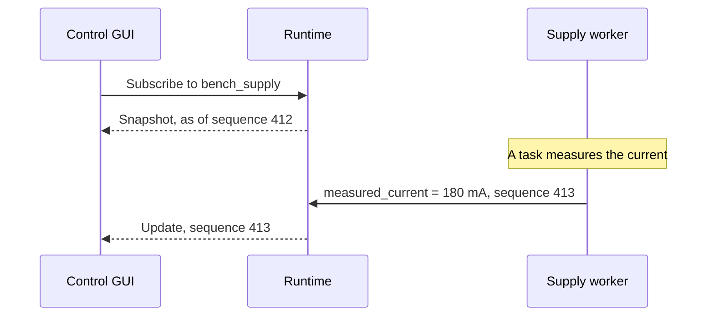
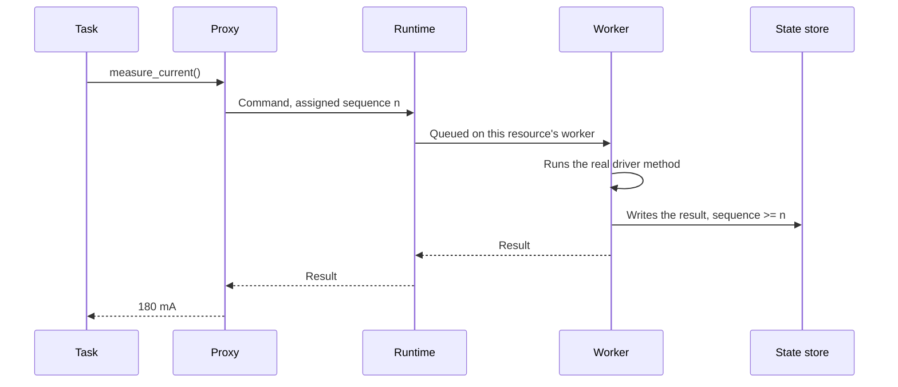

# Events, state, and connected clients

There are three questions people ask about a bench, and they look alike:

- A dashboard asks, *what's the current right now?*
- A test asks, *what's the current, in response to what I just did?*
- A report asks, *what was the current during that run, last Tuesday?*

If you answer all three from the same cached variable, then you'll get at least two of them wrong, and you won't know it. This chapter is about keeping those answers separate. It finishes off our picture of how clients share a station.

!!! example "Design preview"
    `@driver(state=...)` and station lifecycle listeners work today. The state store, `Stamped` values, publication and monitors are part of the runtime design in [ADR-0030](../../adr/0030-execution-topology.md).

## Four kinds of record

mastif produces four kinds of information, and each has a different job and different guarantees.

| Record | What it is | Used by | Can it be stale? | If lost? |
|---|---|---|---|---|
| **Result** | Evidence and a decision | Reports, audits | Never: it's fixed | Unacceptable |
| **Event** | Something that happened in a run | Progress, reports | No: it's history | A gap must be detected |
| **State** | The latest known values | Dashboards, GUIs | Yes, and it says how old | It's replaced by the next one |
| **Log** | Notes for a human | Engineers debugging | n/a | Regrettable |

Most of the design in this chapter is simply about not confusing these with one another.

## Every instrument declares its state

For a GUI to show a bench without interrogating it, it has to know what there is to show. So each resource declares a model of the state it keeps. It's a small extension of something that exists today, `@driver(state=...)`:

```python title="a driver's state model — preview"
class PsuState(BaseModel):
    voltage_setpoint: Stamped[Quantity] | None = None
    output_enabled: Stamped[bool] | None = None
    measured_current: Stamped[Quantity] | None = None


@driver("acme.psu-x", provides=[PowerSupply], state=PsuState)
class PsuX:
    ...
```

That model holds three sorts of thing: **setpoints** (what the station asked for), **output flags** (what's enabled), and **last readings** (what was seen most recently). These are different in kind, as setpoints are facts about what you asked, whereas readings are facts about the world.

Each field is a `Stamped` value, which carries where it came from:

```python title="preview"
class Stamped[T](BaseModel):
    value: T
    timestamp: datetime
    sequence: int      # A counter that increases with every write in this runtime
```

The state model also has uses in direct mode: it's a record of the instruments' condition, which the engine can include in run snapshots.

## Publishing state

In the runtime, every resource's state goes into a **state store**. Clients can read a snapshot, or they can subscribe to changes. This is how a GUI stays live without ever touching an instrument.



Look at the sequence. The GUI didn't poll anything. A test's measurement went through the worker, and the store published the value that resulted. So the GUI gets to see each reading the test takes, at no extra cost in bus time, and without any interference with the test.

Sequence numbers solve the classic problem with subscriptions: if a client gets a snapshot and subscribes separately, an update could slip through the gap between the two. Here, the snapshot says "as of 412", and the updates pick up from 413. If a client sees 413 and then 415, it knows that it missed one, and it can ask for a fresh snapshot.

A slow client also shouldn't be able to hold up the runtime. Since the state store only keeps the latest values, a client that has fallen behind can skip straight to the current one. That's fine for state, as you only care about the newest value. It wouldn't be fine for events or results, which have to be kept in full, so these go through the engine's run store instead.

## The freshness rule

Now for the rule that keeps tests honest, and the one that resolves the argument from the [last chapter](execution-modes.md).

The state store is full of recent readings. It would be very easy for a proxy to answer `measure_current()` straight from there, and it would be fast. It would also bring back every problem with polling that we listed earlier. So there's a firm rule, known in distributed systems as **read-after-write consistency**:

> **A test never accepts a value older than its own command.**

Here's exactly how that works.



The measurement is written into the state, and it's also returned, with a sequence number at least as high as the command that requested it. So in practice, the contract method **is** the refresh command. It can't return an old value, because it's what produces the new one.

So a measurement is retrieved from the state, but only after a command has refreshed it, which guarantees that it's the freshest value available.

In direct mode, the rule holds automatically, as the call simply runs the measurement. Tasks written against one mode get the same guarantee in the other.

And if a test really does want the latest monitored value, say for a safety check, it has to ask for that explicitly. That call has its own name, and it can never be mistaken for a measurement:

```python title="preview"
latest = ctx.station.latest_state("chamber_temp")
if latest.temperature.timestamp < ctx.now - timedelta(seconds=30):
    ctx.check("chamber_monitor_alive", False, detail="no reading for 30 s")
```

## Monitors

Some readings really are worth watching continuously, such as temperature, or a safety-related current. So a resource can have a **monitor**. It's opt-in, in the profile, and it's restricted in three ways.

```yaml title="in a profile — preview"
resources:
  chamber_temp:
    driver: acme.thermo-x
    config: {transport: {kind: tcp, host: 192.0.2.7, port: 5025}}
    monitor:
      readings: [temperature]     # Must be declared monitorable by the driver
      interval: 5 s
      while_leased: pause         # pause, the default, or continue
```

**A resource isn't polled unless you ask.** There's no global polling, so an unconfigured bench has no background traffic at all.

**Only declared readings can be monitored.** The driver says which readings are free of side effects: no setting changes, nothing done to the error queue. A thermometer's temperature qualifies. A spectrum trace qualifies only if reading it doesn't retrigger the sweep. This is a careful, per-reading judgement, so it's made by the person who knows the instrument.

**Monitors pause during a test, by default.** When something holds a lease on the resource, polling stops so that it can't interfere. `continue` exists for pure safety readings, on instruments the test doesn't drive.

Monitor values go into the same state store for GUIs and safety logic to read. They never become test results.

## What clients see

Let's put it all together. Here's what a control GUI might display, along with where each part of it comes from:

```text title="an operator's view — preview"
Station bench-01  ready
Run 20261031T0900  idle_current  (profile=std, voltage=5 V)        <- events

Supply  bench_supply
  Leased by: run 20261031T0900                                     <- lease state
  Setpoint: 5.000 V    Output: ON                                  <- state
  Current: 180 mA      (0.2 s ago)                                 <- state, with its age

Chamber  chamber_temp
  Temperature: 24.8 °C  (3.1 s ago, monitored)                     <- monitor state
```

See how each reading shows its age. That's not decoration. If that number says "47 minutes ago", the operator knows that something's wrong, whereas a plain "180 mA" would have looked fine. Whenever you display a value from state, display how old it is too.

A connecting client follows the same routine each time: **subscribe, get a snapshot, then apply updates**. If the connection drops, it doesn't carry on showing old data as though it were current. It marks what it's showing as disconnected, then goes through the same routine again.

## Recap

- **Results, events, state and logs** are different things, with different guarantees. Don't build one out of another.
- Each instrument declares a **state model**, of `Stamped` values with a timestamp and sequence number.
- The **state store** publishes changes, so that GUIs stay live with no extra traffic to the instruments.
- **The freshness rule:** a test never accepts a value older than its own command. The contract method is the refresh.
- **Monitors** are opt-in, limited to declared readings, and pause during a test by default.

That's the end of the system design section, and you've now seen the whole design. Next, let's look at how much of it has been built, and how that code is organised.

**Next:** [Architecture as built](../architecture/index.md)
