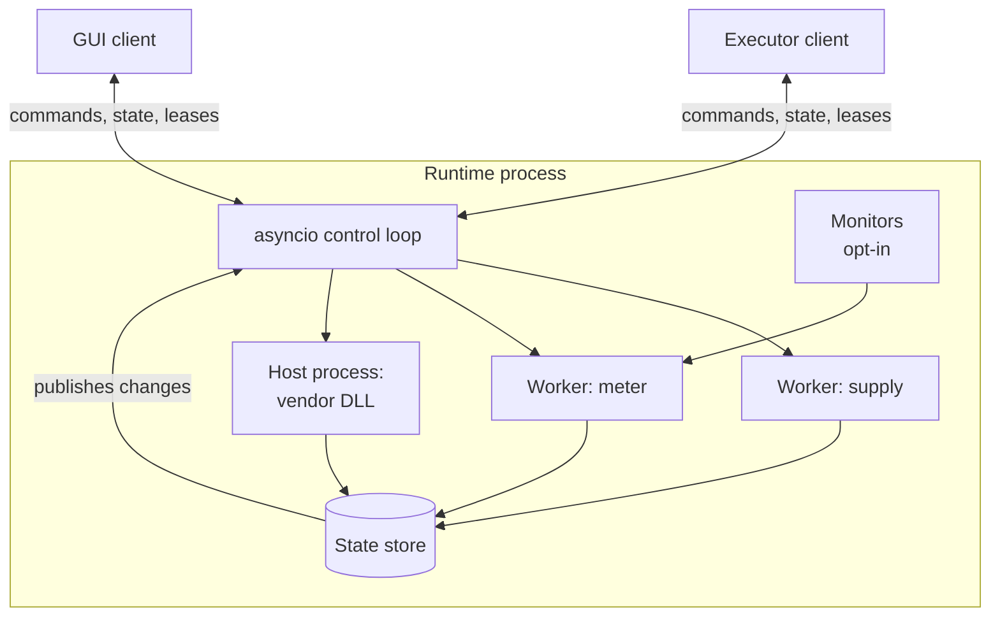

# Direct execution and a persistent station runtime

This chapter is about the largest architectural question in mastif: *which process owns the instruments?*

We'll be open with you about how this went. It was the most argued-over decision in the project. The original vision was a shared runtime process. Then an experienced colleague challenged it, with arguments that were good enough to change the design. Where we ended up keeps the benefits of both, and we think the reasoning is worth following, even if your own situation would lead you to a different answer.

!!! example "Design preview"
    Direct station use works today. The runtime is designed in [ADR-0030](../../adr/0030-execution-topology.md), and it gets built after the engine. See the [roadmap](../../wiki/roadmap.md).

## Why we wanted a runtime

Think about a real production test station, and what you'd really like it to do.

**A control GUI beside a running test.** An engineer wants to see what the instruments are doing during a run, and to use them directly between runs. But a serial port can only be open in one process. The usual workaround is for the GUI to close everything before a run starts, which means losing its view at exactly the moment it's most interesting.

**Eyes on the bench between tests.** A chamber overheats, or a supply goes into current limit, while nothing's running. Nobody finds out until the next run fails strangely.

**Slow connections.** Some instruments take many seconds to open: a vendor DLL loading calibration tables, say. Doing that for every run adds up, and doing it for every test would be intolerable.

**A vendor DLL that crashes.** If it's loaded in your test process, then it takes your test process down with it. Some exist only as 32-bit builds, which a 64-bit Python can't even load.

**Deployment that's the same everywhere.** A standard service on each station, with a known way for clients to connect, is something an organisation can roll out, monitor and upgrade.

All of these point to a single design: one long-lived process owns the bench, and everything else is its client.

## The objection

Then a new colleague joined, with more than twenty years of experience building ATE. He looked at this design, with its background process continually polling all the instruments, and he said it was overkill. His own tests open the connection, make the measurement and close it. Sequential and simple. It can be run anywhere, by anyone, with nothing else installed.

It would be easy to wave that away. But let's put his case as strongly as we can, since he's right about a lot.

- **It's simple.** One process, one sequence, read from top to bottom. No daemon, no IPC, no shared state.
- **It's independent.** Each test starts from a known state. A crashed test leaves nothing behind running.
- **It runs anywhere.** The same script runs on a bench, on a laptop, and in CI. There's no service to deploy.
- **It's cheap.** Constant polling hogs CPU, bus time and the instrument itself, for data nobody asked for. And holding instruments open locks out other tools, like the vendor's own front-panel software.
- **It's debuggable.** One stack trace, one log, one timeline.

And he had a sharper point still, one that changed the design rather than just its defaults.

## Why polling harms tests

The naive runtime continuously reads every instrument, saves the values, and lets tests fetch them from that state. It sounds efficient. Here's why it's wrong, for five separate reasons:

1. **Staleness.** A value that was polled 800 ms ago was measured *before* your test set the voltage. It isn't caused by your stimulus, and it might pass when it should fail.
2. **Interference.** A poll is a command. It can change a range, restart an average, abort a sweep, or read and clear the SCPI error queue, stealing the error your test was about to check.
3. **Measurement conditions.** Polling changes what's being measured: a meter auto-ranging, self-heating from constant reads, extra traffic on a DUT's console that changes its timing.
4. **Bus time.** On a slow, shared bus, a 200 ms poll delays your next command by up to 200 ms, at random. Your timing becomes unpredictable.
5. **Traceability.** A result has to say which command produced it, when, and under what settings. A cached poll can't.

There's no answer to those. They were correct. So the runtime we originally imagined was wrong, and we had to think again.

## What we kept from each side

The resolution comes from noticing that the two positions aren't really about the same thing. The objection was to *blind polling and forced complexity*. The original need was for *shared ownership of a bench*. You can have the second without the first.

So:

| Decision | Where it came from |
|---|---|
| **Direct mode is the default**, and it's built first | The colleague: keep the simple case simple |
| **The runtime is opt-in**, for benches that need it | The original vision: those needs are real |
| **Tasks and drivers don't change** between the two | Both: nobody should have to choose up front |
| **Commands run on demand**, and return fresh results | The colleague: measure when asked |
| **Monitors are opt-in**, declared and restricted | The colleague: polling isn't free |
| **Every instrument declares a state model** | The original vision: clients need to see the bench |

## The two modes

**Direct mode.** Your test process builds the station, opens it, measures and closes it. There's no daemon, IPC or background activity. It's what the tutorial uses throughout, and it's the right choice for development, CI, laptops and simple benches.

```python title="the application owns the station — preview"
station = Station.build(profile, registry)
engine = Engine(provider=station)
engine.run(plan)
```

**Runtime mode.** One long-lived process owns the station. Applications connect to it as clients, and they receive proxies.

<!-- termynal: {title: "Mock of the intended experience · running a shared station"} -->
```console
$ mastif station up stations/bench-01.yaml
Station bench-01
  Opening bench_supply ✓  bench_meter ✓  dut ✓
  Monitors: chamber_temp every 5 s
  Listening on tcp://127.0.0.1:7410

$ mastif run plans/widget-acceptance.yaml --connect bench-01
Connected to the runtime on bench-01
Leased: supply, meter, dut
...
```

```python title="the runtime owns the station — preview"
station = RemoteStation.connect("bench-01")
engine = Engine(provider=station)
engine.run(plan)
```

Compare those two Python snippets, and you'll see the one line that differs. Then consider what doesn't appear in either of them: no task and no driver knows which one is in use. A task calling `self.supply.measure_current()` gets a real driver in the first case and a proxy in the second, and it can't tell.

## Choosing

| You probably want direct mode if... | You probably want the runtime if... |
|---|---|
| You're developing, or running in CI | A GUI has to work alongside a running test |
| One application uses the bench at a time | You want readings watched between tests |
| Instruments open quickly | Instruments take a long time to open |
| You want the simplest possible debugging | A vendor DLL crashes, or it's 32-bit only |
| | Stations are a managed, standard deployment |

Since the code doesn't change, this isn't a commitment. You can develop in direct mode, and deploy with a runtime.

## Inside the runtime

Here's how the pieces fit together, each serving one of the needs we started with:



**The control loop** handles requests and publishes state, and it never talks to hardware. **Resource workers** each own one resource, so calls are ordered and instruments stay independent. **The state store** keeps the latest values, each stamped with a sequence number, and it's how a GUI stays live without touching the hardware. We've covered [concurrency](concurrency.md) and [leases](resource-lifetimes.md) separately, and [state and freshness](events-state.md) come next.

### Containing a crash

Any resource can be hosted in a **child process** rather than a thread, with a line in its profile entry. A vendor DLL that crashes then only takes down its host. The runtime reports that resource as faulted, and everything else keeps working. It can restart the host, if you allow it.

The same mechanism solves a problem that's otherwise really awkward: a 32-bit-only vendor DLL. A 64-bit Python can't load it, but a 32-bit host process can, and it communicates with the runtime in the same way as any other host.

```yaml title="in a profile — preview"
resources:
  old_analyser:
    driver: acme.sa-legacy
    config:
      transport: {kind: native, library: acmesa32}
    host: {process: child, python: "C:/Python312-32/python.exe"}
```

## The rules that keep the door open

We haven't built the runtime yet. Our engine is being built in direct mode first. What makes that safe, without a rewrite later, is a short list of constraints that the engine and your code must follow from today. They're not arbitrary rules. Each exists so that this chapter can come true.

1. **Tasks reach hardware only through `require(role, Contract)`.** No task imports a driver or opens a transport. If one did, a proxy couldn't step in.
2. **Contract values stay serialisable**: quantities, Pydantic models, enums, primitives, `bytes`, and containers of those. Otherwise they can't cross a process boundary.
3. **The engine talks to a `ResourceProvider`**, never to `Station` by name, so that something else can take its place.
4. **The engine acquires a lease per run**, for the roles the plan requires. In direct mode that does nothing, but it means the call is already in the right place.
5. **Measurements are fresh by construction.** A measurement method runs the measurement and returns its value. Nothing is read from a cache.

You'll notice that these are all good practice anyway. That's a nice property of a design: the constraints needed for the difficult future also make the simple present cleaner.

??? question "Still open in this design"
    The IPC technology hasn't been chosen. A local socket with JSON or msgpack messages is the leading candidate, with gRPC as an alternative. Also undecided is how a GUI discovers a runtime, and how several executors should work with several slots on one bench. These are for the runtime's own ADR.

## Recap

- The original vision of a shared process met a strong objection, and **both sides were partly right**.
- **Direct mode is the default**, and **the runtime is opt-in**. Tasks and drivers are identical in both.
- **Commands run on demand.** Blind polling is out, and monitors are opt-in and restricted.
- **Five constraints** on today's code make the runtime possible later, with no rewrite.

There's one thing left to explain. If tests must never read from a cache, how does a GUI stay live? And what does "state" mean, exactly?

**Next:** [Events, state, and connected clients](events-state.md)
