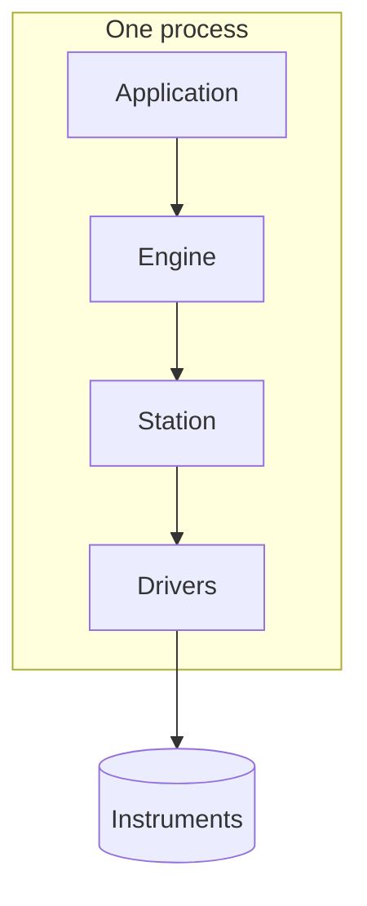
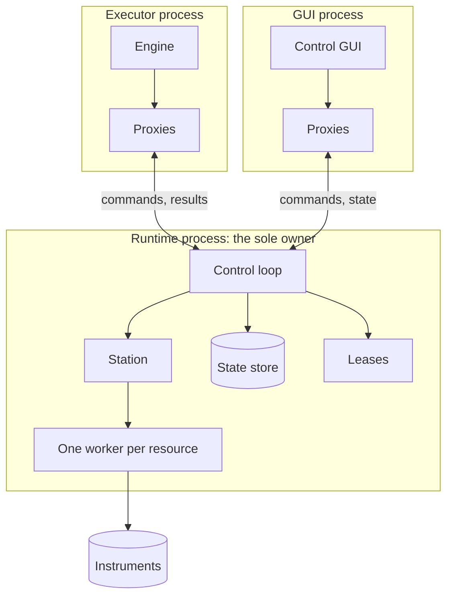
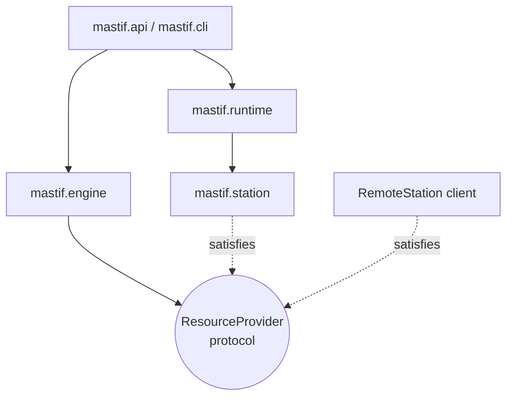

# Who owns what?

A surprising number of problems in test software come down to a question that nobody explicitly answered: *who's in charge of this?*

A UI closes a port while a test is using it. A test assumes that someone else will turn the output off, and that someone assumes the test did. A crashed process leaves a port locked, and nobody knows whether it's safe to restart. In each case, two pieces of software had different ideas about who owned something.

So let's answer the question properly, for every piece of the system. **Ownership means the right, and the duty, to start something, change it and end it.**

!!! example "Design preview"
    Direct station ownership exists today. The engine and runtime arrangement described here is the design set out in [ADR-0030](../../adr/0030-execution-topology.md).

## The physical starting point

Everything follows from one physical fact, so let's begin there.

A test station is a bench of instruments, each reached through something **exclusive**. A serial port can only be opened by one process. A USB-TMC handle, a vendor DLL session, a TCP port that takes one client: whoever opens it owns it until they close it.

And two kinds of software want the bench:

- **The test executor**, which runs a plan: configure, measure, judge, record.
- **Everything around it**: an engineer with a control GUI who wants to switch the supply on and look at a spectrum, a dashboard, maybe a second executor for a second slot.

That's the crux of it. With exclusive hardware and several clients, either they take turns, closing everything between uses, or **one thing owns the hardware and the others ask it**. We'll come back to this choice, because it's the biggest decision in the architecture.

## Who owns which responsibility

Regardless of how that turns out, each responsibility has exactly one owner. This table is worth keeping around.

| Responsibility | Owner | Nobody else should |
|---|---|---|
| Deciding the configuration and execution mode | The **application** entry point | Read global settings |
| Choosing the next task, and coordinating a run | The **engine** | Skip ahead, or reorder |
| Keeping hardware open between runs and clients | The **runtime**, when used | Open a port directly |
| Building resources, and the order they open and close | The **station** and resource manager | Call `close()` on a resource |
| Knowing commands and reply formats | The **driver or DUT type** | Send raw commands |
| Knowing what's acceptable | The **test package** | Hardcode limits in a driver |
| Showing things to people | The organisation's **UI** | Keep its own opinion about state |

The last row deserves a little more thought. A UI that keeps its own copy of what's going on, updated by its own logic, will eventually disagree with reality. So a UI should display what the authoritative owner reports. For any given question, one component should have the answer.

## Direct mode: the application owns everything

In the simple case, one process does everything:



The application's scope is the ownership boundary. When the process ends, everything's over. There's nothing to deploy and no protocol to design, and when something breaks there's one log and one stack trace.

This is the default, and it's what you should use until you have a reason not to. A senior ATE engineer with over twenty years' experience argued this to us very persuasively, and he's right about a great many situations. It's recorded in the [field notes](../architecture/field-notes.md).

## Runtime mode: one owner, many clients

But direct mode has a limit, and you'll hit it the moment you want a control GUI next to a running test. They can't both have the serial port. So in runtime mode, ownership moves to a long-lived process:



Each client gets **proxies**: objects that implement the very same contracts, and that forward each call to the runtime. When a task calls `self.supply.measure_current()`, it can't tell whether that's a driver or a proxy.

That one property is what makes this affordable. Everything we've been careful about comes down to it: tasks only reach hardware via `require(role, Contract)`, and contract values are serialisable. Because of this, moving from direct mode to runtime mode changes no test code and no driver code.

We develop the runtime fully in [Direct execution and a persistent station runtime](execution-modes.md).

## The engine and runtime are peers

Here's a design point that's easy to get wrong. It might seem natural for the engine to contain the runtime, or the other way around. They're actually siblings, and neither imports the other.



They have different jobs. The **engine** coordinates a *procedure*: which task is next, what was the result, what's the policy. The **runtime** coordinates *access to hardware*: who's in control, what's the current state, which call goes next. A runtime is useful with no engine, for a GUI alone. An engine is useful with no runtime, in direct mode.

The piece that connects them is a small protocol. The engine doesn't know what a `Station` is. It talks to a `ResourceProvider`:

```python title="preview"
class ResourceProvider(Protocol):
    def role(self, role: str) -> Any: ...
    def require(self, role: str, contract: type) -> Any: ...
    def open(self, expect: Mapping[str, Mapping[str, object]] | None = None) -> None: ...
    def safe_state(self) -> dict[str, Exception]: ...
    def close(self) -> None: ...
    def lease(self, roles: Collection[str], holder: str) -> AbstractContextManager[None]: ...
```

`Station` already has the first five of these. A future `RemoteStation` client will have the same set. The application decides which of them to hand the engine, and from that point on, the engine has no idea which it's got.

## Following ownership through failure

A good way to test any ownership design is to ask what happens when each owner dies. Let's go through it.

**The executor crashes during a run.** In direct mode, that process owned the hardware, so the operating system closes its handles, and the instruments stay in whatever state they were last set to. Software can't do anything about that, because the software is gone. In runtime mode, things improve: the executor's lease heartbeat stops, so the runtime notices, makes the leased resources safe and releases them. That's a real advantage of having a separate owner.

**The GUI crashes.** A GUI that's only watching: nothing happens, and it can reconnect. A GUI holding a manual-control lease: the heartbeat stops, and the lease expires.

**The runtime crashes.** Now clients have lost their owner. They get a `RuntimeUnavailable` error on their next call, which the engine treats as an ERROR. What clients must never do is try to open the hardware directly as a fallback. That's how two owners come into being, and it's exactly what we're trying to prevent.

**A vendor DLL crashes.** If it was running in-process, it takes the whole process with it. That's the argument for hosting a crash-prone library in its own [child process](execution-modes.md#containing-a-crash), which limits the damage to that one resource.

**A driver raises an exception.** No one dies. The station's [lifecycle](../../getting-started/tutorial/deploying/lifecycle.md) was designed for exactly this.

In each case, the question that matters is "who knows the truth now?". There should always be one answer, even if that answer is "nobody, go and look at the bench".

## Recap

- Hardware access is **exclusive**, so with several clients, someone has to be the sole owner.
- Each responsibility has **exactly one owner**, and a UI displays what its owner reports.
- **Direct mode** is simple, and it's the default. **Runtime mode** moves ownership to one process, and clients use proxies.
- The **engine and runtime are peers**, connected only by the `ResourceProvider` protocol.

So an instrument has an owner. But when does it open, how long does it stay open, and who may control it right now? These turn out to be separate questions.

**Next:** [Resource lifetimes and access](resource-lifetimes.md)
