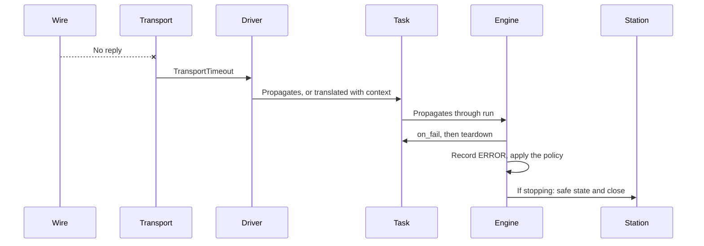

# Failure propagation and recovery

A command timed out. What happened?

The device might never have received it. It might have received it, carried it out, and lost the reply. It might still be carrying it out. The exception looks identical in all three cases, and yet the right response is different for each of them. That's the core difficulty of recovery: **you often don't know what state you're in**, and acting as though you did is how a recoverable problem turns into a bad result.

In this chapter we'll look at how failures travel through the system, and at when it's actually safe to try again.

!!! example "Part implemented, part preview"
    Typed errors and station rollback work today. Task retries and `resume` are a design preview.

## How a failure travels

Let's follow one failure up through the layers, as each has its own part to play.



- The **transport** turns silence into a typed exception.
- The **driver** adds context, or lets it pass.
- The **task** almost never catches it.
- The **engine** classifies it, records it, and applies the plan's policy.
- The **station** makes everything safe, whatever happens.

Each layer does one thing, and at no point does anybody invent a value. This is the [error model](../../adr/0002-error-model.md) at work.

## Is it safe to try again?

Retrying feels like an obvious fix, and for a certain kind of operation it is. The concept to reach for is **idempotence**: an operation is idempotent if doing it twice has the same effect as doing it once.

| Operation | Idempotent? | Safe to retry after a timeout? |
|---|---|---|
| `MEAS:VOLT?` | Yes, mostly | Yes |
| `OUTP OFF` | Yes | Yes |
| `VOLT 5.0` | Yes | Yes |
| `INIT` (start a sweep) | No | Be careful: a sweep may be running |
| `POSITIONER:STEP +10` | **No** | **No:** it could move 20 degrees |
| `ERASE FLASH` | Yes, in effect | Depends how far it got |
| `FIRMWARE:UPDATE` | No | **Definitely not** |

Look at the positioner row, and think of what a simple retry wrapper would do with it. The first command works, and the reply is lost. The wrapper sends it again. The axis has now moved 20 degrees, and everything looks fine. Every later measurement is at the wrong angle, and nothing has raised an exception. So a framework can't safely add retries for you, as only the person who knows the device can say which operations are safe. That's why the default is zero.

Even idempotent operations can have side effects, too. Retrying a read after a timeout might interfere with a measurement in progress, and might read the *previous* command's late reply, leaving your connection out of step with itself from then on. On a line-based connection, after a timeout you can't be sure what's still on its way.

So here's the practical guidance for drivers. Retry reads if it's useful, and resynchronise first if your protocol allows it. Don't retry anything that changes state, unless you've worked out what happens if the first attempt succeeded. A better fix for an ambiguous command is often to check its effect: instead of resending "move to 45°", ask where it is now.

## Task-level retries

A plan can ask for retries, as a policy:

```yaml title="preview"
policies:
  on_error: stop_run
  retries: 1             # Applies to every task unless it's overridden

sequence:
  - task: idle_current
    retries: 2
  - task: reflash_firmware
    retries: 0           # Never
```

A retry runs the whole task again from `should_run`, including `setup` and `teardown`, so its conditions get re-established. The record keeps **every attempt**, not only the last:

```json title="events from a retried task — preview, wrapped"
{"type": "TaskFinished", "task": "idle_current", "attempt": 1, "verdict": "error"}
{"type": "TaskFinished", "task": "idle_current", "attempt": 2, "verdict": "pass"}
```

Think about what you should make of a unit that passes on the third attempt. A retry that hides a marginal failure is a way of shipping marginal units, so the report says it took three attempts. You might decide that's fine. But that should be a decision you've made, rather than something a framework quietly did for you.

And should you retry a FAIL at all? For a real measurement, it's questionable: "measure until it passes" is a statistical trick, not a test. It can be justified where a measurement is known to be noisy, if your procedure specifies a retest. Otherwise we'd leave retries on ERROR only.

## Resuming a run

Retrying handles a single task. Resuming handles a whole run after something has killed it. The mechanics are in [Inspecting progress and saved results](../../getting-started/tutorial/first-results/progress.md#surviving-a-crash). Here we want to think about when it's *valid*.

Let's be clear about what resume can restore, and what it can't:

| What | Restored how | Reliable? |
|---|---|---|
| Which items finished | The snapshot | Yes |
| Their results | The event log | Yes |
| Context values | The snapshot | Yes |
| The plan and configuration | The manifest | Yes |
| Which unit this is | Checked again at opening | Yes |
| The instruments' settings | Task `setup` and loop `enter` run again | Yes, if they're written properly |
| The physical state of the DUT | Loop `enter` runs again | Mostly |
| Temperature, drift, elapsed time | Nothing | **No** |

The last row is the interesting one. Suppose your plan calibrates at each of ten temperatures, and it crashes at the eighth. A later task uses an offset that was measured at the first. If the bench sat idle for six hours before you resumed, is that offset still good? mastif can't know that. Only someone who understands the physics can say.

So resume isn't automatic. It's a command that a person runs, after thinking about it, and the run's record marks that it was resumed, and when. A task that's sensitive to this can check for itself:

```python title="preview"
def should_run(self, ctx):
    offset = ctx.inputs.get(SupplyOffset)
    if ctx.now - offset.measured_at > timedelta(hours=1):
        return Skip("offset is more than an hour old: re-measure it")
```

### What makes resume work

Your loop types and tasks have to cooperate, and it comes down to one idea: **`enter` and `setup` must establish the conditions they need, without assuming what came before.**

A good `enter` doesn't say, "since we just came from the previous profile, I only need to change this one file". It says, "make the board be on this profile". That's the difference between a procedure that resumes correctly and one which only works when it runs from the very start. It's also what makes a task runnable by itself, and what makes reordering possible. All three of those benefits come from the same property.

## The practical baseline

Sophisticated recovery is great to have, and you should build up to it. The baseline, though, is simple, and it's what we'd have you get right first.

1. **Fail explicitly.** Raise a typed exception with context.
2. **Clean up.** The station makes everything safe, and reports what it couldn't do.
3. **Tell the truth.** Record what happened, with the first cause preserved.
4. **Start again from a known state.** A fresh run, or a considered resume.

Anything cleverer than that should be a deliberate extension, with its trade-offs written down, and not an invisible retry wrapper in the middle of the stack.

## Recap

- A timeout often **doesn't tell you what happened**, so acting as if it did is dangerous.
- Retry only **idempotent** operations, and only where you know it's safe. The default is zero, for this reason.
- Every **attempt is recorded**. A pass on the third try isn't the same as a pass on the first.
- **Resume restores the software's state** and re-establishes the bench's. Physics and elapsed time can't be restored, so it's a human decision.
- `setup` and `enter` should **establish conditions, not assume them**. It's what makes resume, standalone tasks and reordering possible.

Now that we've covered all of this for one process, it's time to take on the big question.

**Next:** [Direct execution and a persistent station runtime](execution-modes.md)
