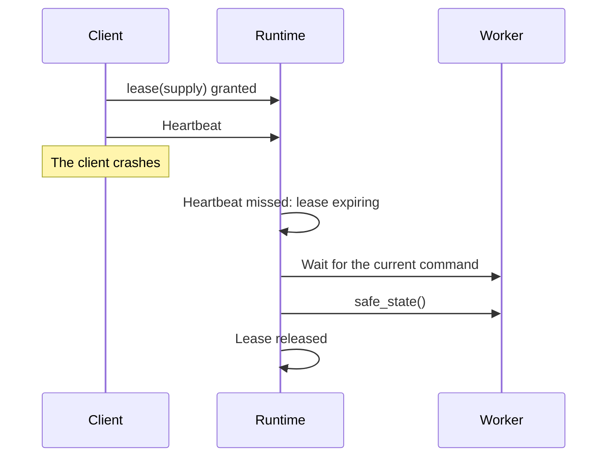

# Resource lifetimes and access

An instrument can stay connected for days, while a test uses it for a few seconds. These are two different lifetimes, and a lot of confusion comes from treating them as one. In this chapter we'll separate the different things that "having" a resource can mean, then look at leases, the mechanism that lets several clients share a bench safely.

!!! example "Design preview"
    Station build, open and close exist today. Leases, heartbeats and shared access are part of the runtime design in [ADR-0030](../../adr/0030-execution-topology.md).

## Five different lifetimes

| Scope | Begins | Ends | Answers |
|---|---|---|---|
| **Object** | `Station.build` | When the station's discarded | Does the driver object exist? |
| **Connection** | Opening the resource | Closing it | Can I talk to it? |
| **Lease** | Control is granted | Released, or expired | May I change it now? |
| **Run** | The run is accepted | The run finishes | What is this work part of? |
| **Task setup** | `setup` finishes | `teardown` finishes | Are its conditions in place? |

In direct mode, these are all nested inside a single process lifetime, and you don't really have to think about them. But consider what the separation allows in runtime mode: the connection lasts for days, a lease lasts for one run, and a task's setup lasts for seconds. Instruments that take thirty seconds to initialise get opened once rather than at the start of every run, and that alone can be worth having the runtime for.

## Why opening and controlling are different

Here's a scenario. A run is in progress, holding the supply at 5 V while it measures a board. An engineer at the control GUI sees the supply's panel, and clicks "12 V".

If "connected" were all it took to control an instrument, that click would go straight through, and here's what would happen:

```text title="the interleaving we must prevent"
Task: set voltage to 5 V
GUI:  set voltage to 12 V       <- a person clicks a button
Task: measure current           <- now measuring at 12 V, and it might fry the board
```

The run records a value under conditions that it didn't establish. It might pass. The report would say 5 V. It's the worst kind of bug, because the evidence is silently false.

Notice that the runtime's worker queue doesn't help here. Each of those three calls ran on its own, in order, with nothing overlapping. The problem isn't that the calls collided. It's that a *sequence* of calls needed to be protected as a unit, and nothing was protecting it.

## Leases

A **lease** is exclusive permission to control a set of roles, held by one named client. It's not a connection. Nothing opens or closes when it's granted. It's a permission, and the runtime enforces it.

The rules are simple:

- **One holder per role**, at any one time.
- **A run takes a lease on exactly the roles it requires**, for its whole duration. The engine knows those roles because tasks declare them.
- **Observing is never blocked.** Anyone can read the published state, with or without a lease.
- **Control needs a lease.** A GUI has to request one for manual control, and it gets refused while a run holds that role.

Here's how that looks from a client's side:

```python title="a manual-control GUI — preview"
station = RemoteStation.connect("bench-01")

try:
    with station.lease(["supply"], holder="alice@control-gui"):
        supply = station.require("supply", PowerSupply)
        supply.set_voltage(12 * V)
except LeaseConflict as conflict:
    show_message(f"The supply is in use by {conflict.holder}")
```

So that's a good outcome for the GUI: its button is greyed out with a reason. "In use by run 20261031T0900" is far more useful than an unexplained failure. And it can still show the current reading, as observing is never blocked.

In direct mode, `lease` is a no-op, since there's nobody to share with. Tasks don't need to know. This is the fourth constraint [ADR-0030](../../adr/0030-execution-topology.md) puts on the engine, and it means that engines and tasks written today work unchanged with the runtime later on.

## When the holder disappears

What happens when a lease holder crashes? Without some care, that lease would be held forever, and the bench would be stuck until someone restarted things. So a lease carries a **heartbeat**: the holder must keep saying that it's alive. If it stops, then the lease expires.

But expiring a lease isn't the end of the story, as there's a subtle problem. Suppose a client crashes while a command is running on an instrument. Its lease has expired. The command hasn't finished, and the instrument could be in any state.

So the sequence on expiry has to be:

1. **Stop accepting** commands from the old holder.
2. **Let what's running finish**, or time out.
3. **Make the resource safe**, because its state is now unknown, and it may be energised.
4. **Release the lease**, and only then let anyone else take it.



Expiry doesn't instantly make anything safe. All it does is start a process, and the status should say so.

## The trap of aliases

Here's something a simple implementation would get wrong. A lease is requested by role, but what it needs to protect is physical.

Roles are only names, so two of them can refer to the same thing:

```yaml title="in a profile"
roles:
  main_supply: bench_supply
  aux_supply: bench_supply       # The same instrument
```

Or they can refer to [children that share a controller](../../getting-started/tutorial/hardware-integration/channels.md#how-they-differ):

```yaml title="in a profile"
roles:
  az: positioner.azimuth
  el: positioner.elevation       # Two axes, one controller and one command queue
```

If leases were tracked by role name, then one client could hold `main_supply` and another could hold `aux_supply`, and they'd be fighting over one instrument. So the runtime resolves each role to the underlying physical resource, and it tracks the lease there.

## Asking for several at once

A test usually needs several instruments at the same time, and that brings up an old problem from concurrent programming. Client A holds the supply and wants the meter, while client B holds the meter and wants the supply. They'd both wait forever.

The straightforward fix is that **a lease request covers all of its roles, and is granted atomically**: all of them or none. A client never holds a part of what it needs while waiting for the rest, so a deadlock like that can't form.

Since an engine knows all the roles a plan needs before it starts, this suits it well. A run takes everything at the beginning, and it gives everything back at the end.

There's a cost, of course. A long run that needs one instrument briefly holds it for hours. We've gone with the simple rule, and we could consider leasing per task in future if real benches show a need.

## Today's profile fields

You might notice `shared` and `slot` fields on a resource entry in the profile. They're vocabulary reserved for this design. Today, nothing enforces them: a `shared: true` resource isn't locked by anything. In direct mode there's only one user, so that's fine. Multi-slot scheduling will give them meaning.

??? question "Still open in this design"
    Should a run be able to hold a lease on some roles for only part of a plan, for a shared instrument on a multi-slot bench? That would need a more elaborate approach to deadlock. And what should the default heartbeat interval be, since it trades speed of recovery against false expiry on a busy machine? Both of these will be settled in the runtime's own ADR.

## Recap

- **Object, connection, lease, run and setup** are five different lifetimes, and separating them is what makes a long-lived runtime useful.
- A **lease** is permission to control, not a connection. There's one holder per role, and observing is never blocked.
- A worker queue stops calls overlapping. A lease protects a **whole sequence**. You need both.
- **Expiry starts a recovery process**, ending in safe state, before anyone else is let in.
- Leases track **physical resources**, not role names, and they're granted **all at once**.

We've mentioned workers and queues a few times now. Let's look at concurrency directly.

**Next:** [Concurrency and blocking device operations](concurrency.md)
