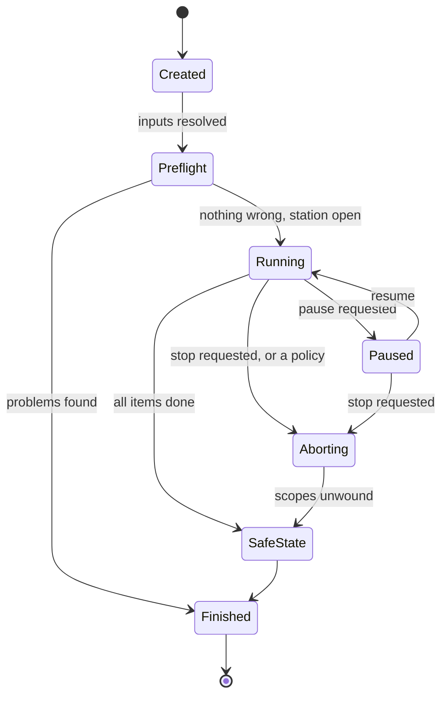
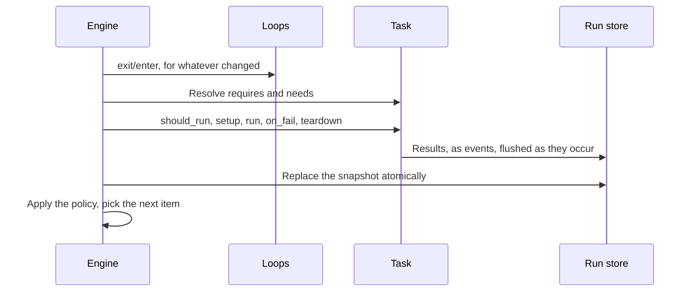
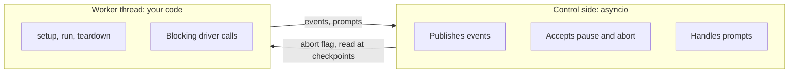

# From starting a run to receiving a result

We've seen the whole system from the outside. The next few chapters look closely at the behaviour inside one station: how a run actually executes, who is responsible for what, and how one station can serve several applications at the same time.

We'll start by following one run, from the command to the final verdict.

!!! example "Design preview"
    This page describes the engine, which we're designing in these pages. The station operations and result models it uses are implemented. See the [roadmap](../../wiki/roadmap.md) for what is built.

## One request, seven stages

```console
mastif run plans/widget-acceptance.yaml --station stations/bench-01.yaml --unit SN-42
```

Here's what happens next. A run moves through a series of named states, and each state answers a different question.



Why model it as an explicit state machine? We could have written a function with a `try/finally`, and that's how most test runners do it. But think about what a UI needs to show, and what a report needs to say. "Stopping" and "stopped" are different. "Cleaning up" is a real period of time, which may take a while, and during which an operator shouldn't unplug anything. If those aren't explicit states, then they can't be shown, recorded or tested. A run's state is one of the most important facts in the whole system, so we make it a first-class value.

Let's walk through each stage.

### 1. Created: what's being asked?

The engine loads the plan and the profile, and resolves all configuration values. Nothing has been checked yet, and nothing's touched. It writes `manifest.json` straight away, so that even a run which goes no further leaves a record of what was attempted.

**Failures here** are things like a missing file or invalid YAML. They mean you asked for something that doesn't make sense.

### 2. Preflight: can this work at all?

The engine expands the plan into its ordered list of items, and it checks everything that's knowable without hardware:

- Is the plan valid, and do its loop types exist?
- Does each task's configuration validate?
- Is each role bound to a resource that provides the required contract?
- Is each `needs` produced by something earlier?

**Failures here** are all reported together, with no hardware touched, and the run ends. This is the cheapest place for anything to go wrong, so we try to move as many errors to this stage as possible.

Next, the engine opens the station. That's when reality gets checked: reachability, identity and health. If the run is on a shared station, this is when it acquires its [lease](resource-lifetimes.md) as well.

**Failures here** mean the bench isn't ready. The station has rolled back, and nothing is left open.

### 3. Running: producing evidence

This is the main loop. For each item, the engine works out which loops need to exit and enter, using the pure `transitions` function, and it then calls the task's hooks in order.



Note when the snapshot is written: after the item finishes, and not during. So an item is either complete in the snapshot, or it isn't, and on a [resume](../../getting-started/tutorial/first-results/progress.md#surviving-a-crash) it runs again from the start.

**Failures here** are classified as FAIL or ERROR and handled according to the plan's policies.

### 4. Paused: holding

Reached only on request, and only at a point where it's safe: an item boundary or a `ctx.checkpoint()`. The bench stays exactly as it is, and nothing is powered off. An operator might be looking at something.

### 5. Aborting: unwinding

Reached when an operator presses stop, or when a policy such as `on_error: stop_run` decides that it's over. No new items get scheduled, and the current task finishes through `teardown`. Then each loop that was entered is exited, innermost first. Items marked `always: true` still run.

### 6. SafeState: the hardware comes first

Every run passes through this state, whether it finished normally or not. The station runs safe state across all resources, which [never stops early](../../getting-started/tutorial/deploying/lifecycle.md#safe-state-and-close-are-different-things), and then closes them. Any failure here is recorded and kept.

Having this as its own state makes a promise explicit: there's no route to `Finished` that skips it, except for a run that never opened anything.

### 7. Finished: the answer

The engine aggregates the verdicts, generates `report.json` from the event stream, and emits `RunFinished`. If cleanup failed, then that's in the report alongside the verdict, as its own fact.

## Which thread does what?

Now for the part that surprises people. A task's code runs on one ordinary worker thread, and it just blocks. Yet at the same time, the engine has to stay responsive: a Stop button has to register right away, events have to be delivered, and a prompt has to wait for an answer.

So there are two parts to this:



That keeps authors' code simple. You write ordinary, sequential, blocking Python, with no `async` and no threads, and that's a deliberate gift to the people writing tests. The hard parts live on the control side, and you won't ever need to see them. There's more on why in [Concurrency and blocking device operations](concurrency.md).

## How errors find their stage

The value of all this structure is that when something goes wrong, the stage tells you where to look. Here's the same idea as a table, and it's worth comparing it to the one in [the failures chapter](../../getting-started/tutorial/writing-tests/failures.md):

| Where it failed | Example | What it tells you |
|---|---|---|
| **Created** | `plans/x.yaml` isn't found | The request is wrong |
| **Preflight, checks** | `role 'supply' not found` | The setup is wrong, and nothing's been touched |
| **Preflight, opening** | `serial is 'B1', expected 'A1'` | The bench isn't what the setup says it is |
| **Running, FAIL** | `263 mA (<= 250 mA)` | The unit has a problem |
| **Running, ERROR** | `no reply to MEAS:CURR?` | The bench or the test broke |
| **SafeState** | `bench_supply: close failed` | Go and physically check the bench |

## Recap

- A run is an **explicit state machine**, so that "stopping" and "stopped" can be shown, recorded and tested.
- Checks happen **as early as possible**: first with no hardware, and then at opening, before anything's energised.
- **Every run that opened the station passes through SafeState.** There's no way around it.
- Authors write **blocking code on one worker thread**, while an async control side stays responsive.

That's how one run flows. But who actually owns all of this? As soon as there's more than one application, that becomes the key question.

**Next:** [Who owns what?](ownership.md)
