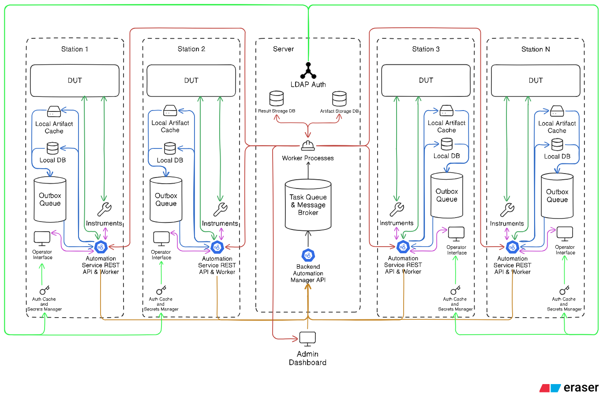
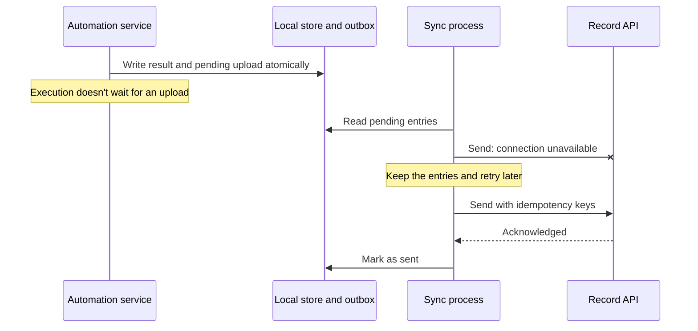
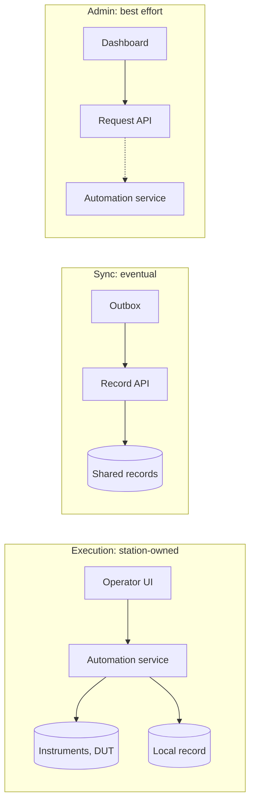

# The concept system design

This chapter looks beyond one test process to the system around it. It's a first iteration and not a final deployment plan, and its purpose is to make the operating model visible: where execution happens, where evidence lives, and what happens when a connection fails.

!!! example "Concept design"
    This is a high-level system design, not an implemented mastif deployment. The device layer and station lifecycle are built; the engine and persistent runtime are planned. Shared services in the diagram describe integration responsibilities, not a server stack shipped by mastif.

## The picture

There's a lot in there, but only one idea matters at first. Look at where the DUT and instruments connect: each station has its own automation service, right beside them. The server in the middle never touches hardware.

The drawing includes illustrative technology labels, such as LDAP. They explain the original concept, but don't prescribe an identity provider, deployment stack or physical station layout. This chapter is about the responsibilities and flows between the boxes.

## Two requirements that pull against each other

The diagram comes from taking two requirements seriously at the same time:

- **Local continuity:** a station must keep working when shared services are unavailable.
- **Deterministic recordkeeping:** the organisation must be able to reconstruct what ran and trust the stored results.

The obvious design for the second one is a central server that executes everything and treats stations as remote actuators. It's tidy: one place, one truth. It also fails the first requirement, because every network interruption becomes a stopped test. Real-time hardware coordination is precisely where partial failure is difficult to handle.

Once you accept that stations must work alone, the rest follows. **The station is the authority on what's happening now; shared storage retains the long-term record of what happened.** The record may arrive later, so a dashboard must distinguish the latest known state from the current state.

That gives us three principles:

**Local execution is authoritative.** The station coordinates hardware, pause and abort requests, and recovery. A remote view reports that state; it doesn't create a second version of it.

**Shared services provide retention and oversight.** They make evidence available across stations and support administration when reachable.

**Offline-first requires durable local state.** A station needs the inputs to run, somewhere to record its outputs, and enough execution state to recognise interrupted work. Losing the server connection must not silently lose the evidence.

## Responsibilities at the execution boundary

| Component | What it does | Why it exists |
|---|---|---|
| **DUT and instruments** | The hardware, reached through the station's control paths | Keeps hardware coordination with its owner |
| **Automation service** | Owns execution and orchestrates the hardware | The authority on run state |
| **Operator interface** | Requests actions and shows progress | Lets a person interact without owning execution |
| **Local artifact cache** | Holds test packages, configuration and limits | Makes inputs available without fetching them during a run |
| **Local record** | Holds run inputs, events, results and checkpoints | Preserves evidence and supports restart recovery |
| **Outbox queue** | Holds what still has to reach shared storage | Separates execution from connectivity |

The automation service is a logical boundary here. Inside it, the engine owns the run lifecycle and the hardware owner manages resource lifetimes. [Who owns what?](ownership.md) explains that distinction. The identity and secrets boxes in the picture are integration boundaries; their policies and implementation belong to the surrounding application.

### The outbox pattern

Suppose the station finishes a measurement and needs to tell a server. Sending it immediately creates an awkward choice when the connection fails: wait and block execution, or discard it and lose evidence.

The **outbox** separates recording from sending. The station stores the result and a pending-upload entry together, in one durable operation. A separate process sends pending entries when it can and retains them until delivery is acknowledged.

Two properties make this work. The result and pending entry are written **atomically**, so a crash can't leave a stored result with no upload scheduled. Delivery is **idempotent**: if an acknowledgement is lost and the sender retries, the receiver recognises the same record rather than creating a duplicate.

This removes a dependency on upload availability, not on every kind of storage failure. A full disk or failed local write still needs an explicit response. The system must not acknowledge evidence it failed to store. The [run-recording design](../../getting-started/tutorial/first-results/progress.md) discusses that boundary.

## Responsibilities at the shared-services boundary

| Component | What it does | The constraint on it |
|---|---|---|
| **Identity service** | Supplies identity and access-policy information | Its availability must be considered separately from hardware control |
| **Result storage** | Retains runs, outcomes and measurements | Preserves the meaning of the original evidence |
| **Artifact storage** | Retains captures, reports and versioned inputs | References identify the exact content used |
| **Backend API** | Accepts records and serves clients | Handles delayed delivery and duplicate requests explicitly |
| **Task queue and broker** | Coordinates asynchronous processing | Stays outside the hardware-control path |
| **Workers** | Validate, export and aggregate records | Never perform real-time hardware control |
| **Admin dashboard** | Shows health and history and submits requests | Reports the execution owner's state rather than inventing it |

The constraints are as important as the components. A queue is convenient, but allowing it into the execution path can make an otherwise independent station depend on a remote service. Keep the reason for each connection visible.

## Three flows

Almost all communication falls into three flows with different guarantees:

The arrows show responsibility and data flow, not a prescribed network protocol. **Execution** owns hardware interaction and records its outcome. **Sync** restores shared visibility later and tolerates duplicates. **Admin** improves operations when available; a remote abort remains a request until the execution owner reports what happened. [Operator interfaces](../operations/operator-ui.md) explains how to show that distinction.

## How this relates to direct and runtime modes

[Direct and runtime modes](execution-modes.md) answer who owns the hardware and for how long. The wider system diagram answers how execution, evidence and shared services relate. These are different choices.

A direct-mode application owns a station for its scope and can still produce records for later export. A persistent runtime keeps hardware open between clients and coordinates their access. Neither mode, by itself, requires the server-side components in this picture. The same capability contracts keep test logic independent of that choice.

## What mastif provides, and what it doesn't

mastif supplies the generic testing foundation. Its device layer, station lifecycle and result types are implemented. The engine, run records, persistent runtime and stable application API are planned. Your organisation supplies its SDK, tests and interfaces.

The broader system can build around those boundaries. An outbox, shared storage and administrative services illustrate how it can preserve local execution while making evidence useful elsewhere. They aren't current mastif APIs or a required deployment recipe. [Framework requirements](specification.md) and [project status](../status.md) describe the narrower framework scope.

??? question "Still open in this design"
    The diagram shows a local database, while the tutorial proposes a [run folder of plain files](../../getting-started/tutorial/first-results/progress.md#what-gets-saved). Files are inspectable; a transactional store can pair a result and pending upload atomically. The eventual storage interface and its acknowledgement guarantees need a separate decision. The concept diagram doesn't settle that choice.

## Recap

- **Local execution** owns the present; shared records preserve and expose what happened.
- **Durable local state** and an **outbox** can separate execution from upload availability.
- Shared services must not become hidden hardware-control dependencies.
- **Execution, sync and administration** carry different guarantees.
- This system-level concept is independent of a particular platform stack or physical station deployment.

With those responsibilities clear, we can examine how the software inside the boundaries is structured.

**Next:** [Architectural styles and patterns](styles-and-patterns.md)
