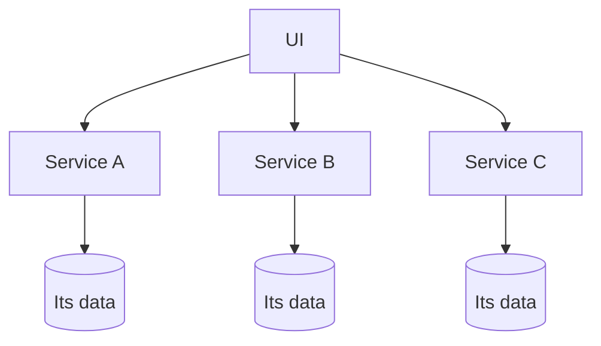
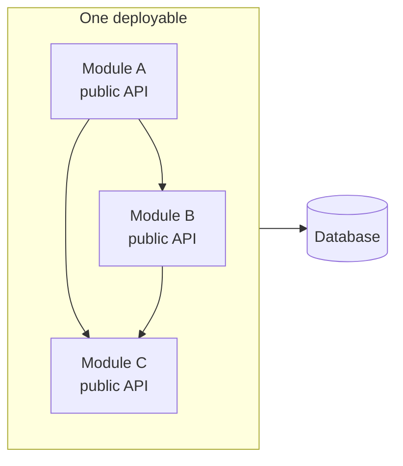
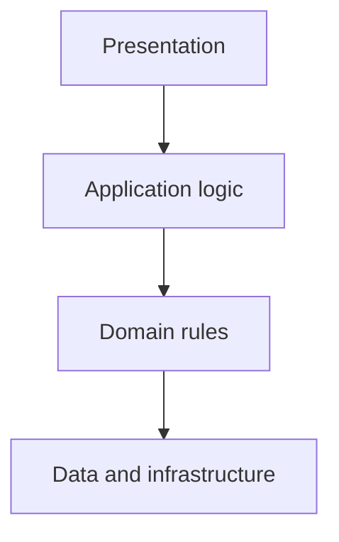
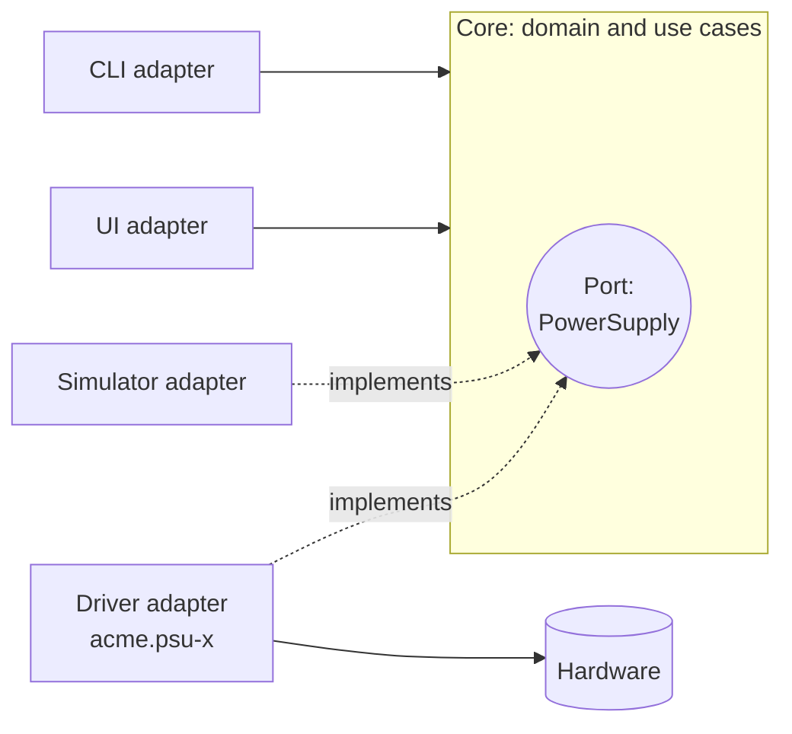
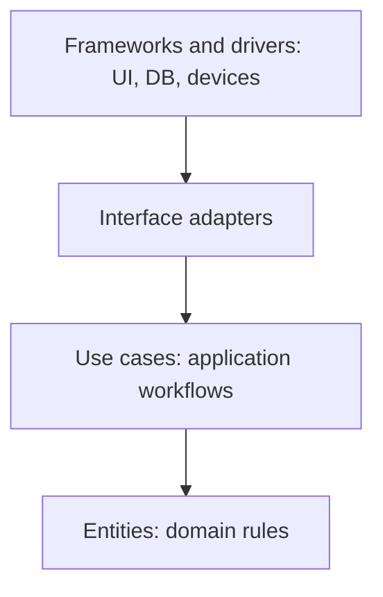

# Architectural styles and patterns

When two tests share a driver, should that driver become a service? Usually not: sharing code and sharing a running instrument are different problems. To make that distinction precise, we need to look at how software is packaged and how each piece is structured inside. There are well-known options for both, and each came about as a response to the problems of the one before. We'll go through them as a story, then explain which ideas mastif uses and why.

## Styles: what gets deployed as a unit

An **architectural style** decides what you deploy together, and so what operating costs you take on.

### Monolith

One deployable unit containing everything. It's underrated. One runtime, one release, one place to debug. When a system is young, this is a real advantage.

The limits appear as it grows. Unrelated responsibilities pile up in one artifact, every release changes everything, everyone's working in the same code, and you can't scale or replace one part alone. Most importantly, without enforced boundaries, everything gradually comes to depend on everything.

### Microservices

Many independently deployable services, each owning one responsibility and its own data.

The aim isn't to split things up for its own sake. It's *independence*: a team can change, deploy and scale one capability without coordinating a release of everything.

The price is that **complexity moves out of the code and into the system**. A function call becomes a network request, so now you've got timeouts, retries, partial failure, service discovery, versioned interfaces, and data consistency across services. That's only worth paying if you've got strong platform capabilities, and teams big enough to own services.

### Modular monolith

One deployable, with microservice-like discipline inside: strong module boundaries, explicit public interfaces, and dependencies that only go one way.

This isn't a monolith with tidy folders, since boundaries are *enforced*. Many organisations arrive here after adopting microservices before they had the platform maturity to run them. It keeps most of the benefit (ownership, isolated change, separation of concerns) without the cost of distributed systems.

### What we chose

mastif's core is a **modular monolith**, in Python packages. Layers have one-way dependencies, and `import-linter` fails the build if anything breaks that rule. [ADR-0001](../../adr/0001-layered-architecture.md) records the decision.

The repository is a **monorepo**: related packages live together, including the core and the testing kit. That is a source-management choice, not a requirement to deploy a collection of services. An application can use the existing station and resource layers in one Python process. Organisation SDKs and applications can live in their own repositories and depend on these packages.

Process separation enters where a different lifetime or failure boundary earns its cost. The planned station runtime keeps hardware open independently of its clients. A crash-prone vendor library may need its own process. [ADR-0030](../../adr/0030-execution-topology.md) explains those choices and preserves direct execution for applications that don't need them; [execution modes](execution-modes.md) works through the trade-offs.

## Patterns: how a component is structured inside

An **architectural pattern** is about the structure inside one deployable: where logic lives, and which way dependencies point.

### Layered

Separate concerns into stacked layers, with each one calling down.

The great contribution is clarity, as new engineers know where things go. The common failure is **leaky layers**. When nothing enforces the rules, infrastructure bleeds upward: domain logic starts depending on the database or a device's API. Then testing gets hard, and swapping any technology means a wide rewrite.

### Hexagonal, or ports and adapters

This responds directly to leaky layers. The domain sits in the centre, and **everything external becomes an adapter**. The core defines interfaces that it needs (ports), and the outside implements them.

The key move is that **dependencies point inward**. If that diagram looks familiar, it should. A `PowerSupply` contract is a port, and a driver is an adapter. It's the pattern at the heart of mastif's device layer, and it's why a test can run on a simulator with no changes.

### Clean architecture

A further formalisation of the same principle: concentric rings, with entities in the middle, then use cases, then interface adapters, then frameworks and drivers on the outside. Inner rings can't know about outer ones.

Beyond hexagonal, it distinguishes between *use cases* (application-specific orchestration) and the *domain* (rules that hold everywhere). It's worth the extra structure when you expect a system to evolve for years, with new workflows and integrations arriving all the time.

### Matching each component to a pattern

Different parts of a system change for different reasons, so they suit different structures:

| Component | Pattern in mastif | What it protects |
|---|---|---|
| **Kernel** | Pure domain model at the bottom of the layers | Evaluation rules that can be tested without I/O |
| **Resources** | Ports and adapters within a layer | Capability contracts while device protocols change |
| **Station** | Composition root and lifecycle owner | Wiring and cleanup that aren't repeated in each test |
| **Engine (planned)** | Orchestration above the station boundary | Task ordering and evidence independent of device models |

This is a description of responsibilities, not a requirement to apply every pattern everywhere. [ADR-0001](../../adr/0001-layered-architecture.md#10-alternatives-considered) explicitly chooses layers as the primary structure, with ports and adapters where they help.

## A framework, not a library

There's one more decision here, and we'd say it's the most important one for the station side.

What's the difference between a library and a framework? **With a library, your code calls it. With a framework, it calls your code.** That's called *inversion of control*, and it's exactly what's needed here.

If the main loop lives in each test, then every test decides how pausing, retries, cleanup and recording work, and the behaviour fragments. It's the [problem we started with](../../getting-started/intro/problem.md). The planned engine owns that loop and calls your task at defined points, giving those responsibilities one implementation:

!!! example "Engine design preview"
    Tasks, run recording and control are planned. The station lifecycle and computed result verdicts are implemented today.

| Lifecycle | What the framework defines |
|---|---|
| **Run** | How a run is created, validated and recorded before execution starts |
| **Execution** | How steps start and end, what a checkpoint is, what safe abort means |
| **Evidence** | How measurements and artifacts are associated with a run and its inputs |
| **Control** | How pause, resume and abort requests reach defined checkpoints |
| **Durability** | What a write acknowledges, what is checkpointed, and how incomplete runs are recognised |

The proposed `Task` API follows from this. Hooks are the points where the framework calls you, and `requires` and `ctx` are the contracts you use. Those boundaries make consistent behaviour possible; they don't make device calls interruptible or prove that hardware reached a safe state. The [cancellation chapter](cancellation.md) explains those limits.

### Why not build on pytest?

We looked at this carefully, and there's a real case for it. pytest offers fixtures, assertions, parametrisation, reporting and a large ecosystem, and test authors already know it. An earlier version of this design proposed building the engine as a pytest extension, as [HardPy](https://everypinio.github.io/hardpy/) does.

The current author-facing design leans towards a custom engine, closer in shape to OpenHTF and OpenTAP: loop transitions with real cost, recovery after hours of work, an explicit run state machine, and operator prompts need more than ordinary test collection. The [roadmap](../../wiki/roadmap.md#next-the-test-execution-engine) still calls for a comparison spike and an ADR before that implementation choice is settled. A driver's or a task's *own* tests still use pytest.

## Modelling the domain

One last idea. **Domain-driven design** says to structure software around real concepts from the domain, rather than around technical convenience, and to build a shared language between engineers and domain experts.

You can see that in mastif's vocabulary: station, role, DUT, measurement, verdict, run. A test engineer can read those, and they mean what they'd expect. The kernel's name also comes from here: a *shared kernel* is a small model that every part of the system deliberately agrees on.

There's a lesson here from earlier efforts in this field. Attempts to model the test domain have often got the modelling largely right, and still failed to be adopted, because a good domain model on its own didn't come with shared infrastructure, deployment and practices. The model is necessary, and it isn't enough. That's what a whole system design is for.

## Recap

- **Styles** decide what's deployed together. mastif uses modular Python packages; a monorepo doesn't require multiple running services.
- **Patterns** decide internal structure. Contracts and drivers are **ports and adapters**, with dependencies pointing inward.
- The planned engine is a **framework**: it owns the loop and calls your code, giving execution and recording a common owner.

Next, we'll look at a boundary that matters even after execution ends: the difference between measured evidence and a decision made about it.

**Next:** [Verdicts, dispositions, and audit](dispositions.md)
