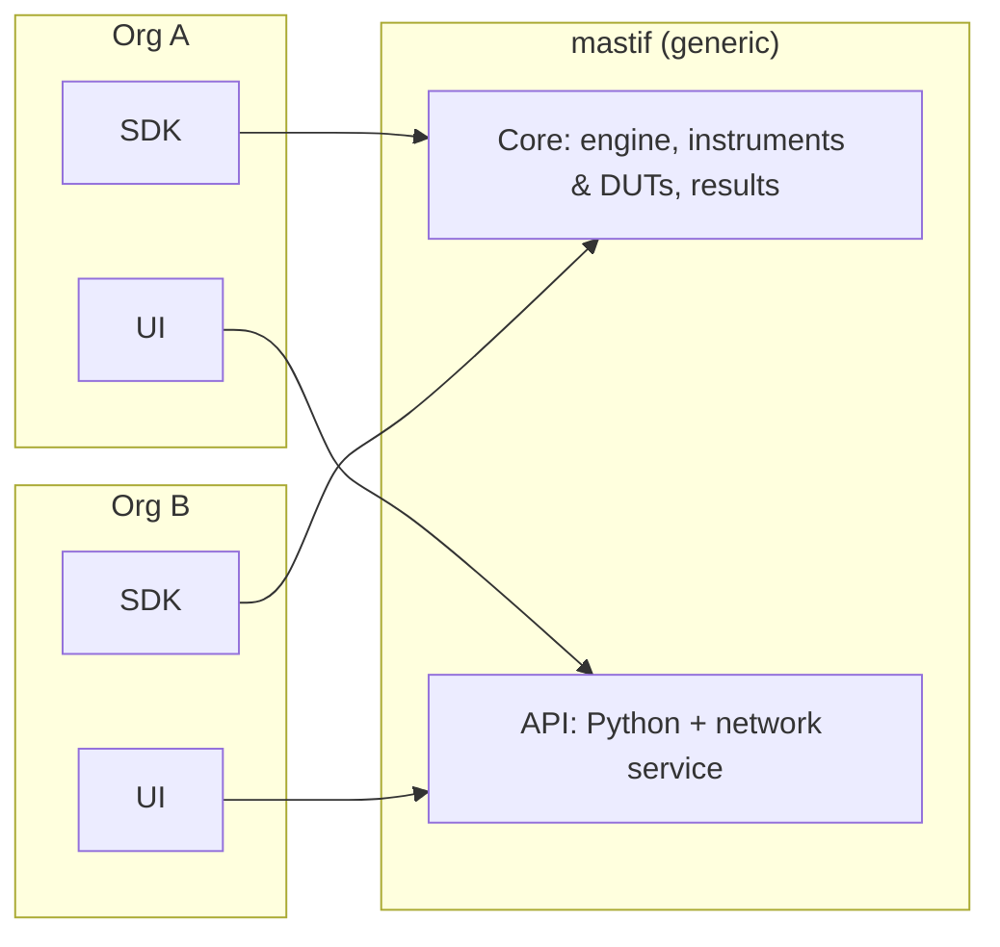
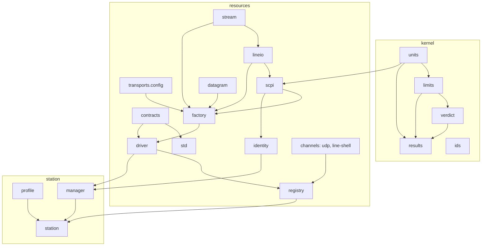

# Architecture: the system as a whole

This page explains how mastif is put together, and *why*, from first principles. The
binding decisions are ADR-0001 (layers) and ADR-0002 (errors).

## The product vision

mastif is meant to be the **generic foundation** any organisation can build test
software on:

Everything true at *every* test station goes in the core:

- values with units
- limits and verdicts
- instruments with a lifecycle
- benches described by profiles
- runs, loops and events

Everything specific to one product goes in that org's SDK: an amplifier's calibration
settings, a board's boot sequence, one vendor's instrument commands.

## The layers

| Layer | Question it answers | Built? |
|---|---|---|
| `kernel` | What do values, limits, verdicts and results *mean*? | ✓ |
| `resources` | How is a piece of hardware described, built and talked to? | ✓ |
| `station` | Which hardware is on *this* bench, under which roles, and how is it brought up and made safe? | ✓ |
| `engine` | How is a test plan run: tasks, loops, results, events, resume? | planned |
| `api` | What stable surface do test authors, SDKs and UIs use? | planned |
| `cli` | How do I run it from a terminal? | planned |

**Rule:** a layer imports only layers below it. `import-linter` enforces this in CI.

**Why layers?** Three forces:

- **Generality.** The lower layers must never learn product specifics.
- **Change isolation.** UIs and drivers change often, while verdict rules and record
  formats must not.
- **Testability.** Logic that decides things lives in pure code (the kernel). Code that
  does I/O sits at the edges.

## Extension points: where org code plugs in

| Org provides | Mechanism | Found by |
|---|---|---|
| Contracts (capabilities) | plain `typing.Protocol` | imported by the org's own drivers and tests |
| Drivers and DUT types | `@driver` / `@dut` classes | `Registry.discover()` via the `mastif.drivers` entry point |
| Station profiles | YAML files | loaded with `StationProfile.load` |
| Loop types, test packages | planned | planned entry points |

mastif **never imports org code by name**. That is what keeps the core generic.

## How the built layers connect

## Cross-cutting rules

- **Errors** are typed, layered and never replaced by sentinel values (ADR-0002, and the
  [error map](errors.md)).
- **Importing a module has no side effects.** In particular, nothing registers itself
  globally.
- **Data models** are frozen Pydantic models with `extra="forbid"`. Unknown keys are
  errors.
- **I/O is injected,** so the same code path runs with real hardware and with fakes.
- **Every docstring example is a doctest,** so documentation can't silently rot.

## Where to go next

- [Life of a station](life-of-a-station.md): all of the above as one sequence.
- [ADR index](../adr/index.md): every decision in depth.
