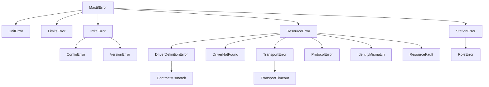

# Error map

Every exception mastif raises, in one place. For each one: what it means, a typical
cause, and what you should do. The design behind this is ADR-0002.

## Three questions to ask about any error

1. **Is it about the unit, or about the test?** No exception ever means "the unit is
   bad". That is a FAIL *verdict*. Exceptions mean "the test or setup is broken", which
   becomes ERROR.
2. **When did it happen?**
   - *Definition time* (importing org code): fix the code.
   - *Build time* (`Station.build`): fix the profile.
   - *Open time*: fix the bench.
   - *Run time*: investigate the hardware or the test.
3. **What does the message name?** Messages start with the resource, endpoint or field
   concerned.

## The catalogue

| Exception | When | Typical cause | What to do | ADR |
|---|---|---|---|---|
| `UnitError` | any time | volts compared with amps; `dBm + dBm`; a quantity against unitless limits | Fix the test or the spec. | 0003, 0004 |
| `LimitsError` | building limits or tables | a range with no bounds or `low > high`; a narrow warning range; a ragged table; an index without limits | Fix the spec. | 0004, 0006 |
| `ConfigError` | start-up | config directory or file missing; unparseable file; missing or invalid settings section; invalid logging config | Fix the configuration; the message names the file or key. | 0026, 0027 |
| `VersionError` | start-up | distribution not installed; unparseable version | Check the distribution name and installation. | 0028 |
| `DriverDefinitionError` | importing org code; `Station.build` | a bad id, `Config`, `__init__` parameter or channel; an impossible I/O combination | Fix the driver class. | 0011, 0018 |
| `ContractMismatch` | importing org code | a driver missing contract methods, or with the wrong parameters | Implement the missing members. | 0008 |
| `DriverNotFound` | `Registry.get` | a typo in the profile; the SDK isn't installed | Check the id against the listed known ids. | 0012 |
| `TransportError` | open or run | connection refused; port missing; peer closed; pyserial, pyvisa or paramiko missing; SSH host key unknown or changed; SSH authentication failed | Check cabling, addresses, extras, credentials, `known_hosts`. | 0014, 0015, 0017, 0032, 0033 |
| `TransportTimeout` | open or run | the device didn't answer in time; a Telnet login or ready prompt never appeared; an SSH command didn't finish | Check power, baud rate, prompts, terminators, command timeouts. | 0014, 0015, 0017, 0020, 0032, 0033 |
| `ProtocolError` | run | non-numeric reply; a SCPI overflow `9.9E37`; errors in the instrument queue; bad exit-code output | Check the command set, range, firmware. | 0016, 0020 |
| `IdentityMismatch` | open | the wrong device or unit; `expect:` set but the driver can't identify itself | Fix the bench, or the profile's `expect:`. | 0010, 0022 |
| `ResourceFault` | open or run | `health()` not ok; the device reports a fault | Fix or replace the instrument. | 0010, 0022 |
| `ResourceError` | `close_all`; reading an unattached channel; building a driver that needs settings without any | something didn't close cleanly; a DUT used outside a station; settings not passed | Inspect the bench; build DUTs through the station. | 0011, 0022 |
| `StationError` | loading a profile; `Station.build` | YAML or schema errors; dangling roles; unknown driver; invalid config; channel problems | Fix the profile; the message names the field. | 0021, 0023 |
| `RoleError` | preflight; `require` | unknown role; wrong contract for the role; a child that only exists after open | Map the role correctly in the profile. | 0023 |

## Who catches what

- **Test tasks:** almost never. Let errors propagate, so the verdict is honest.
- **Drivers:** translate library exceptions into `TransportError`, `TransportTimeout` or
  `ProtocolError`, adding context. Retry only idempotent queries.
- **The station:** translates build problems into `StationError` with the resource name;
  rolls back on open failure; never stops safe state early.
- **The engine and CLI (planned):** catch `MastifError` at the top, record ERROR, and
  always make the station safe.
