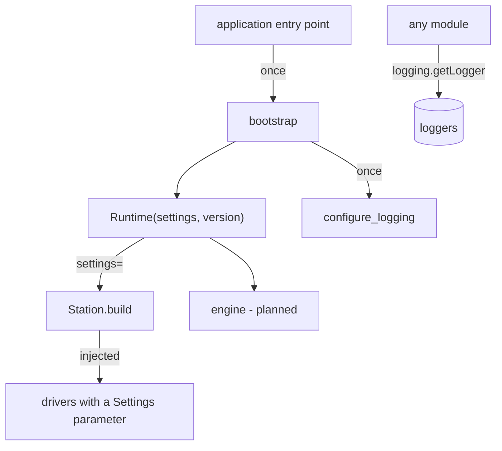

# Infra: settings, logging and version information

**Package:** `mastif.infra`. **ADRs:** 0026 (settings), 0027 (logging), 0028 (version
information), 0029 (bootstrap), 0002 (errors).

## Why it exists

Every application built on mastif needs the same plumbing:

- **configuration** loaded from files and the environment
- **logging** that serves both the operator and the engineer investigating a failure
- a record of **which software version** is running

None of this is test logic, and all of it does I/O (files, environment variables, git),
so it can't live in the pure kernel. The infra layer sits just above the kernel, so
every higher layer (resources, station, engine) can receive settings and loggers.

## The rule that shapes everything: build once, pass explicitly



There is **no global settings object**. Settings are created once, at the top of the
application, and passed to what needs them. Tests can therefore build their own settings
with no interference, and every dependency on configuration is visible in a signature.

Logging is the one exception, because Python makes it global. It is configured once, by
an explicit call, and never at import time.

## Settings (`mastif.infra.config`)

```python
from mastif.infra import create_settings, section

settings = create_settings(
    "C:/stations/bench-01/config",  # every *.toml/*.yaml/*.json/*.ini, sorted by name
    files=["C:/stations/bench-01/local.yaml"],  # machine-specific overrides
    defaults={"station": {"retries": 1}},  # lowest precedence
    envvar_prefix="ACME",  # ACME_STATION__RETRIES=5 overrides station.retries
)
settings.station.name  # dotted access (it's a Dynaconf object)
settings.get("operator.language", "en")  # with a default
```

**Precedence**, lowest to highest: `defaults` → directory files (in sorted filename
order) → `files` → environment variables. Nested sections **merge**. Number your files
(`00-base.toml`, `10-site.yaml`) to control the order.

**Typed sections**, for settings a component depends on:

```python
class StationSettings(BaseModel):
    name: str
    retries: int = 1


station_cfg = section(settings, "station", StationSettings)  # ConfigError lists every bad field
```

**In drivers**, annotate a parameter with `Settings`, and the station injects it:

```python
@driver("acme.psu-x", provides=[PowerSupply])
class PsuX:
    def __init__(self, cfg: Config, io: Scpi, settings: Settings):
        self.defaults = section(settings, "acme.psu", PsuDefaults)


station = Station.build(profile, registry, settings=settings)
```

!!! note "environments"
    `environments=True` enables `[default]`/`[production]` sections, but Dynaconf then
    *ignores every key outside those sections*. That's why it is off by default.

## Logging (`mastif.infra.logs`)

**What you get with the bundled default:**

| Destination | Level | Content |
|---|---|---|
| Console (Rich, colour-coded) | INFO+ | messages; tables as real tables |
| `mastif.log` (rotating, 10 MB × 5) | DEBUG+ | `time \| level \| logger \| message`; tables as markdown |
| `mastif.io` logger | DEBUG | instrument byte traffic, **file only** |

```python
log = logging.getLogger("acme.tests")
log.info("powering board")
log.success("power-up complete")  # extra level 25 (after configure_logging)
log.info(sweep_table)  # kernel Table → console table + markdown in file
log.info(df, extra={"title": "Raw data"})  # pandas DataFrame (pip install 'mastif[pandas]')
```

**Customising:** put a standard `logging.yaml` (`dictConfig` format) in your config
directory, or a `logging:` section in your settings. Copy
`mastif/infra/default_logging.yaml` as a starting point. Relative log-file names are
placed under `log_dir`.

## Version information (`mastif.infra.version`)

```python
info = VersionInfo.load("acme-sdk")
print(info)  # acme-sdk 1.2.0 | abc1234 on main | uncommitted changes
info.git.source  # "embedded" (installed wheel), "runtime" (git checkout) or "unavailable"
```

Wheels carry their commit, embedded at build time by `packages/mastif/hatch_build.py`.
Org SDKs can copy that file, changing `PACKAGE`. Development checkouts ask git live.
Missing information is stated as missing. There is never a fake `0.0.0`.

## Bootstrap (`mastif.infra.bootstrap`)

All of the above in the right order, in one call. See the
[bootstrap guide](guides/bootstrap-an-application.md).

## Where to look

| What | Where |
|---|---|
| Code | `packages/mastif/src/mastif/infra/` |
| Build hook | `packages/mastif/hatch_build.py` |
| API | [reference](../reference/infra.md) |
