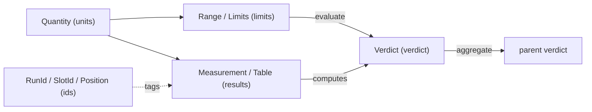

# The kernel: the vocabulary everything speaks

**Package:** `mastif.kernel`. **ADRs:** 0003 (units), 0004 (limits), 0005 (verdicts),
0006 (results), 0007 (ids), 0002 (errors).

## Why it exists

Every other layer has to agree on what a value, a limit, a verdict and a result *are*.
If each layer had its own idea, results would be judged differently in the engine and
in a report. The kernel is that shared agreement.

It is **pure**: no I/O, no threads, no hardware. That makes it the easiest part to
test, and the hardest to break. The name comes from the "shared kernel" idea in
domain-driven design: a deliberately small model that every part of the system depends
on.

## How the pieces relate



## The modules in one minute each

### `units`: values carry their unit

```python
from mastif.kernel.units import A, V, mA, mV, GHz, dB, dBm

12 * V  # Quantity(value=12.0, unit='V')
(2.4 * GHz).to("MHz")  # 2400 MHz
300 * mA < 1 * A  # True: compared after conversion
10 * dBm + 3 * dB  # 13 dBm (a level plus a gain)
10 * dBm + 3 * dBm  # UnitError: adding two levels means nothing
```

Unknown units (`Unit("psi")`) just work, converting only to themselves. NaN is
refused. Why mastif doesn't use pint: ADR-0003.

### `limits`: what is acceptable

```python
from mastif.kernel.limits import Limits, IndexedLimits, evaluate

supply = Limits.between(4.75 * V, 5.25 * V, warn_low=4.5 * V, warn_high=5.5 * V)
evaluate(5.4 * V, supply)  # Verdict.WARN
evaluate(5400 * mV, supply)  # also WARN: converted first
```

There are three zones: inside the passing range is PASS, inside the wider warning
range is WARN, and anything else is FAIL. `IndexedLimits` give per-channel limits, and
an index that isn't listed is an error unless a default was given.

### `verdict`: one answer at every level

`PASS, WARN, FAIL, ERROR, SKIPPED, ABORTED`. `aggregate` takes the worst. **ERROR is
not FAIL**: ERROR means the test broke (retest the unit), FAIL means the unit is bad.

### `results`: evidence that can't lie

```python
from mastif.kernel.results import Measurement, Check, Table

Measurement("idle_current", 180 * mA, Limits.at_most(250 * mA)).verdict  # PASS
Check(name="fw", passed=False, detail="expected 2.1, got 2.0").verdict  # FAIL
```

Verdicts are computed and can never be passed in. A stored verdict is recomputed on
load. Tables judge every cell, and pick per-row limits through `index` +
`IndexedLimits`.

### `ids`: where data came from

`new_run_id()` gives `"20261021T090000Z-3fa9c2"`. `Position.of(profile="std",
channel=2)` names the current point in a plan's nested loops. `SlotId` names a DUT slot;
it defaults to `"0"`.

### `errors`: the root of the hierarchy

`MastifError`, plus `UnitError` and `LimitsError`. mastif errors are deliberately not
`ValueError`s, so Pydantic can't swallow them (ADR-0002).

## Things that surprise newcomers

- **Bare numbers.** `evaluate(5.0, limits)` treats a bare number as being in the
  limits' unit, which is convenient for raw readings. A *quantity* against *unitless*
  limits is an error, because mastif refuses to guess.
- **Empty aggregation.** `aggregate([])` is SKIPPED, not PASS. Nothing was verified.
- **Tables and bools.** In a table, a bool cell in a judged column is FAIL, because
  bools aren't numbers.

## Where to look

| What | Where |
|---|---|
| Code | `packages/mastif/src/mastif/kernel/` |
| Tests | `packages/mastif/tests/kernel/`, plus every docstring |
| API | [reference](../reference/kernel/index.md) |
