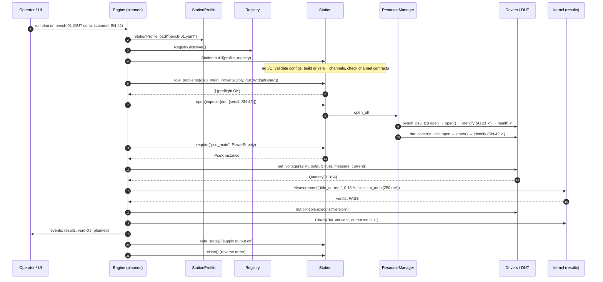

# Life of a station: one run, end to end

This page follows a single bench from a YAML file to recorded results and a safe
shutdown. It shows how every built module takes part. Steps marked *(planned)* belong
to the engine, which isn't built yet. They are shown so you can see where today's code
is heading.

## The cast

- **Profile** `bench-01.yaml`: a power supply (`bench_psu`) and a DUT (`dut`). The DUT
  has a serial console and a UDP control channel.
- **Org SDK**: the `acme.psu-x` driver and the `demo.widget-board` DUT type, advertised
  through the `mastif.drivers` entry point.
- **Test**: "power the board at 12 V, idle current ≤ 250 mA, firmware version is 2.1".

```yaml
station: bench-01
resources:
  bench_psu:
    driver: acme.psu-x
    config: {transport: {kind: tcp, host: 10.0.0.5, port: 5025}}
    expect: {serial: A123}
  dut:
    driver: demo.widget-board
    channels:
      console: {driver: mastif.line-shell,
                config: {transport: {kind: serial, port: COM3, baudrate: 115200}, prompt: "# "}}
      ctrl:    {driver: mastif.udp,
                config: {transport: {kind: udp, host: 192.168.1.50, port: 9000}}}
roles: {psu_main: bench_psu}
```

## The whole flow



## Step by step, and which module does what

1. **Load the profile.** `StationProfile.load` (ADR-0021) parses the YAML and checks
   names, roles and sim keys. A typo stops everything here, with the file and field
   named.
2. **Discover drivers.** `Registry.discover` (ADR-0012) reads the entry points of the
   installed packages. `mastif.line-shell` and `mastif.udp` are always there.
3. **Build the station, still without I/O.** `Station.build` (ADR-0023) runs once per
   resource:
   - it looks up the driver
   - `build_resource` (ADR-0011) validates `config:` against the driver's `Config`
   - `build_io` (ADR-0018) creates an unopened `Scpi(StreamLineIO(TcpTransport))`
     (ADR-0014–0016)
   - for the DUT, it builds each channel, checks the channel driver provides `Shell` or
     `MessageChannel`, and attaches it as `board.console` / `board.ctrl`
4. **Preflight** *(engine planned)*. The engine collects the roles its tasks need, and
   calls `role_problems`. A bench without a power supply under `psu_main` is reported
   before anything is energised.
5. **Open.** The `ResourceManager` (ADR-0022) works in profile order. For each resource
   it opens the I/O, then the channels, calls `open()`, checks `identify()` against
   `expect:` (and the operator's scanned serial), checks `health()`, and finally
   collects `children()`. If the DUT reports SN-41 instead of SN-42, an
   `IdentityMismatch` is raised, the supply is closed again, and nothing is tested on
   the wrong unit.
6. **Run tasks** *(engine planned)*. Tasks get hardware only with `require(role,
   Contract)`. Values come back as `Quantity` (ADR-0003). Results judge themselves
   (ADR-0004–0006).
7. **Record** *(engine planned)*. Every result becomes an event tagged with the run id,
   slot and position (ADR-0007).
8. **Make safe.** `safe_state()` turns the supply output off. It uses the contract's
   declared action, or the driver's own `safe_state`. It continues past any device that
   fails to respond.
9. **Close** in reverse: DUT channels, then the DUT, then the supply, then their
   sockets and ports.

## What happens when things go wrong

| Failure | Where it surfaces | What the system does |
|---|---|---|
| Typo in the profile | step 1 or 3, `StationError` | Nothing opened. The message names the field. |
| Driver not installed | step 3, `StationError` wrapping `DriverNotFound` | Nothing opened. Known ids are listed. |
| Wrong unit in the fixture | step 5, `IdentityMismatch` | Already-opened resources are closed. Nothing is tested. |
| Supply over-temperature | step 5, `ResourceFault` | Same. |
| Cable pulled mid-test | step 6, `TransportTimeout` | The task gets ERROR (planned); the station is made safe and closed. |
| Value out of limits | step 6, `Measurement.verdict == FAIL` | Recorded as FAIL. The run continues or stops according to the plan's policy (planned). |
| One device stuck during shutdown | step 8 | The failure is returned. Every other device is still made safe. |

## Try it today, without the engine

```python
from mastif.resources.registry import Registry
from mastif.resources.std import PowerSupply
from mastif.station import Station, StationProfile
from mastif.kernel import Measurement, Limits
from mastif.kernel.units import V, mA

station = Station.build(StationProfile.load("bench-01.yaml"), Registry.discover())
with station:  # open … safe_state + close
    psu = station.require("psu_main", PowerSupply)
    psu.set_voltage(12 * V)
    psu.output(True)
    m = Measurement("idle_current", psu.measure_current(), Limits.at_most(250 * mA))
    print(m.verdict)
```
