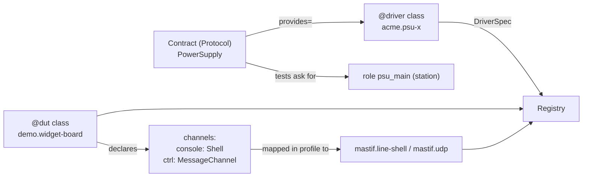
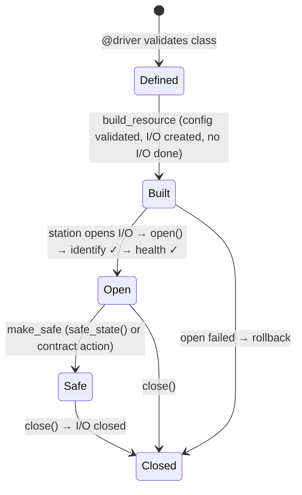

# Resources: describing hardware and talking to it

**Package:** `mastif.resources`. **ADRs:** 0008 (contracts), 0009 (standard contracts),
0010 (identity and health), 0011 (drivers and DUTs), 0012 (registry), 0019–0020
(built-in channels). For transports, see the [Transports](transports.md) page.

## Why it exists

Hardware is the most variable part of a test system. Models differ per bench, get
replaced over the years, and sometimes have to be simulated. This layer gives a fixed
**shape** to that variability:

- **Contracts** say what a test needs ("set a voltage, measure a current").
- **Drivers** say how one specific device does it.
- **DUT types** describe the product being tested, and its ways in (channels).
- The **registry** finds the drivers an org has installed.

Nothing in this layer knows about any particular bench. That is the station's job.

## The four concepts, and how they connect



### Contracts

A contract is a plain `typing.Protocol`. Defining one doesn't need a mastif import:

```python
class PowerSupply(Protocol):
    def set_voltage(self, voltage: Volts) -> None: ...
    def measure_current(self) -> Amps: ...
```

mastif checks contracts **structurally**: every member must exist, with compatible
parameters. The check happens at two points:

- when a driver is defined, against its `provides=`
- when a test asks for a role

Problems are reported as `ContractProblem(member, ProblemKind)`. `@contract(safe_state=...)`
can declare how to make any provider safe.

The built-in starter set in `mastif.resources.std`:

- for instruments: `PowerSupply`, `SignalSource`, `PowerMeter`, `Switch`, `Relay`,
  `DigitalIO`, `Axis`
- for DUTs: `Shell` and `MessageChannel`

They are small on purpose. Extend or replace them.

### Drivers

```python
@driver("acme.psu-x", provides=[PowerSupply])
class PsuX:
    class Config(DriverConfig):
        transport: TcpConfig  # where it is: from the profile

    def __init__(self, cfg: Config, io: Scpi):  # io is built and injected
        self.io = io

    def identify(self) -> Identity:
        return self.io.identify()  # optional hook

    def set_voltage(self, voltage):
        self.io.write(f"VOLT {voltage.magnitude('V'):.4f}")

    ...
```

- **No base class, no registration.** The decorator validates the class (id, Config,
  contracts, `__init__` parameters) and attaches a `DriverSpec`.
- **What `__init__` can receive:** the validated config, injected I/O (`StreamTransport`,
  `LineIO`, `Scpi`, `DatagramChannel`) and a `logging.Logger`. Nothing else, unless the
  parameter has a default.
- **Optional hooks:** `open`, `identify`, `health`, `safe_state`, `close`, `children`.
  The station calls them in a fixed, safe order.

### DUT types and channels

```python
@dut("demo.widget-board", state=BoardState)
class WidgetBoard:
    console: Shell = channel()
    ctrl: MessageChannel = channel(optional=True)
    state: BoardState  # annotate it, so type checkers know
```

The station builds each channel as a resource of its own, from the profile. It checks
that the channel provides the declared contract, and attaches it before the DUT's
`open()` runs. Common channels need no code:

- `mastif.line-shell` turns a prompt-based console into a `Shell` (ADR-0020).
- `mastif.udp` turns a UDP peer into a `MessageChannel` (ADR-0019).

### Identity and health

`identify() -> Identity(vendor, model, serial, revision, extra)` is compared with the
profile's `expect:` before use. `health() -> Health(ok, detail, readings)` must be ok.
Together they ensure mastif never drives the wrong device, or a faulty one.

### The registry

```toml
# in your SDK's pyproject.toml
[project.entry-points."mastif.drivers"]
acme = "acme_sdk.drivers"
```

`Registry.discover()` reads those entry points when it is called, never at import time.
Duplicate ids are errors. `Registry([MyDriver], builtin=False)` gives an isolated
registry for tests.

## Lifecycle of one driver object



## Where to look

| What | Where |
|---|---|
| Code | `packages/mastif/src/mastif/resources/` |
| Guides | [Write a driver](guides/write-a-driver.md), [Write a DUT type](guides/write-a-dut.md) |
| API | [reference](../reference/resources.md) |
