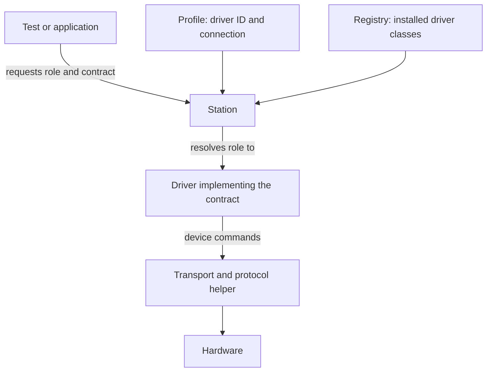

# Resources: connect capabilities to hardware

A test needs a current reading. Today it comes from a bench supply over TCP; next
year it may come from a different model over a vendor library. The test's acceptance
rule has not changed. Why should its device communication code change with it?

The resources layer separates **the capability a test needs** from **the commands
a particular device understands**. Station composition then selects the devices and
connections for a particular bench.

!!! info "Scope of this page"
    This page describes the current resource implementation. Engine/runtime integration
    remains planned. Lifecycle expansion and other resource design changes should be
    recorded in new or superseding decisions before they become implementation claims.

## One request, several responsibilities

Consider a test that needs to set a voltage and measure current:

| Concept | Question it answers | Example |
|---|---|---|
| **Contract** | What operations does the test need? | `PowerSupply` |
| **Driver** | How does this device implement those operations? | An organisation's `acme.psu-x` class |
| **Transport / protocol helper** | How are commands delivered and replies decoded? | TCP carrying SCPI commands |
| **Profile** | Which device and connection are on this bench? | Driver ID, host, port, expected serial |
| **Role** | What name does the test use for the capability? | `psu_main` |

A **resource** is an object the station manages, such as an instrument, a device under
test (DUT), or one of that DUT's communication channels. The
[glossary](glossary.md) defines the wider vocabulary.



These arrows describe requests and composition, not module imports. Diagram context:
[contracts](../adr/0008-contracts.md), [driver registry](../adr/0012-driver-registry.md),
[profiles](../adr/0021-station-profile.md), and
[station composition](../adr/0023-station-composition-root.md).

## 1. Describe a capability with a contract

A contract is a Python `Protocol`: an interface described by its members rather than
by requiring every implementation to inherit from one base class. An organisation
can define a plain protocol without importing mastif. The built-in contracts use
mastif quantities so their physical values retain units.

For common power-supply operations, use the existing contract:

```python
from mastif.resources.std import PowerSupply
```

The built-in set also includes `SignalSource`, `PowerMeter`, `Switch`, `Relay`,
`DigitalIO`, and `Axis`. They are starting points; an organisation can define additional
capabilities. See [Standard contracts](../adr/0009-standard-contracts.md).

mastif checks members and compatible signatures when a driver declares `provides=`
and when a station resolves a requested role. This can detect a missing method;
it cannot prove that the device's physical behaviour is correct.

**Design:** [Contract validation](../adr/0008-contracts.md).
**API:** [Contract reference](../reference/resources/contracts.md).

## 2. Implement the device-specific behaviour

A driver translates capability calls into commands for one device model. Its
`@driver` decorator validates the declaration and attaches a specification; it does
not add the class to a global registry or open a connection.

The driver receives validated configuration and injected I/O. For example, a driver
using **SCPI** (Standard Commands for Programmable Instruments) receives a `Scpi`
helper rather than constructing its own socket. This keeps device commands separate
from connection setup and makes fake I/O usable in tests.

**Try it:** [Write a driver](guides/write-a-driver.md) contains a complete driver example.
**Design:** [Drivers and DUTs](../adr/0011-drivers-and-duts.md) and
[I/O injection](../adr/0018-io-injection.md).

## 3. Describe a DUT and its channels

A DUT may expose several independent ways to interact with it: a console, a message
interface, or another device-specific connection. A **channel** describes one such
interface using a contract. The station builds the channel resource and attaches it
before calling the DUT's `open()` hook.

Existing channel drivers include:

| Channel driver | Interface | Use it for |
|---|---|---|
| `mastif.line-shell` | `Shell` | A prompt-based console over serial, TCP, Telnet, or interactive SSH |
| `mastif.ssh-shell` | `Shell` | Separate SSH commands with exit codes and stderr |
| `mastif.udp` | `MessageChannel` | A UDP request/reply interface |

**Guide:** [Write a DUT type](guides/write-a-dut.md).
**Decisions:** [Line shell](../adr/0020-builtin-line-shell.md),
[SSH shell](../adr/0034-builtin-ssh-shell.md), [UDP channel](../adr/0019-builtin-udp-channel.md).

## 4. Check what is connected

Connection success does not mean the intended device is connected. A driver may
implement `identify()` to report an [`Identity`][mastif.resources.identity.Identity].
The station compares configured `expect:` fields with that report.

```python
from mastif.resources.identity import Identity

connected = Identity(vendor="ACME", model="PSU-X", serial="B999")
print(connected.mismatches({"serial": "A123"}))
# {'serial': ('A123', 'B999')}
```

`mismatches()` returns differences; it does not raise the station exception itself.
During bring-up, the manager turns a mismatch into
[`IdentityMismatch`][mastif.resources.errors.IdentityMismatch]. Expectations without
an available identity also fail verification. Without expectations, identity matching
does not restrict the connected device.

A driver's optional `health()` hook returns [`Health`][mastif.resources.identity.Health].
An explicit `ok=False` causes a `ResourceFault`. This reports what the driver checks
at that moment; it is not continuous monitoring or proof of physical safety.

**Reference:** [Identity and health](../reference/resources/identity.md).
**Decision:** [Identity and health model](../adr/0010-identity-and-health.md).

## 5. Let the station coordinate the lifecycle

Driver hooks describe device-specific actions. The station's resource manager decides
when to call them:

1. Open injected I/O and DUT channels.
2. Call the driver's `open()` hook, if present.
3. Verify identity, then check health if those hooks are available.
4. Collect child resources and mark bring-up complete.
5. When requested, attempt safe-state actions; separately, close resources in reverse order.

!!! note "Opening, making safe, and closing are distinct operations"
    Identity is checked **after** `open()`, so it cannot prevent commands that the
    driver's opening hook already sent. Closing a transport does not prove the
    instrument's output is off. Safe-state actions and cleanup may themselves fail.
    [ADR-0022](../adr/0022-resource-manager.md) specifies the current guarantees and limits.

## Find installed drivers

An organisation advertises driver modules through Python entry points:

```toml title="Your SDK's pyproject.toml"
[project.entry-points."mastif.drivers"]
acme = "acme_sdk.drivers"
```

`Registry.discover()` reads these entry points when explicitly called. For isolated
tests, construct a registry from a chosen set of classes instead of discovering the
whole environment. Duplicate driver IDs are errors.

**Decision:** [Driver registry](../adr/0012-driver-registry.md).

## Continue learning

- [Transports](transports.md): choose the appropriate communication boundary.
- [Station](station.md): assemble resources into a bench and resolve roles.
- [Test your driver](guides/test-your-driver.md): verify behaviour without hardware.
- [Life of a station](life-of-a-station.md): follow composition and execution together.
