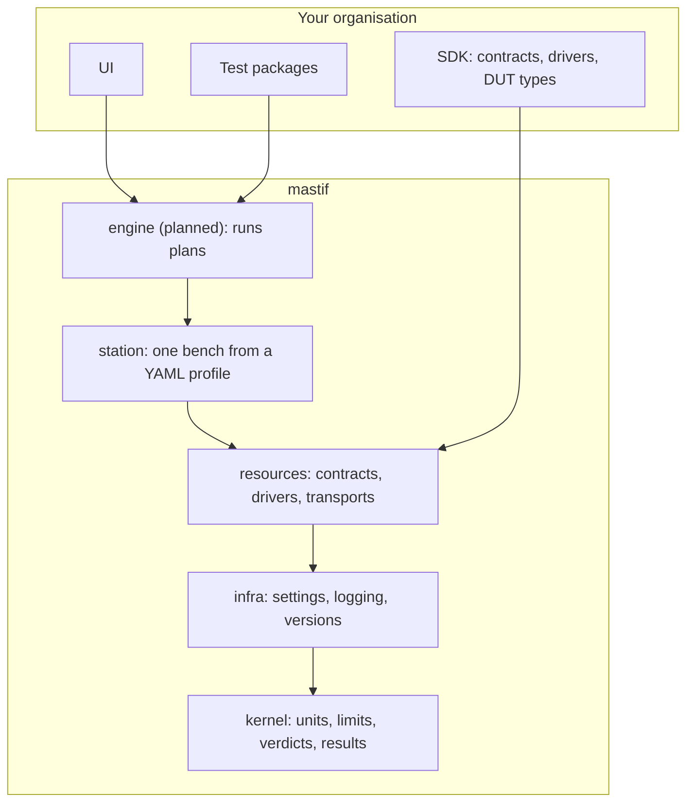

# Start here: your first day on mastif

Welcome. This page gets you from zero to "I know where things are and why". It takes
about 30 minutes. Read it in order.

## 1. What problem are we solving?

Picture a production test station:

- a **bench** with instruments: a power supply, an RF generator, a switch matrix,
  a relay board
- a **fixture** holding the **device under test (DUT)**, e.g. a circuit board, connected
  over a serial console and a UDP control port

A test engineer writes **tests**, like "power the board at 12 V, check the idle current
is under 250 mA, read the firmware version, sweep the output power on 8 channels". An
operator presses *start*. The station runs the tests and records the results, and the
unit is shipped or rejected.

The software behind this must:

1. **Talk to many kinds of hardware**, which differs from bench to bench and changes
   over the years.
2. **Run test plans** in the right order, with loops ("for each channel"), retries,
   operator prompts and safe aborts.
3. **Record evidence you can trust:** numbers with units, the limits they were judged
   against, and verdicts that cannot contradict the data.
4. **Never leave hardware in a dangerous state**, whatever fails.

Most companies build this from scratch, tangled up with their product. mastif is the
**generic** part, done once and done well. Companies add only what is genuinely theirs.

## 2. The big picture in one diagram



Dependencies only point **down**. Org code is **plugged in**, never imported by name.
Details: [Architecture](architecture.md) and ADR-0001.

## 3. Five ideas that explain most of the code

1. **Values carry units.** Write `12 * V`, never `12`. A reading in A is compared
   correctly against a limit in mA. Mixing volts with amps raises an error. (ADR-0003)
2. **Results judge themselves.** A `Measurement(value, limits)` computes its verdict and
   cannot be given one. ERROR ("the test broke") is not FAIL ("the unit is bad").
   (ADR-0004–0006)
3. **Tests ask for capabilities, by role.** A test needs "something that can set a
   voltage", which is a **contract**, under a **role** name like `psu_main`. The
   station decides which actual driver plays that role. (ADR-0008, ADR-0023)
4. **Drivers say what to send; profiles say where it goes.** A driver is a small class
   marked `@driver`. Connections are injected from the station's YAML profile.
   (ADR-0011, ADR-0018, ADR-0021)
5. **Lifecycle and safety are central.** The station opens everything in order,
   checks identity and health, rolls back on failure, and always reaches a safe state.
   Nobody else has to get this right. (ADR-0022)

## 4. Set up and run everything

```bash
cd mastif-oss
uv sync --all-groups          # creates .venv with everything
uv run pytest                 # ~330 tests incl. every docstring example
uv run ruff check . && uv run ruff format --check .
uv run ty check               # static types
uv run lint-imports           # layer rules
uv run mkdocs serve           # this wiki at http://127.0.0.1:8000
```

## 5. Where things live

```
mastif-oss/
├── packages/
│   ├── mastif/src/mastif/
│   │   ├── kernel/        units, limits, verdict, results, ids, errors
│   │   ├── infra/         config (settings), logs, version, bootstrap, errors
│   │   ├── resources/     contracts, std, identity, driver, registry, errors
│   │   │   ├── transports/   config, stream, lineio, scpi, datagram, factory
│   │   │   └── channels/     built-in mastif.udp and mastif.line-shell
│   │   └── station/       profile, station, manager, errors
│   └── mastif-testing/src/mastif_testing/   fakes, conformance
├── docs/
│   ├── adr/               one decision record per module (+ cross-cutting)
│   ├── wiki/              you are here
│   └── reference/         generated API pages
├── AGENTS.md              engineering rules (read it)
└── CONTRIBUTING.md        git flow, commits, versioning, checklist
```

## 6. A guided reading path

| Order | Read | Why |
|---|---|---|
| 1 | [Architecture](architecture.md) | The layers and the rules between them |
| 2 | [Kernel](kernel.md) | The vocabulary everything else speaks |
| 3 | [Infra](infra.md) | Settings, logging and versions: how an application starts |
| 3b | [Resources](resources.md) and [Transports](transports.md) | How hardware is described and reached |
| 4 | [Station](station.md) | How a bench comes together and stays safe |
| 5 | [Life of a station](life-of-a-station.md) | Everything above, as one flow |
| 6 | [Write a driver](guides/write-a-driver.md) | Do it yourself |
| 7 | [Working on mastif](working-on-mastif.md) | Conventions before your first change |

## 7. Rules you will be held to

These come from `AGENTS.md`:

- **Build from scratch.** Other projects can inspire you, but never copy code from
  them. No employer or customer identifiers anywhere.
- **Fakes, not mocks.** Every docstring has a runnable example, which pytest executes.
- **Every new module ships with its own complete ADR and wiki updates,** in the same
  branch.
- **Follow the git flow.** Work on `feature/*` branches and write Conventional Commits.
  Never commit to `main` or `develop` directly.
