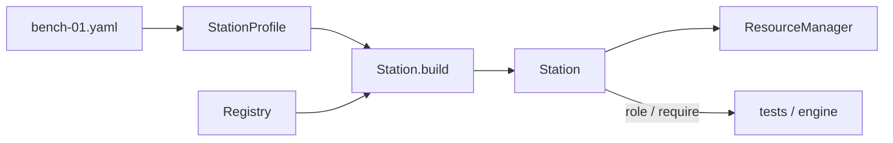
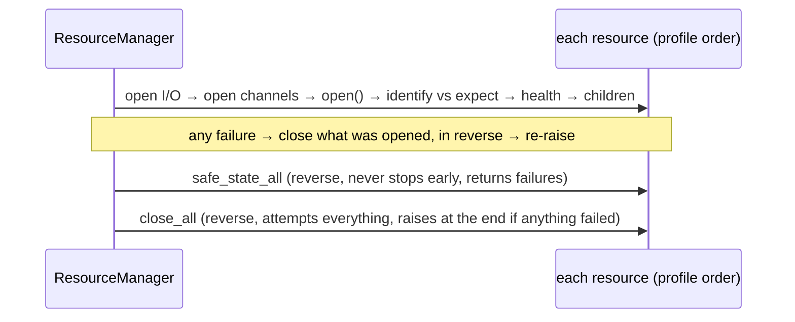

# Station: one physical bench, built and kept safe

**Package:** `mastif.station`. **ADRs:** 0021 (profile), 0022 (resource manager), 0023
(composition root and roles).

## Why it exists

Drivers describe devices in general. A **station** is a particular bench: these
instruments, at these addresses, with these serial numbers, known to tests by these role
names. The station layer turns a YAML description of that bench into live objects, and
owns their lifecycle. The lifecycle matters most for safety: ordered bring-up,
verification, rollback, safe state and shutdown.

## Three parts



### 1. The profile: facts as data

```yaml
station: bench-01
resources:                       # opened top to bottom, closed bottom to top
  bench_psu:
    driver: acme.psu-x
    config: {transport: {kind: tcp, host: 10.0.0.5, port: 5025}}
    expect: {serial: A123}       # must match identify() before use
  dut:
    driver: demo.widget-board
    channels:
      console: {driver: mastif.line-shell, config: {transport: {kind: serial, port: COM3}, prompt: "# "}}
roles:
  psu_main: bench_psu            # tests say "psu_main", never "bench_psu"
  console: dut.console           # roles can point at DUT channels or children
sim:
  bench_psu: {driver: demo.psu-sim}   # used when building with sim=True
```

No control flow belongs in profiles. Loading validates names, roles and sim keys, and
reports every problem with its location.

### 2. `Station.build`: wire everything, touch nothing

For each resource, the build looks up the driver, validates `config:`, creates (but
doesn't open) the I/O, builds the DUT channels, and checks that each provides its
declared contract. Every mistake becomes a `StationError` naming the resource. **No I/O
happens**, so profiles can even be validated in CI.

Tests reach hardware through roles:

```python
psu = station.require("psu_main", PowerSupply)  # RoleError if the bench can't serve it
station.role_problems({"psu_main": PowerSupply, "console": Shell})  # preflight list
```

### 3. The resource manager: the safety-critical lifecycle



The operator's scanned serial is checked with `station.open(expect={"dut": {"serial":
"SN-42"}})`.

As a context manager, the station opens on entry. On exit it runs **safe state, then
close**, even if your code raised.

## Guarantees you can rely on

- A failed open leaves nothing open.
- Identity is checked before anything else is done to a device.
- Safe state reaches every open resource, even if some of them fail.
- Close attempts every step of every open resource.
- Every step is emitted as a `ResourceEvent` for UIs and logs.

## Where to look

| What | Where |
|---|---|
| Code | `packages/mastif/src/mastif/station/` |
| Guide | [Write a station profile](guides/write-a-station-profile.md) |
| Flow | [Life of a station](life-of-a-station.md) |
| API | [reference](../reference/station/index.md) |
