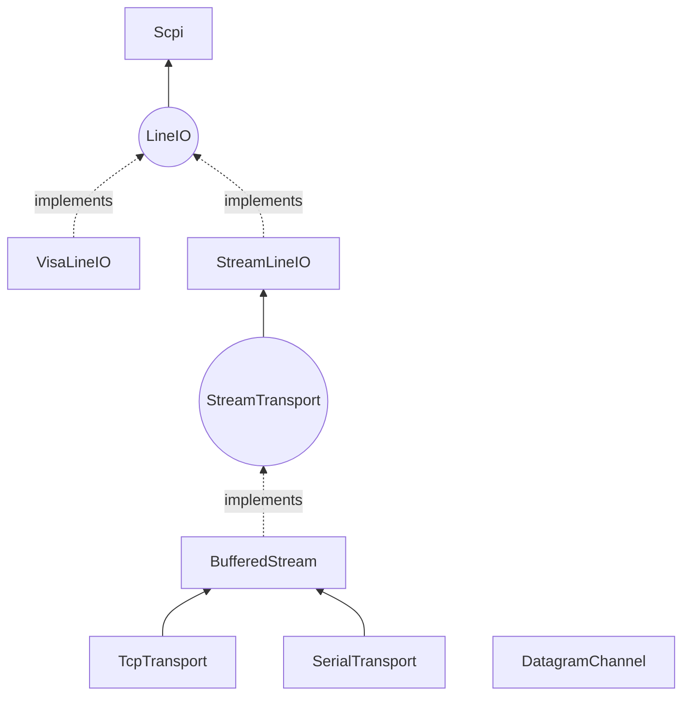
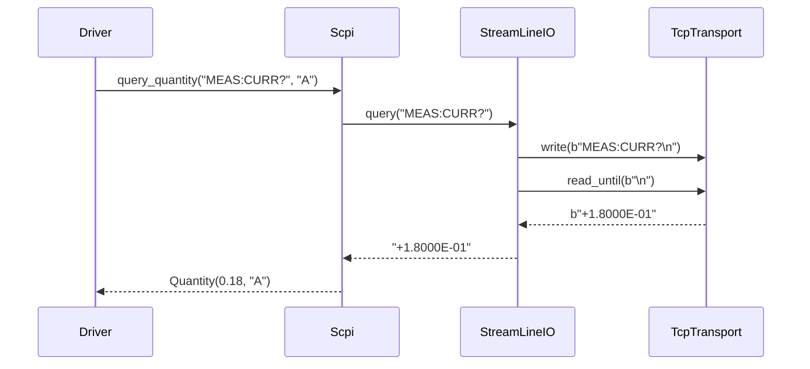

# Transports: how bytes and messages reach devices

**Package:** `mastif.resources.transports`. **ADRs:** 0013 (configs), 0014 (streams),
0015 (line I/O), 0016 (SCPI), 0017 (datagrams), 0018 (injection).

## Why it exists

Drivers need to talk to devices over TCP, serial, VISA or UDP. Each medium has its own
library, its own errors, and its own ways of losing or merging data. If every driver
handled this itself, there would be dozens of slightly different, slightly wrong
implementations. The transports layer handles it once:

- **Framing:** partial reads and back-to-back replies are handled correctly.
- **Timeouts that raise:** a silent device never hangs a run.
- **Typed errors:** `TransportError`, `TransportTimeout`, `ProtocolError`.
- **I/O tracing** through the station's logger.
- **Injection:** drivers never construct connections.

## The stack



| You need to… | Ask for | Built from `kind` |
|---|---|---|
| speak a binary protocol | `io: StreamTransport` | tcp, serial |
| speak a text-line protocol | `io: LineIO` | tcp, serial, visa |
| drive a SCPI instrument | `io: Scpi` | tcp, serial, visa |
| exchange UDP messages | `io: DatagramChannel` | udp |

## Configs: where a device is

Configs live in the station profile under the driver's `config.transport`, and `kind`
picks the model:

```yaml
transport: {kind: tcp, host: 10.0.0.5, port: 5025, timeout: 2.0}
transport: {kind: serial, port: COM3, baudrate: 115200, read_termination: "\r\n"}
transport: {kind: visa, resource: "USB0::0x1234::0x5678::A123::INSTR"}
transport: {kind: udp, host: 192.168.1.50, port: 9000, local_port: 9001}
```

Unknown keys, bad ports and impossible stop bits are rejected before anything opens.
Serial and VISA need the extras: `pip install 'mastif[serial]'` or `'mastif[visa]'`.

## Behaviours worth knowing

**Streams** (ADR-0014):

- `read_until` keeps any bytes after the terminator for the next read.
- Timeouts cover the whole read.
- `write("text")` encodes, but **never adds a terminator**, because binary protocols
  would break. `LineIO.write_line` adds it.

**SCPI** (ADR-0016):

- `query_float` rejects the instrument's overflow marker `9.9E37`, so an over-range
  reading becomes an error, never a huge "valid" number.
- `identify()` parses `*IDN?`.
- `errors()` drains `SYST:ERR?`.
- `Scpi(io, check_errors=True)` checks for errors after every write.

**Datagrams** (ADR-0017):

- A background thread reads everything.
- `request(msg, match=...)` registers a waiter **before** sending, and returns the first
  datagram the matcher accepts.
- Unsolicited messages go to subscribers, and never get mistaken for replies.
- Retries resend on timeout.
- A failing subscriber is logged and doesn't break the channel.

**VISA** (ADR-0015): errors whose text mentions "timeout" become `TransportTimeout`. The
per-read timeout argument is ignored; the resource timeout applies.

## Data flow of one SCPI query



## Where to look

| What | Where |
|---|---|
| Code | `packages/mastif/src/mastif/resources/transports/` |
| Fakes for tests | [Testing kit](testing-kit.md) |
| API | [reference](../reference/resources.md) |
