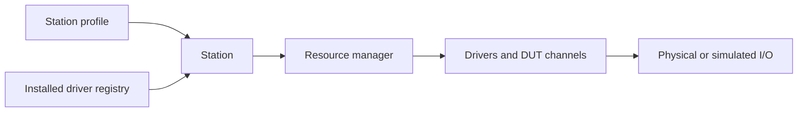

# A guided tour of mastif

This walkthrough is a route through the documentation for engineers evaluating the
framework. Follow it in order for a technical showcase, or use the links to explore
a particular boundary. Allow roughly 10–15 minutes, excluding the optional exercise.

## 1. Begin with evidence, not hardware

A reading of `180` is ambiguous: 180 amperes and 180 milliamperes describe very different
devices. A pass/fail flag alone is also insufficient: it does not tell you what was
measured or which limit was applied.

mastif's kernel brings the reading, unit, and acceptance limit together in a result.
The verdict is calculated from those inputs.

**Try it:** [Your first measurement](first-measurement.md) includes runnable code and
a terminal demonstration. Then read [Kernel](kernel.md) for checks and tables.

## 2. Separate a capability from a device model

A test needs to measure current. It should not need to know whether the instrument
uses TCP, a serial port, or a vendor library. A **contract** describes the capability;
a **driver** implements it; a **transport** carries the device's commands.

**Explore:** [Resources](resources.md) explains these boundaries using a power supply.
The [identity and health reference](../reference/resources/identity.md) shows how
drivers report what is connected and whether it is ready.

## 3. Assemble one bench

The same test may run on different benches. A station profile selects installed
drivers, supplies connection settings, and maps logical roles to resources. The station
builds the objects and coordinates their lifecycle.

Diagram reading: the profile and registry are inputs to composition; the resource
manager coordinates the resulting objects. These arrows describe responsibility,
not Python imports.

**Explore:** [Station](station.md) · [Station composition decision](../adr/0023-station-composition-root.md)
· [Resource lifecycle decision](../adr/0022-resource-manager.md).

## 4. Follow the failure path too

What happens when the third instrument fails to open? What if output-off fails during
shutdown? These are different problems: releasing a connection is not the same as
confirming a physical safe state.

The current resource manager attempts rollback and continues past ordinary cleanup
exceptions. Hardware outcomes depend on device behaviour and the available shutdown
actions. [ADR-0022](../adr/0022-resource-manager.md) documents the exact ordering and
limitations rather than promising that software can always make hardware safe.

**Explore:** [Error map](errors.md) for the distinction between a failed measurement
and a failure to obtain a measurement.

## 5. Place execution in the wider system

!!! info "Design direction — not an executable engine demonstration"
    Test scheduling, runtime ownership, and the application API are design work in
    this checkout. Their contracts will be refined before implementation.

The intended execution layer sits above station composition. Organisation-specific
tests and interfaces use the framework without putting product knowledge into its core.

**Explore:** [System architecture](architecture.md) for the boundaries;
[Life of a station](life-of-a-station.md) for an end-to-end flow with planned steps
explicitly marked; [Roadmap](roadmap.md) for status.

## Continue from the tour

- **Evaluate integration effort:** [Write a driver](guides/write-a-driver.md).
- **Inspect contracts and types:** [API reference](../reference/resources/index.md).
- **Review the reasoning:** [Architecture decisions](../adr/index.md).
