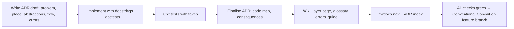

# Working on mastif

How to make a change that will be accepted. The binding rules are in `AGENTS.md`
(engineering and documentation) and `CONTRIBUTING.md` (git flow, commits, versioning).

## The definition of done

A change is done when **all** of the following are true:

1. **Code** sits in the right layer (ADR-0001) and raises typed errors (ADR-0002).
2. **Docstrings** on every function are Google style, with a runnable `Example:` and a
   sentence on where the code fits.
3. **Tests** use fakes, not mocks. Every test has a docstring saying what it pins down
   and why that matters.
4. **An ADR** exists for every new module, with all sections of the
   [template](../adr/0000-template.md) filled in. Changed modules get their ADR updated,
   plus a *History* line.
5. **The wiki** is updated: the layer page, the flows, the [glossary](glossary.md) for
   new terms, the [error map](errors.md) for new exceptions, and a guide for new
   extension points.
6. **Every check passes:**

   ```bash
   uv run pytest                     # unit tests + doctests
   uv run ruff check . && uv run ruff format --check .
   uv run ty check
   uv run lint-imports
   uv run mkdocs build --strict
   ```

## Adding a new module: a checklist



Writing the ADR draft **before** the code is encouraged. It's the cheapest place to
find a design problem.

## Conventions worth memorising

- **Models:** Pydantic v2, `ConfigDict(extra="forbid", frozen=True)`.
- **No import-time side effects.** Never register things globally.
- **Pure decision functions,** with I/O at the edges and injected.
- **Errors:** subclass the layer's base error. Messages start with the subject. Chain
  causes with `raise ... from exc`.
- **Physical values are `Quantity`.** Timeouts are float seconds.
- **Names:** org ids are `org.name`, in lowercase.
- **Examples** use the fictional orgs `demo` and `acme` and simulated devices. Never
  real company or product names.

## Branches and commits

```bash
git switch develop
git switch -c feature/<topic>
# ... work, with Conventional Commits:  feat(station): ..., docs(adr): ..., test(kernel): ...
git switch develop && git merge --no-ff feature/<topic>
```

Versions follow SemVer. While the version is `0.y.z`, breaking changes bump the minor
version. See `CONTRIBUTING.md`.

## Doctests

Every `>>>` example in a docstring is run by `uv run pytest`. If you change behaviour
and forget an example, CI tells you. For examples that need real hardware, use a prose
code block (indented, without `>>>`) instead.
